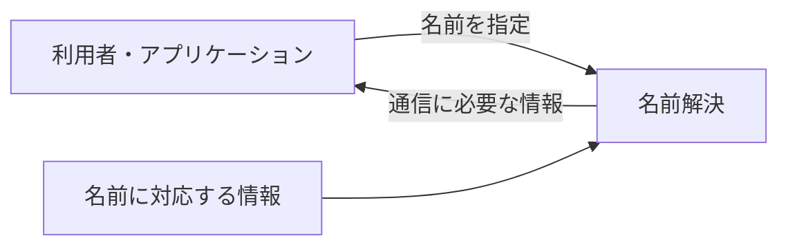
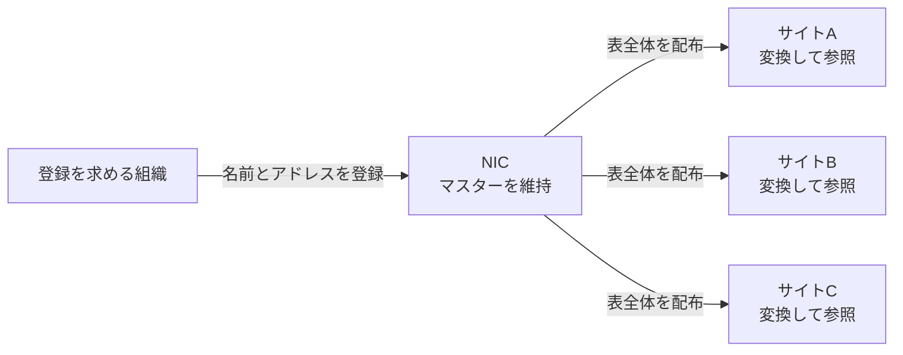
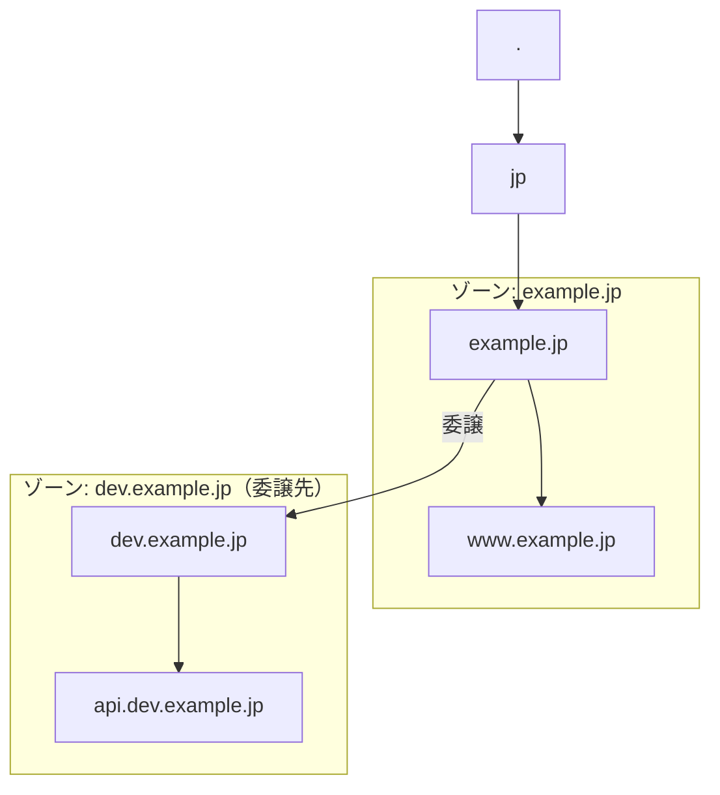
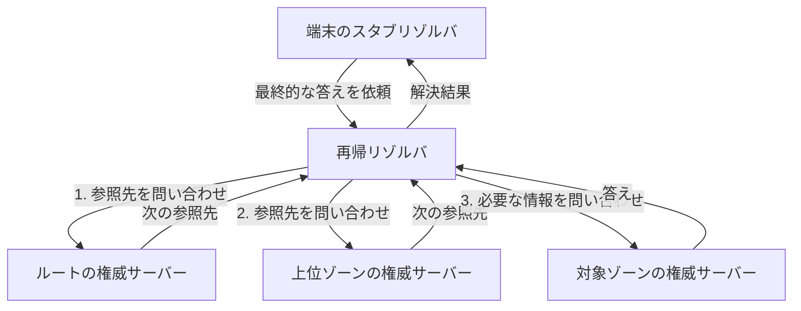
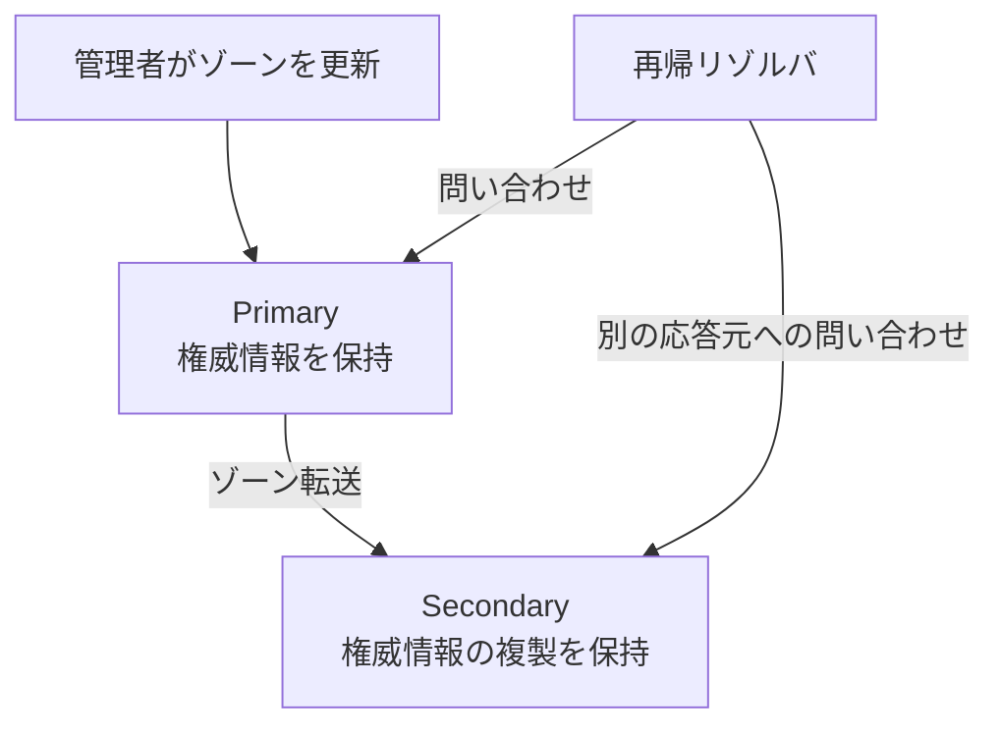
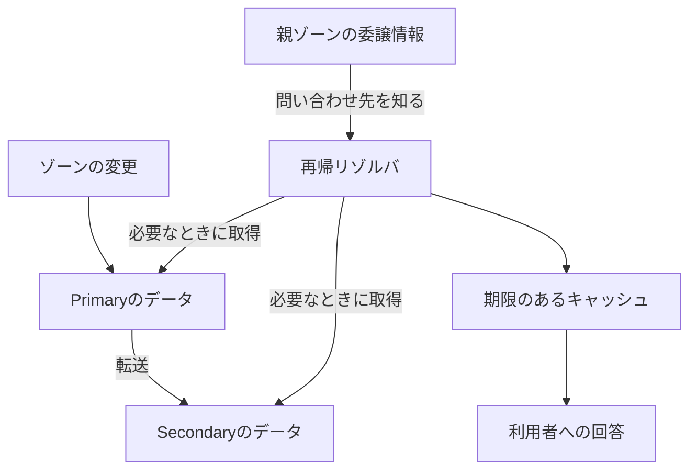
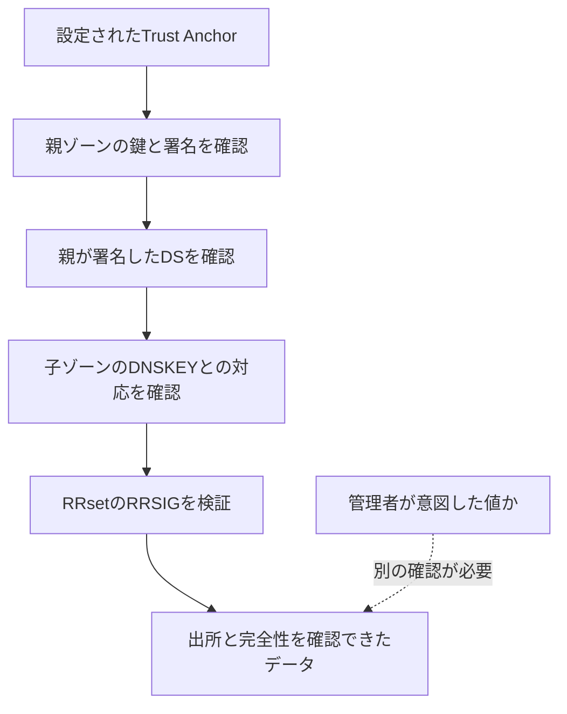
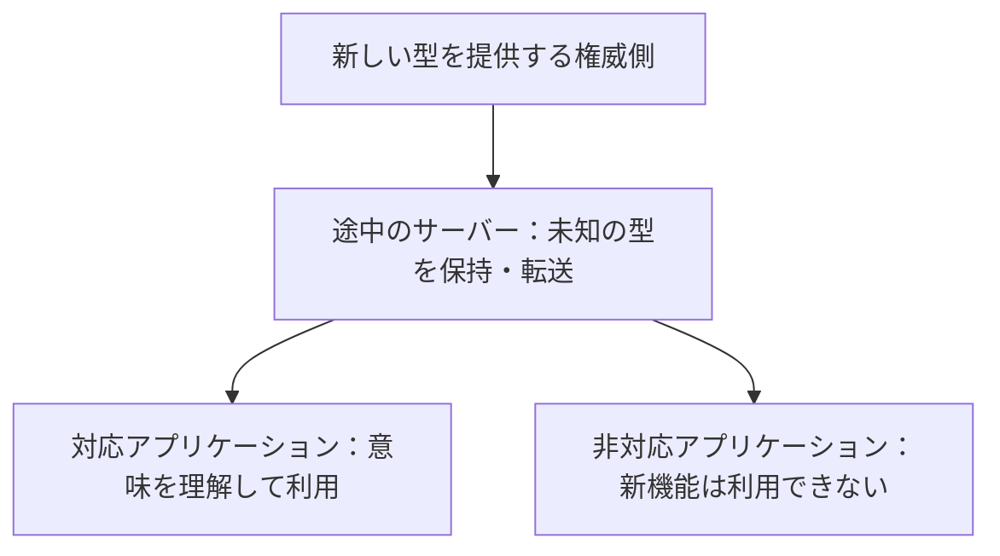

# 準備章 なぜ名前解決が必要なのか

この章は、第2章以降の本編を読むための前提知識を補う章です。あとで読んだり、本編から振り返って読んだりしても問題ありません。

それぞれの節も辞書的に配置しているので、話がつながっているところもあれば、少し離れているところもあります。この章だけで全部理解しよう、と考えなくても大丈夫です。「なんか書いとったなぁ」ぐらいの読み方が、ちょうどよいと思います。

DNSを「覚えにくいIPアドレスの代わりに、覚えやすい名前を使う仕組み」と説明することがあります。これは利点の一つですが、それだけでは、利用者がURLを覚えずにブックマークやリンクを使う現在にも名前解決が必要な理由を説明できません。

最初の項目では、名前と通信先の関係、名前解決、対応情報の管理といった話を扱います。いずれも何かを「分ける」話ですが、分ける対象と解く問題は同じではありません。

## 必要な説明を引く

本編から分からない言葉を引いたら、リンク元の話へ戻ってください。仕組みの図、細かい規則、観測の手順もここにまとめています。

| 調べたいこと | 項目 |
| --- | --- |
| 名前解決の前提 | [名前と通信に必要な情報は役割が違う](#名前と通信に必要な情報は役割が違う) ／ [名前解決は分けた値を利用時に結び付ける](#名前解決は分けた値を利用時に結び付ける) ／ [DNS以前にも名前解決はあった](#dns以前にも名前解決はあった) ／ [DNSが最初に変えようとしたもの](#dnsが最初に変えようとしたもの) ／ [最初の目的と、後から広がった用途を分ける](#最初の目的と後から広がった用途を分ける) |
| 名前と管理 | [ホスト表の集中管理](#ホスト表の集中管理) ／ [階層名とゾーンの委譲](#階層名とゾーンの委譲) ／ [ホスト表からの移行](#ホスト表からの移行) |
| 問い合わせと再利用 | [名前解決の問い合わせ手順](#名前解決の問い合わせ手順) ／ [TTLと再利用期限](#ttlと再利用期限) ／ [不在と失敗のキャッシュ](#不在と失敗のキャッシュ) ／ [UDPとTCPによる問い合わせ](#udpとtcpによる問い合わせ) ／ [キャッシュ応答の観測記録](#キャッシュ応答の観測記録) ／ [レコードとリソースレコード集合](#レコードとリソースレコード集合) ／ [キャッシュの先取り更新](#キャッシュの先取り更新) |
| 複製と応答の継続 | [権威情報の複製と更新経路](#権威情報の複製と更新経路) ／ [ゾーン転送と変更通知](#ゾーン転送と変更通知) ／ [Anycastによる応答元の配置](#anycastによる応答元の配置) ／ [期限切れ情報を使う応答](#期限切れ情報を使う応答) ／ [権威サーバーの観測記録](#権威サーバーの観測記録) |
| 変更とコピー | [変更が届く経路](#変更が届く経路) ／ [Serialとキャッシュの期限](#serialとキャッシュの期限) ／ [動的更新が保証する範囲](#動的更新が保証する範囲) ／ [変更前の情報が残る実験](#変更前の情報が残る実験) |
| 回答と更新の保護 | [回答の照合とキャッシュへの受け入れ](#回答の照合とキャッシュへの受け入れ) ／ [DNSSECの署名と信頼の連鎖](#dnssecの署名と信頼の連鎖) ／ [DNSSECの検証結果](#dnssecの検証結果) ／ [更新の認証とTSIG](#更新の認証とtsig) ／ [再帰サービスの制限と応答量](#再帰サービスの制限と応答量) ／ [署名の期限と保守](#署名の期限と保守) |
| 情報開示と通信の保護 | [暗号化DNSの通信方式](#暗号化dnsの通信方式) ／ [問い合わせ名の最小化とECS](#問い合わせ名の最小化とecs) ／ [通常の問い合わせとHTTPSの観測記録](#通常の問い合わせとhttpsの観測記録) |
| 運用時の応答 | [利用場所で異なる名前解決](#利用場所で異なる名前解決) ／ [エラー応答の追加情報](#エラー応答の追加情報) |
| 新しい機能との共存 | [未知のレコード型の扱い](#未知のレコード型の扱い) ／ [EDNSによる機能拡張](#ednsによる機能拡張) ／ [IPv6の情報と通信](#ipv6の情報と通信) |

## 名前と通信に必要な情報は役割が違う

ネットワーク上の相手と通信するには、通信を届けるための情報が必要です。一方、人やアプリケーションは、相手を継続して参照するための識別子を必要とします。この二つは同じ役割ではありません。

数値のアドレスを相手の識別子として直接記録することもできます。しかし、相手のアドレスが変わるたびに、利用者の記録やアプリケーションの設定も直さなければなりません。人にとって覚えやすいかどうかだけでなく、**何を利用したいか**と、**現在どこへ通信を届けるか**が一つの値へ固定されることが問題です。

筆者の言葉でものすごく雑に説明すると、「サービス名と、実際にサービスを動かしているサーバーは、分けておいたほうが都合がいいね」ぐらいになります。

利用する側は同じ名前を使い続け、サーバーが移ったら、その名前に対応するアドレスを変える。そうすれば、利用する側の設定を一斉に書き換えずに済みます。そのために、名前とアドレスの対応を管理して、必要なときに調べられるようにしておきます。変更が利用者へ届くまでの時間は、[第5章](05-consistency.md)で扱います。



この図では、名前を使う側と、名前に対応する情報を管理する側を分けています。どのサーバーへどの順序で問い合わせるかは省略しています。

## 名前解決は分けた値を利用時に結び付ける

本書では、**名前解決**を、名前について、通信やサービスの利用に必要な情報を得る処理と呼びます。「名前をIPアドレスへ変換する処理」は代表例ですが、DNSが扱う情報はIPアドレスだけではありません。

## DNS以前にも名前解決はあった

DNSが名前解決そのものを発明したわけではありません。1973年のRFC 606には、各サイトが名前とアドレスの表を維持していたことが記録されています。対応表を参照することでも、名前から情報は得られます。問題は、別々に維持した表が食い違っていたことでした。表を一つの基準へ集め、その後に管理責任を分割する経緯は、[第2章](02-scalability.md)で評価します。[RFC 606: Host Names On-line](https://www.rfc-editor.org/rfc/rfc606.html)

名前解決に関わる話は、次の三つに分けて考えられます。

- **値の役割を分ける**――継続して参照する名前と、その時点で通信に必要な情報を別の値にする
- **分けた値を結び付ける**――名前を使う時点で、対応する情報を得る
- **対応情報の管理を分担する**――誰がどの範囲を正しい状態に保ち、利用者がどこから参照できるようにするかを決める

名前解決が直接行うのは「分けた値を結び付ける」処理です。「値の役割を分ける」ことが、その処理を必要にします。対応表を一つ作れば名前解決はできますが、利用者と更新主体が増えても、その表の管理を続けられるとは限りません。

## DNSが最初に変えようとしたもの

ホストと更新する組織が増えると、一つの表の維持と配布では負荷や調整が集中します。RFC 882とRFC 1034は、これを新しい仕組みが必要になった背景として挙げています。DNSが中心的に変えたのは、**対応情報を、一つの組織と一つの一覧へ集めずに管理し、参照する方法**です。[RFC 882: Domain Names—Concepts and Facilities](https://www.rfc-editor.org/rfc/rfc882.html)、[RFC 1034: Domain Names—Concepts and Facilities](https://www.rfc-editor.org/rfc/rfc1034.html#section-2.1)

そのために、名前空間を階層化し、範囲ごとに管理責任を委ねる設計が採用されました。これは、名前と通信先を別の値にする話とは異なり、管理する範囲を分ける話です。

### 名前の範囲と管理する範囲

名前を階層として並べた全体を**名前空間**と呼びます。その中で、ある名前を根とする部分木が**ドメイン**です。たとえば `example.jp` ドメインには、`www.example.jp` も `api.dev.example.jp` も含まれます。

一方、権威情報を管理する単位が**ゾーン**です。`example.jp` の管理側が `dev.example.jp` 以下を別のゾーンへ任せると、名前の階層はそのままでも、管理する範囲に境界ができます。このように子ゾーンへ権威を渡し、親にその参照先を置くことを**委譲**と呼びます。`dev.example.jp` 以下は `example.jp` ドメインに含まれ続けますが、親ゾーンの管理範囲からは外れます。[RFC 1034: Domain Names—Concepts and Facilities](https://www.rfc-editor.org/rfc/rfc1034.html) 3.1節、4.2節

ここでいう**権威情報**は、そのゾーンの責任のもとで提供される情報です。それを保持して問い合わせに答えるのが**権威サーバー**で、別のサーバーから得た応答を一時保存するキャッシュとは役割が違います。「権威」は情報の出所と責任を表し、登録内容に誤りがないことを保証する言葉ではありません。[RFC 9499: DNS Terminology](https://www.rfc-editor.org/rfc/rfc9499.html) 6節、7節

図は[階層名とゾーンの委譲](#階層名とゾーンの委譲)にあります。委譲によって誰の仕事が減り、どの調整が増えるのかは[第2章](02-scalability.md)で考えます。

## 最初の目的と、後から広がった用途を分ける

名前とアドレスを別に管理すれば、同じ名前に対応するアドレスを変更したり、複数のアドレスを対応させたりできます。この性質は、サーバーの移転、複数サーバーへの負荷の分散、障害時の接続先変更にも利用できます。

初期目的の根拠は、1983年のRFC 882が挙げる表の維持・更新の限界です。一方、1995年のRFC 1794は、それ以前の負荷分散の工夫を回顧しています。したがって1995年は、その用途が始まった年ではありません。初期仕様に複数アドレスを表す能力があること、その能力を負荷分散へ使うこと、その用途が初期設計の中心目的だったことは、別々の主張として扱います。[RFC 882: Domain Names—Concepts and Facilities, INTRODUCTION](https://www.rfc-editor.org/rfc/rfc882.html)、[RFC 1794: DNS Support for Load Balancing 1・2節](https://www.rfc-editor.org/rfc/rfc1794.html)

また、応答の変更だけで瞬時の切り替えが成立するわけではありません。以前の応答が残る時間や、接続先を選ぶ側の動作も関係します。[第4章](04-availability.md)では応答継続の条件、[第5章](05-consistency.md)では変更が見えるまでの時間を評価します。負荷分散の製品設定や選択アルゴリズムは、本書の範囲には含めません。

## ホスト表の集中管理

集中した一覧が作られる前から、公式のホスト名一覧はありました。しかし、RFC 606は、それがネットワークから機械可読な形で取得できず、各サイトが自分のシステムやプログラムで使う表を手元で維持していたと記録しています。著者が確認できた四つのサイトでは、名前とアドレスの対応が少しずつ異なり、完全な表は一つもありませんでした。これは回顧ではなく、1973年12月の同時代の報告です。[RFC 606: Host Names On-line](https://www.rfc-editor.org/rfc/rfc606.html)

この状態では、管理作業が分散していても、正しさを保つ責任は分担されていません。各サイトが同じ範囲の表を重複して直し、どれを正しいコピーとみなすかも揃わないからです。RFC 608では、この問題への応答として、Network Information Center（NIC）が機械可読な一覧を生成するプログラムを用意し、週次または必要に応じて実行する案が示されました。ここでの集中は、重複作業と食い違いを減らし、一つの基準となる表を配るための設計でした。[RFC 608: Host Names On-Line](https://www.rfc-editor.org/rfc/rfc608.html)

### 一つの表を使う四つの工程

ホスト表を使った仕組みを「中央管理」の一語でまとめると、何が制約になったのかを見失います。実際には、少なくとも四つの工程がありました。利用する前に名前とアドレスを**登録**し、NICが一つのマスターを**維持**し、各サイトが表を**取得**し、それぞれの環境で使える形式へ変換して**参照**します。



登録とマスターの維持は中央に集まりますが、問い合わせのたびに中央へ接続するわけではありません。取得済みのコピーは各サイトで参照できます。したがって、NICや配布サービスの停止は新規登録、変更、次の取得を妨げますが、取得済みの名前を使う処理がすべて即座に止まるとは限りません。管理上の単一障害点と、参照時の単一障害点は別です。

### 登録と更新主体

RFC 810のASSUMPTIONS第7項は、名前とアドレスを使い始める前にNICと交渉して登録することを前提にしています。連絡先には電子メールアドレスだけでなく電話番号も記載されています。同じ文書の第6項は、取得したホスト表を必要な形式へ変換する責任を利用者に置いています。登録は中央で調整し、利用環境への適合は各利用者が担う分業でした。[RFC 810: DoD Internet Host Table Specification](https://www.rfc-editor.org/rfc/rfc810.html)

この工程では、データの件数だけでなく、独立した更新主体の数が効きます。要求元が増えると、名前の重複を避け、使用前であることを確かめ、登録内容と責任主体を調整する仕事が中央へ集まるからです。これは一次資料にある工程から導く本書の分析であり、当時の作業時間を測った結果ではありません。確認したRFCには処理時間や衝突件数の数値がないため、負荷の大きさは定量化しません。

RFC 882は、従来の表について、その大きさ、とりわけ更新頻度が管理可能な限界に近づいていると述べました。ここでは表の容量だけでなく、変化を一つの表へ取り込む工程が問題にされています。[RFC 882: Domain Names—Concepts and Facilities](https://www.rfc-editor.org/rfc/rfc882.html)

### マスターの配布とローカルコピー

中央のマスターを直しただけでは、各サイトのコピーは変わりません。利用者は更新された表を取得し、自分の環境で使える形式へ変換する必要があります。取得する時点がサイトごとに違えば、同じ時点でも参照している内容は異なり得ます。中央での更新、一覧の配布、ローカルでの利用は、それぞれ別の完了時点を持つ工程です。

RFC 1034の2.1節は、ホスト数を *N* としたとき、ホスト表の大きさと配布先がともに *N* に比例するため、新版を配る総ネットワーク帯域は *N* の二乗に比例するという設計上の見積りを示しています。これは1987年の説明であり、当時の転送量を測った実測値ではありません。確認した同時代資料には、ホスト数、ファイルサイズ、転送量の具体値がないため、ここから実際の規模や増加率までは断定できません。[RFC 1034: Domain Names—Concepts and Facilities](https://www.rfc-editor.org/rfc/rfc1034.html#section-2.1)

集中方式の制約は、中央にデータがあることだけではありません。登録要求が中央を通ること、変更の大小にかかわらず一覧を取得すること、各利用者がコピーを更新することが組み合わさっていました。保存場所だけを分散しても、登録の調整が中央に残れば更新主体の増加には対応できません。反対に、登録権限だけを分けても、全員へ一覧全体を配り続ければ配布負荷は残ります。

[この仕組みが必要になった要件を読む：第2章](02-scalability.md)

## 階層名とゾーンの委譲

### 一意性を部分木ごとに保つ

平坦な名前空間では、各名前が全体で一意でなければならないため、名前を割り当てるたびに全体との衝突を調整する必要があります。RFC 921は、単純な文字列として全体で一意だった名前から、各構成要素が一つ上の構成要素の下でだけ一意となる構造化された名前へ変更すると説明しています。たとえば `www.example.jp` の `www` は、名前空間全体で唯一である必要はなく、`example.jp` の直下で一意なら構いません。[RFC 921: Domain Name System Implementation Schedule—Revised](https://www.rfc-editor.org/rfc/rfc921.html)

階層化だけでは、更新権限は分かれません。DNSは、名前空間をゾーンに分け、親ゾーンに子ゾーンへの**委譲**を示す情報を置きます。親ゾーンは子ゾーンの全データを持つ代わりに、子ゾーンの権威サーバーを示すName Server（NS）リソースレコード集合（RRset）を管理します。子ゾーンは委ねられた範囲の権威情報を管理します。委譲によって別の組織へ運用責任を渡せますが、プロトコル上の境界はゾーンであり、同じ組織内でゾーンを分けることもできます。中央がすべての末端データを更新する必要をなくしながら、親から子へたどれる関係を残す設計です。[RFC 1034: Domain Names—Concepts and Facilities](https://www.rfc-editor.org/rfc/rfc1034.html) 2.4節、4.2節

### ドメインとゾーンは同じ境界ではない

RFC 1034の3.1節では、**ドメイン**は名前空間中のあるノードを根とする部分木と定義されています。これに対し、RFC 9499の現行用語でいう**ゾーン**は、ある権威サーバー群が同じ権威情報を提供する範囲です。部分木の途中を子へ委譲すると、委譲先の部分木は元のドメインに含まれたままでも、親のゾーンには含まれません。[RFC 1034: Domain Names—Concepts and Facilities](https://www.rfc-editor.org/rfc/rfc1034.html#section-3.1)、[RFC 9499: DNS Terminology](https://www.rfc-editor.org/rfc/rfc9499.html) 2節、7節

次の図では、名前空間上は `dev.example.jp` も `example.jp` ドメインの一部です。しかし、`dev.example.jp` には委譲があるため、二つは別のゾーンです。親ゾーンは子ゾーンの `api` の値を管理せず、子ゾーンへの委譲を示すNS RRsetを管理します。



この区別によって、一意性を保つ責任にも境界ができます。親ゾーンは子ゾーンへの委譲を表すNS RRsetを管理し、子ゾーンではその範囲の名前を割り当てます。NS RRsetが示すのは権威サーバーであり、管理組織そのものではありません。一つの組織が複数のゾーンを管理することも、一つのゾーンを複数の権威サーバーで提供することもできます。全体の一意性を捨てたのではなく、名前を割り当てる範囲をゾーン境界に沿って分割したのです。[RFC 1034: Domain Names—Concepts and Facilities](https://www.rfc-editor.org/rfc/rfc1034.html#section-4.2.1)

### 一括配布から必要な情報の参照へ

委譲されたデータは一つの表に集め直されません。情報を探す側は、親が示す委譲情報をたどり、必要な名前の権威情報を持つサーバーへ問い合わせます。これにより、ある組織の変更を、名前空間全体の利用者へ一覧として配る必要はなくなります。誰がこの探索を引き受け、結果をどう再利用するかは[第3章](03-performance.md)で扱います。ここで重要なのは、データの所在だけでなく、データを見つけるための参照関係も分散したことです。[RFC 1034: Domain Names—Concepts and Facilities](https://www.rfc-editor.org/rfc/rfc1034.html) 5.3.1節、5.3.3節

[この仕組みが必要になった要件を読む：第2章](02-scalability.md)

## ホスト表からの移行

新しい設計が優れていても、既存の名前を一度に無効にはできません。RFC 921が示した移行の第一段では、旧来の名前へ `.ARPA` を付けたものをドメイン形式の名前としました。既存の名前を新しい階層の中へ機械的に写すことで、最初からすべてを命名し直す事態を避けています。

ホスト表も直ちに廃止せず、新形式をDHOSTS.TXTとして並行提供した後、それをHOSTS.TXTへ切り替え、旧版をOHOSTS.TXTとして残す計画でした。同じ文書は、前身のRFC 881で定めた予定が機能しなかったことも記録しています。ここで確認できるのは、責任を分割する設計と、その設計へ既存利用を移す手順が別の問題だったことです。この資料だけでは遅延の原因までは特定しません。[第9章](09-compatibility.md)では、別の拡張例を通じて、一斉更新できない主体と共存する条件を考えます。[RFC 921: Domain Name System Implementation Schedule—Revised](https://www.rfc-editor.org/rfc/rfc921.html)

[この仕組みが必要になった要件を読む：第2章](02-scalability.md)

## レコードとリソースレコード集合

同じ名前でも欲しい情報の種類が違えば、同じ答えではありません。IPv4アドレスのAレコードとIPv6アドレスのAAAAレコードは別です。レコードとは、名前に結び付く情報を型ごとに表す単位です。同じ名前、クラス、型のレコードをまとめたものをリソースレコード集合（Resource Record Set、RRset）と呼びます。一つの名前に複数のアドレスがあっても、それぞれを無関係な答えとして都合よく混ぜるわけではありません。[RFC 2181: Clarifications to the DNS Specification](https://www.rfc-editor.org/rfc/rfc2181.html) 5節

[この仕組みが必要になった要件を読む：第3章](03-performance.md)


## 名前解決の問い合わせ手順

**リゾルバ**は、名前について必要な情報を取得する側の機能です。端末の**スタブリゾルバ**は、通常、十分な探索機能を持つ**再帰リゾルバ**へ解決を依頼します。再帰リゾルバは、使える情報が手元になければ、その依頼を解決するための問い合わせを進めます。

この分担では、端末は「次にこのサーバーへ聞いてください」という途中経過を一つずつ処理しません。**再帰問い合わせ**は、その先の解決まで相手へ依頼します。一方、**反復問い合わせ**では、問い合わせ先が自分の知る答えや参照先を返し、問い合わせる側が次へ進みます。再帰リゾルバが権威サーバーをたどるとき、この反復の形を取れます。[RFC 9499: DNS Terminology](https://www.rfc-editor.org/rfc/rfc9499.html) 4節、6節

次の図は、途中の情報もキャッシュにない場合の、簡略化した経路です。図の矢印一つを実際のパケット一個とはみなしません。再送、別名の解決、サーバーのアドレスを調べる処理などは省いています。狭い画面では図を横へスクロールできます。



利用者から見える依頼が一回でも、リゾルバの先では複数の仕事が行われ得ます。逆に、途中の委譲情報を再利用できれば、毎回ルートから始める必要もありません。「名前のドットが多いから、必ず同じ回数だけ問い合わせる」とは数えられません。名前の階層、実際の委譲、保持している情報を分けて考えます。[RFC 1034: Domain Names—Concepts and Facilities](https://www.rfc-editor.org/rfc/rfc1034.html) 5.3.3節

なお、再帰リゾルバが別のリゾルバへ処理を転送する構成もあります。この場合、端末の一段先だけを測っても、権威サーバーまでの仕事の配分は見えません。この項の図は全構成の一覧ではなく、依頼を受けることと探索を実行することを区別するための図です。

[この仕組みが必要になった要件を読む：第3章](03-performance.md)

## TTLと再利用期限

キャッシュを無期限に使えば、情報を取り直す負荷は小さくできます。その代わり、管理側でアドレスを変えても、古い値を返し続けます。**Time to Live（TTL）**は、この再利用に時間の上限を与えるための値です。通常のキャッシュでは、得た情報をいつまでも同じ残り時間のまま返すのではなく、経過した分だけ残り時間を減らします。[RFC 1035: Domain Names—Implementation and Specification](https://www.rfc-editor.org/rfc/rfc1035.html) 3.2.1節、7.1節

説明用に、あるリゾルバがTTL 300秒の情報を時刻0秒に受け取り、途中の再取得も削除もない場合を考えます。120秒後の再利用では、残り時間は180秒です。そこから受け取った別のキャッシュが、元の300秒へ勝手に戻してよいわけではありません。次の図の数値は、この仮定から作った説明用の値であり、実測ではありません。

<div class="time-figure" role="region" aria-label="TTLの時間図。横にスクロールできます" tabindex="0">
<svg viewBox="0 0 540 260" width="100%" role="img" aria-label="説明例。0秒でTTL300秒の情報を取得し、120秒で残り180秒、300秒で通常の再利用期限を迎える">
  <line x1="46" y1="40" x2="46" y2="220" stroke="#0969da" stroke-width="3"/>
  <circle cx="46" cy="48" r="6" fill="#0969da"/>
  <text x="65" y="53" font-size="15" fill="#24292f">0秒：取得。TTLは300秒</text>
  <circle cx="46" cy="128" r="6" fill="#0969da"/>
  <text x="65" y="133" font-size="15" fill="#24292f">120秒：再利用。残りは180秒</text>
  <circle cx="46" cy="208" r="6" fill="#0969da"/>
  <text x="65" y="213" font-size="15" fill="#24292f">300秒：通常の再利用期限を迎える</text>
</svg>
</div>

この300秒は、必ずキャッシュへ保持される時間でもありません。容量や実装上の判断で早く削除される場合があり、TTLは通常の再利用の上限です。また、TTLが満了した瞬間に、すべてのキャッシュが一斉に問い合わせるという意味でもありません。期限後に必要になってから取得する場合と、[先取り更新](#キャッシュの先取り更新)を行う場合を区別します。[RFC 2181: Clarifications to the DNS Specification](https://www.rfc-editor.org/rfc/rfc2181.html) 8節

長いTTLは、同じ情報を再び使う機会を増やす一方、変更前の情報が使われる期間も長くします。短くすれば変更を確認する機会は増えますが、上流への問い合わせと、その待ち時間を引き受けます。したがって、TTLを長くすることを性能の改善だけとして評価することはできません。変更反映との交換条件であり、具体的な変更計画は第5章で扱います。期限切れデータを障害時に使う例外は、[期限切れ情報を使う応答](#期限切れ情報を使う応答)で説明します。

TTLを変える案も同じ条件で比較します。説明用に、一つのリゾルバへ同じRRsetの問い合わせが毎秒届き、取得した回答をTTLの上限まで保持し、先取り更新は行わず、再取得が成功する場合を考えます。TTLを300秒から60秒へ短くすると、定常状態でその回答を取り直す機会は、おおむね5分ごとから1分ごとへ増えます。一方、問い合わせが10分に一度なら、どちらのTTLでも次の利用前に期限が切れるので、この変更だけで再取得回数は増えません。数値は仮定であり、実際の上流パケット数や遅延の予測ではありません。負荷の増加率はTTLの比だけで決めず、問い合わせの間隔と再利用の実態から判断します。

[この仕組みが必要になった要件を読む：第3章](03-performance.md)

## 不在と失敗のキャッシュ

利用者が存在しない名前を何度も指定する場合、そのたびに同じ探索を繰り返すと、答えが得られないまま上流の仕事だけが増えます。**Negative Caching（否定応答のキャッシュ）**は、不在を示す応答も再利用する仕組みです。ただし、「名前が存在しない」と「その名前に指定した種類の情報がない」は異なります。前者をNXDOMAIN、後者をNODATAと呼びます。たとえばAレコードがないことだけから、その名前の他の種類の情報まで存在しないとは判断できません。[RFC 2308: Negative Caching of DNS Queries](https://www.rfc-editor.org/rfc/rfc2308.html) 2節、5節

不在応答の再利用にも期限があります。RFC 2308では、ゾーンの管理情報を表すStart of Authority（SOA）レコードを使い、そのTTLとMINIMUMフィールドの小さい方から否定応答の期限を定めます。不在を再利用すると、失敗を繰り返す問い合わせの負荷を抑えられますが、その後で名前やレコードを追加しても、過去の不在が残る場合があります。「まだない」を覚える設計も、性能と変更反映を交換しているのです。[RFC 2308: Negative Caching of DNS Queries](https://www.rfc-editor.org/rfc/rfc2308.html) 3節、5節

さらに、「存在しないと確認できた」と「調べる処理が失敗した」も区別します。タイムアウトや検証失敗を不在と取り違えると、答えの意味が変わります。それでも失敗のたびに探索を繰り返せば、障害中の上流へ負荷を集中させます。RFC 9520は解決失敗のキャッシュを必須とし、その記録に一致する問い合わせについて、記録の期限が切れるまで対応する上流問い合わせを送らないよう規定しています。失敗の記録を長く保持すれば反復負荷を抑えられる一方、上流が直った後も利用者側の回復が遅れる場合があります。障害中の負荷削減と復旧後の再確認を一緒に評価する必要があります。[RFC 9520: Negative Caching of DNS Resolution Failures](https://www.rfc-editor.org/rfc/rfc9520.html) 3.2節

[この仕組みが必要になった要件を読む：第3章](03-performance.md)

## UDPとTCPによる問い合わせ

問い合わせ一回の通信にも費用があります。User Datagram Protocol（UDP）は、Transmission Control Protocol（TCP）のような接続確立を先に行わずにメッセージを送れます。ただし、届かなかったときに誰が待ち、再送し、別の相手を選ぶかという仕事がなくなるわけではありません。初期仕様も、UDPによる問い合わせについて再送の戦略を必要としています。[RFC 1035: Domain Names—Implementation and Specification](https://www.rfc-editor.org/rfc/rfc1035.html) 4.2.1節

UDPの応答へ必要な情報が収まらない場合もあります。応答が切り詰められたことを示すTruncation（TC）ビットが返ると、完全な答えを得るためにTCPを使い直す経路が生じます。したがって、UDPで始めれば常に最短の往復で終わるとは限りません。応答の大きさ、損失、やり直しまで含めて評価します。[RFC 2181: Clarifications to the DNS Specification](https://www.rfc-editor.org/rfc/rfc2181.html) 9節

反対に、TCPの接続がすでに使えるなら、問い合わせごとに確立し直す必要はありません。RFC 7766は、汎用DNS実装へUDPとTCPの両方への対応を要求し、TCPをUDP失敗後だけの手段とは位置付けていません。接続再利用や複数問い合わせの処理も、性能を考える際の対象です。[RFC 7766: DNS Transport over TCP—Implementation Requirements](https://www.rfc-editor.org/rfc/rfc7766.html) 5節、6節

ここでの判断は「UDPかTCPか」という名称の比較では終わりません。初回の接続なのか、再利用できる接続なのか、応答が一度で届くのか、待ち直しが起きるのかを条件としてそろえます。暗号化する区間と終端の選び方は第7章で扱います。

[この仕組みが必要になった要件を読む：第3章](03-performance.md)

## キャッシュの先取り更新

よく使う情報がキャッシュにあれば、多くの問い合わせは短く終わります。それでも期限直後の利用者は、情報の取得を待つ場合があります。**Prefetch（先取り更新）**は、その待ちを減らすための実装上の工夫です。たとえばBIND 9では、期限の近いキャッシュ情報への問い合わせを契機に、権威サーバーへ更新を求める設定があります。これはBINDの実装例であり、すべてのリゾルバが同じ条件で動くという意味ではありません。[BIND 9.20.16 ARM: prefetch](https://bind9.readthedocs.io/en/v9.20.16/reference.html#namedconf-statement-prefetch)

先取りは、後の利用者が待たずに済む可能性を買うために、再取得を前倒しします。その情報が再び利用されなければ、更新の仕事は利用者の待ち時間削減につながりません。総問い合わせ数がどれだけ増えるかは利用の続き方によるため、評価には平均応答時間だけでなく、先取りなしと比べた上流問い合わせ数と、期限直後の遅延を含めます。

[この仕組みが必要になった要件を読む：第3章](03-performance.md)


## キャッシュ応答の観測記録

期限の仕組みを踏まえて、同じ名前を繰り返し問い合わせたとき、返されるTTLがどう変わるかを見ます。ここで確かめるのは応答の値であり、速度の優劣ではありません。

次は2026年11月20日に、著者のWindows作業端末から採った観測です。対象は `example.com` のAレコード、問い合わせ先に指定したアドレスは `1.1.1.1` です。地理的な観測地点とリゾルバ内部の処理先は特定していません。キャッシュの消去や対象レコードの変更も行っていません。

PowerShell 7.6.9で、次のコマンドを3回実行し、各応答の後に2秒待ちました。`-DnsOnly` と `-NoHostsFile` は、DNS以外の補助的な名前解決とhostsファイルを対象から外すための指定です。[Microsoft Learn: Resolve-DnsName](https://learn.microsoft.com/en-us/powershell/module/dnsclient/resolve-dnsname)

```powershell
Resolve-DnsName -Name example.com -Type A -Server 1.1.1.1 -DnsOnly -NoHostsFile
```

| 問い合わせ開始時刻（日本時間） | 返されたAレコード数 | 各AレコードのTTL |
| --- | --- | --- |
| 2026-11-20 20:54:51.735 | 2 | 27秒 |
| 2026-11-20 20:54:57.353 | 2 | 28秒 |
| 2026-11-20 20:54:59.378 | 2 | 126秒 |

3回とも同じ二つのアドレスが返りましたが、TTLは単調には減りませんでした。[観測の生データ](../references/observations/cache-2026-11-20.json)には時刻、アドレス、コマンド全体の所要時間も保存しています。最初の実行時間にはコマンド初期化などが含まれ得るため、通信だけの時間としては掲載しません。

この結果は、「TTLと再利用期限」の説明用の図と矛盾するのでしょうか。図は「同じキャッシュの同じ取得結果を、再取得せずに使う」という仮定でした。一方、この観測では、その仮定が成立したかを確認できません。異なるキャッシュの応答だった可能性や、途中で更新された可能性などを、この三つの値だけでは切り分けられません。TTLが増えた理由をPrefetchだったと断定することもできません。

確かめられたのは、この条件でその値が返ったことまでです。キャッシュの効果を厳密に比較するなら、同じ処理先、キャッシュの状態、上流へ実際に出た問い合わせを観測できる環境が必要になります。制御していない公開リゾルバで最初と二度目を比較しただけでは、「二度目が速かったからキャッシュの効果」とは結論できません。

[この仕組みが必要になった要件を読む：第3章](03-performance.md)

## 権威情報の複製と更新経路

一つのゾーンは複数の権威サーバーで提供できます。ある応答元が使えなくても、同じゾーンを提供する別の応答元が使えれば、解決を続ける余地があります。ただし、リゾルバが使えない相手を試す時間は残ります。代わりがあることと、利用者が遅延を感じないことは同じではありません。

ここで**Primary**と**Secondary**は、通常、ゾーンのデータを取得する関係を表します。Secondaryはゾーン転送によって情報を取得する権威サーバーで、Primaryはその転送元となる権威サーバーです。名前がPrimaryだから通常の問い合わせを独占し、Secondaryは障害時だけ起動する、という関係ではありません。どちらも保持するゾーンの問い合わせへ応答できます。[RFC 9499: DNS Terminology](https://www.rfc-editor.org/rfc/rfc9499.html) 6節

次の図は、更新の経路と問い合わせの経路を分けています。説明用の構成であり、すべてのサービスがこの形を取るわけではありません。狭い画面では図を横へスクロールできます。



Primaryとの更新経路が止まっても、Secondaryはそれまでに取得した情報を保持しています。そのため、更新できなくなった瞬間に、すべての問い合わせが止まるわけではありません。ただし古いコピーを無期限に権威情報として提供してよいわけでもありません。RFC 1034は、Secondaryが変更を確認する間隔、失敗後の再試行間隔、確認できない状態が続いた場合の期限をSOAの値で扱っています。[RFC 1034: Domain Names—Concepts and Facilities](https://www.rfc-editor.org/rfc/rfc1034.html) 4.3.5節

したがって、「Primaryが停止した」という一文だけでは利用者への影響は決まりません。他の応答元の到達性、最後に取得したデータ、更新できない期間、問い合わせ側の挙動を併せて見ます。

例えば、転送元との連絡が途絶えたままSOAの失効期限を迎えれば、Secondaryのプロセスが動いていても、そのコピーを権威情報として使い続けることはできません。期限までに更新経路を復旧できることが、複製で応答を支える条件になります。これは、問い合わせ側のキャッシュを何秒再利用できるかというTTLとは別の期限です。[RFC 1034 4.3.5節](https://www.rfc-editor.org/rfc/rfc1034.html)

[この仕組みが必要になった要件を読む：第4章](04-availability.md)

## ゾーン転送と変更通知

ゾーン全体を転送する方式が**AXFR**です。一部分の変更であっても全体を送るので、仕組みを理解しやすい一方、ゾーンが大きい場合や変更が頻繁な場合には転送量が増えます。AXFRは1987年のRFC 1034/1035にも存在し、2010年のRFC 5936で相互運用に必要な詳細が明確化されました。[RFC 5936: DNS Zone Transfer Protocol (AXFR)](https://www.rfc-editor.org/rfc/rfc5936.html) 概要

変更部分を転送する方式が**IXFR**です。以前の版からの差分を扱うことで、全体を送り直す負荷を減らせます。その代わり、転送元には差分を提供するための情報が必要です。要求された差分を用意できない場合などには、全体を返す場合もあります。IXFRという方式名だけで、毎回必ず少量の転送になるとは限りません。[RFC 1995: Incremental Zone Transfer in DNS](https://www.rfc-editor.org/rfc/rfc1995.html) 1節、2節

そして**NOTIFY**はデータそのものの転送ではなく、変更を知らせて確認を促す仕組みです。Secondaryが次の定期確認まで待つ期間を短くすることを狙います。通知を受けたことと、新しいデータを取得し終えたことは分けて観測します。[RFC 1996: A Mechanism for Prompt Notification of Zone Changes](https://www.rfc-editor.org/rfc/rfc1996.html) 1節

この三つを区別すると、更新の失敗を説明しやすくなります。変更があったことを知らせられなかったのか、確認できなかったのか、転送が失敗したのかでは、調べる場所が違います。複製を置く設計は、応答元を増やすと同時に、コピーの更新を監視する仕事も増やします。

異なる事業者間でゾーンを同期するサービスもあります。Cloudflareの公式資料はPrimaryとSecondaryの両方の構成、およびAXFR/IXFRによる同期を説明しています。ただし、これは当該サービスが提供する構成の資料です。事業者を二つ選んだだけで、利用する全機能や設定方法まで互換になるという根拠にはしません。[Cloudflare DNS: Zone transfers](https://developers.cloudflare.com/dns/zone-setups/zone-transfers/)

[この仕組みが必要になった要件を読む：第4章](04-availability.md)

## Anycastによる応答元の配置

応答元を分ける方法は、異なるアドレスを列挙するだけではありません。**Anycast**では、同じアドレスへの経路を複数の場所から提供し、ネットワークの経路選択によって到達先を分けます。利用者側が物理拠点を一つずつ選ぶのではなく、経路の側が到達先を決める設計です。権威サーバーへの適用はRFC 3258、運用上の考慮事項はRFC 4786に記されています。[RFC 3258: Distributing Authoritative Name Servers via Shared Unicast Addresses](https://www.rfc-editor.org/rfc/rfc3258.html)、[RFC 4786: Operation of Anycast Services](https://www.rfc-editor.org/rfc/rfc4786.html) 3節、4節

これにより、一つの名前やアドレスで複数の設備を提供できます。しかし「いつでも地理的に一番近い拠点へ届く」「一拠点の故障が即座に隠れる」とまではいえません。経路選択の条件、サービスの異常をどう検出して経路へ反映するか、経路の変化にかかる時間が関係します。サーバープロセスが止まっても経路を提供し続ければ、そこへ届く利用者の失敗は残ります。

IANAの公式一覧も、ルートの権威サーバー名と、各地に置かれた多数のサーバーを区別しています。したがって、NSレコードに現れる名前の数を物理的な台数と読むことはできません。名前、アドレス、拠点、運用主体は、異なる数え方です。[IANA: Root Name Servers](https://www.iana.org/domains/root/servers)

複数リージョンを使う場合も同じです。別の場所に置くことで分かれる依存先と、設定配布や管理機能など共有したままの依存先を列挙します。Anycastや複数リージョンは、障害条件に対して選ぶ仕組みであり、それ自体が可用性の達成を証明するラベルではありません。

[この仕組みが必要になった要件を読む：第4章](04-availability.md)

## 期限切れ情報を使う応答

第3章のキャッシュは、通常の再利用期限の間、上流へ問い合わせずに答える機会を作りました。上流が使えなくなっても、期限内の情報が手元にあれば、その範囲の問い合わせは影響を受けずに済む場合があります。しかし、初めて調べる名前や、必要な情報が残っていない場合には、この助けはありません。

**Serve Stale**は、情報を更新できないときに、期限を過ぎたデータも使って応答の継続を図る仕組みです。RFC 8767は、TTLが満了した後もデータを保持できるよう従来の定義を更新しています。通常のキャッシュ期限と、障害対応のため期限後に保持する期間を区別しなければなりません。[RFC 8767: Serving Stale Data to Improve DNS Resiliency](https://www.rfc-editor.org/rfc/rfc8767.html) 4節

同RFCの実装例では、利用者へ返すまで待つ時間、解決処理を続ける時間、失敗した相手を再確認する間隔、期限切れデータを保持する上限が分かれています。利用者へ古い情報を返した後も更新を試す場合があり、「応答を返した」と「最新の情報を取り直せた」は別の時点です。これは一つの実装例であり、全リゾルバが同一のタイマーで動くという規定ではありません。[RFC 8767: Serving Stale Data to Improve DNS Resiliency](https://www.rfc-editor.org/rfc/rfc8767.html) 5節、6節

可用性の評価では、応答を返せた割合だけでなく、古い情報が利用者にどの影響を与えるかを見ます。アドレスが以前と同じなら利用を継続できても、すでに接続先が廃止されていれば、名前解決の応答が返るだけでは目的を果たしません。古い情報を使う設計は「正しさを不要にした」のではなく、最新性の保証を弱めることで応答を続ける判断です。

また、使える古い情報がキャッシュにない場合には生成できません。上流が復旧したことを検知できなければ、古い情報を使う期間も延びます。応答継続を導入するときは、更新失敗を見失わない観測と、復旧後に通常の更新へ戻ったことの確認を組み合わせます。

本書の設計上の比較では、旧接続先も有効な読み取りサービスなら、古い回答を許して停止を避ける案を検討できます。反対に、旧接続先を利用させてはいけないなら、回答が返る割合を上げるだけでは要件に反します。ゾーンを提供する側は外部リゾルバの設定を一括で選べないため、「TTLを過ぎれば旧接続先は使われない」という前提で停止計画を組むこともできません。どこまで古い情報を許すかという運用方針と、それを制御できる範囲を分けます。

署名付きデータには、さらに署名の有効期間があります。期限切れのキャッシュを返せることと、その回答が署名検証を通ることは別です。RFC 8767も、署名の有効期間を過ぎたデータによる検証失敗を注意点に挙げています。検証が必要な利用者への応答継続は、署名の条件も満たして評価します。詳細は[第6章](06-security.md)で扱います。[RFC 8767 10節](https://www.rfc-editor.org/rfc/rfc8767.html)

[この仕組みが必要になった要件を読む：第4章](04-availability.md)

## 権威サーバーの観測記録

複製の一覧を見たとき、そこからどこまで可用性を判断できるでしょうか。まず二つの応答元へ問い合わせ、その結果と、障害時に知りたいことの違いを見ます。

2026年11月20日、著者のWindows作業端末で、`iana.org` のNSレコードを `1.1.1.1` へ問い合わせました。返された四つのサーバー名のうち、名前順の先頭二つへSOAレコードを直接問い合わせています。地理的な観測地点と、各サーバー名の背後の物理拠点は特定していません。障害の注入や設定変更は行っていません。

```powershell
Resolve-DnsName -Name iana.org -Type NS -Server 1.1.1.1 -DnsOnly -NoHostsFile
Resolve-DnsName -Name iana.org -Type SOA -Server a.iana-servers.net -DnsOnly -NoHostsFile -NoRecursion
Resolve-DnsName -Name iana.org -Type SOA -Server b.iana-servers.net -DnsOnly -NoHostsFile -NoRecursion
```

| 問い合わせ開始時刻（日本時間） | 問い合わせ先 | 結果 | SOAのSerial |
| --- | --- | --- | --- |
| 2026-11-20 21:04:26.286 | a.iana-servers.net | 応答あり | 2026110902 |
| 2026-11-20 21:04:26.500 | b.iana-servers.net | 応答あり | 2026110902 |

Serialは、ゾーンの版を比較するための値です。この観測では二つの名前で指定した応答元から、同じ値が返りました。生データには更新確認、再試行、失効までの時間を表すSOAの値も残しています。[観測の生データ](../references/observations/authorities-2026-11-20.json)

ただし、この結果が証明するのは、その時点のその観測地点から、二つの問い合わせへ応答があったことまでです。一方を停止させたときにも利用者が解決できること、両者が異なる電源や回線を使うこと、ゾーン内の全データが同じことは証明していません。同じSerialが返ったことも、データ全体を比較したこととは区別します。

正常時の一覧と障害時の能力を混同しないことが、この観測の読みどころです。障害耐性を確かめるには、自分で管理する検証環境で一つの依存先を外し、別の応答元を使えるか、利用者が何秒待つか、復旧後にデータが揃うかを測る必要があります。第三者の公開サービスへ、その実験を勝手に行うことはしません。

[この仕組みが必要になった要件を読む：第4章](04-availability.md)

## 変更が届く経路

ゾーンの変更では、まず権威データの更新があります。PrimaryからSecondaryへ転送する構成なら、次に複製の更新があります。その先に、再帰リゾルバが保持するキャッシュがあります。NOTIFYはSecondaryが変更を確認するきっかけを早めますが、利用者側のキャッシュを一斉に消去する通知ではありません。[RFC 1996: DNS NOTIFY 2・3節](https://www.rfc-editor.org/rfc/rfc1996.html)

権威サービスの事業者を替える場合は、親ゾーンの委譲情報も関わります。古い委譲先を記憶しているリゾルバは、移行前のサーバーへ問い合わせる可能性があります。新しい事業者のゾーンにだけ正しいデータを置いても、その経路からは読まれません。[RFC 1034 4.2節](https://www.rfc-editor.org/rfc/rfc1034.html)

次の図は、別々に進む更新と参照を分けています。矢印全体を一つの「伝播速度」として測ると、どこが遅れているかを見失います。狭い画面では図を横へスクロールできます。



[この仕組みが必要になった要件を読む：第5章](05-consistency.md)

## Serialとキャッシュの期限

SOA（Start of Authority）レコードのSerialは、ゾーンの版を比較するための値です。Secondaryが更新の必要性を判断する際に使います。一方、TTL（Time to Live）は取得した情報を再利用する期間に関わります。Serialを増やしても、すでに情報を持つ再帰リゾルバへ変更が配信されるわけではありません。[RFC 1035: Domain Names—Implementation and Specification 3.3.13節](https://www.rfc-editor.org/rfc/rfc1035.html)

Serialは32ビットの値で、通常の無制限な整数と同じ比較はできません。RFC 1982は周回を含む比較規則を定め、一部の差では順序を定義しません。日付に見える値も、更新時刻そのものの保証にはなりません。古いファイルへ切り戻すときも、内容と版を分けて考え、複製側が新しい版として認識できるSerialを付けます。[RFC 1982: Serial Number Arithmetic 2〜4節](https://www.rfc-editor.org/rfc/rfc1982.html)

TTLを短くすれば、通常のキャッシュ利用で古い回答を保持できる期間は短くなります。同じ情報を繰り返し使う経路では、再取得が増えて権威側の負荷や上流障害への依存が増える場合があります。しかも、新しいTTLはこれから取得する回答に載る値です。すでに長いTTLで取得されたコピーを、その場で短くする操作ではありません。[RFC 1034 3.6節](https://www.rfc-editor.org/rfc/rfc1034.html)

存在する情報だけが残るわけでもありません。RFC 2308の不在応答のキャッシュでは、SOAのTTLとMINIMUMフィールドの小さい方を使って期限を定めます。新しい名前を追加しても、直前にその不在を取得した側からは、しばらく利用できないことがあります。[RFC 2308: Negative Caching of DNS Queries 3・5節](https://www.rfc-editor.org/rfc/rfc2308.html)

[この仕組みが必要になった要件を読む：第5章](05-consistency.md)

## 動的更新が保証する範囲

RFC 2136は、ゾーンのレコードを追加・削除する動的更新を規定しています。1997年の文書は、従来のマスターファイルの外部編集を背景に、前提条件付きの更新を導入しました。前提条件が満たされなければ更新を行わない、という原子性を定めています。[RFC 2136: Dynamic Updates in the Domain Name System (DNS UPDATE) 概要・3節](https://www.rfc-editor.org/rfc/rfc2136.html)

この更新要求が対象にするのは一つのゾーンです。ここでの原子性は、複数ゾーンの一括更新や、すべての再帰リゾルバが同時に新しい値へ切り替わる保証ではありません。更新の受理と、複製やキャッシュを経た観測は分けて扱います。本書ではこれを、書き込み側の保証を読み取り側全体へ広げないための境界として捉えます。更新要求の認証・認可も必要ですが、その具体的な保護は第6章で扱います。[RFC 2136 2.3節](https://www.rfc-editor.org/rfc/rfc2136.html)

[この仕組みが必要になった要件を読む：第5章](05-consistency.md)

## 変更前の情報が残る実験

2026年11月20日21時10分（日本標準時）、Windows上のループバックだけを使い、CoreDNS 1.15.0で実験しました。権威側を`127.0.0.1:15354`、キャッシュ側を`127.0.0.1:15353`で待ち受け、外部への転送は設定していません。キャッシュ側はこの権威側だけを参照します。OSの名前解決設定も変更していません。

権威側には`lab.test`を読み込ませ、Serialが変わったかを1秒間隔で確認する`file`プラグインを使いました。キャッシュ側には`cache 300`と`forward`を設定しました。この300は保持期間の上限であり、20秒のTTLを300秒に延長する指定ではありません。[CoreDNS: file](https://coredns.io/plugins/file/)、[cache](https://coredns.io/plugins/cache/)、[forward](https://coredns.io/plugins/forward/)

最初は`app.lab.test`のAレコードを`192.0.2.1`、TTLを20秒とし、`new.lab.test`は存在させませんでした。両方をキャッシュ側へ問い合わせた後、Serialを1から2へ進め、`app`を`192.0.2.2`、TTLを5秒へ変更し、`new`に`192.0.2.3`を追加しました。SOAのTTLとMINIMUMは20秒のままです。次の表は実測値で、アドレスは説明用の範囲を使っています。

| 時刻（日本標準時） | 問い合わせ先・操作 | 観測した結果 |
| --- | --- | --- |
| 21:10:28.428 | キャッシュへ`app` | `192.0.2.1`、TTL 20 |
| 21:10:28.432 | キャッシュへ`new` | クライアントが`ENOTFOUND`を報告 |
| 21:10:28.434 | ゾーンファイルを変更 | Serial 2、`app`変更、`new`追加 |
| 21:10:29.408 | 権威側へ`app` | `192.0.2.2`、TTL 5 |
| 21:10:29.409 | キャッシュへ`app` | `192.0.2.1`、TTL 20 |
| 21:10:29.410 | 権威側へ`new` | `192.0.2.3`、TTL 5 |
| 21:10:29.411 | キャッシュへ`new` | 引き続き`ENOTFOUND` |
| 21:10:50.441 | キャッシュへ`app` | `192.0.2.2`、TTL 5 |
| 21:10:50.443 | キャッシュへ`new` | `192.0.2.3`、TTL 5 |

権威側の変更を確認した直後でも、キャッシュ側には古いアドレスと不在の回答が残りました。最初の取得から約22秒後には、両方とも新しい値を得ました。約1秒後と約22秒後の標本なので、切り替わった瞬間を測定したとは言えません。また、2回目の`app`の取得は最初から約0.98秒後であり、整数のTTLは20のまま記録されています。見やすさのために19へ補正することはしていません。

以下の図は観測の前後関係です。横幅が足りない場合はスクロールできます。

<div class="time-figure">
<svg viewBox="0 0 680 330" width="100%" role="img" aria-label="変更直後は権威側だけが新しく、キャッシュ側は古い回答を保持し、約22秒後の再問い合わせで新しい回答を取得した">
  <rect width="680" height="330" fill="#f6f8fa"/>
  <g font-family="sans-serif" font-size="16" fill="#24292f">
    <text x="20" y="30">時刻</text><text x="220" y="30">権威側</text><text x="440" y="30">キャッシュ側</text>
    <path d="M180 50V300 M410 50V300" stroke="#8c959f"/>
    <text x="20" y="80">21:10:28</text><text x="220" y="80">旧アドレス／不在</text><text x="440" y="80">旧アドレス／不在を取得</text>
    <text x="20" y="140">ファイル変更</text><text x="220" y="140">Serialを更新</text><text x="440" y="140">変更通知は届かない</text>
    <text x="20" y="200">21:10:29</text><text x="220" y="200">新アドレス／追加済み</text><text x="440" y="200">旧アドレス／不在が残る</text>
    <text x="20" y="270">21:10:50</text><text x="220" y="270">新アドレス／追加済み</text><text x="440" y="270">再取得で新しい回答</text>
  </g>
</svg>
</div>

再現には、[公式リリース](https://github.com/coredns/coredns/releases/tag/v1.15.0)のチェックサムで確認した実行ファイルとNode.jsを使います。今回のNode.jsはv22.20.0です。リポジトリのルートで次を実行すると、専用プロセスを起動し、観測後に終了します。ポート15353と15354が空いている環境で実行します。

```powershell
node scripts/observe_change.cjs <CoreDNS実行ファイルのパス> .review/change-rerun.json
```

[設定・ゾーン内容・全観測の記録](../references/observations/change-2026-11-20.json)と[実行スクリプト](https://github.com/crg-docs/dns-design-tradeoffs/blob/main/scripts/observe_change.cjs)を公開しています。`ENOTFOUND`はNode.jsのクライアントが返した状態であり、パケットを採取して応答コードを直接表示したものではありません。

この実験が示すのは、一つのキャッシュで更新前の情報が残る挙動です。Secondaryへの転送、親の委譲変更、署名の検証、期限切れ情報の提供は測っていません。Serve Staleなどを使う構成もあるため、この20秒を一般の環境の上限へ読み替えることはできません。[RFC 8767: Serving Stale Data to Improve DNS Resiliency](https://www.rfc-editor.org/rfc/rfc8767.html)

[この仕組みが必要になった要件を読む：第5章](05-consistency.md)

## 回答の照合とキャッシュへの受け入れ

キャッシュポイズニングは、誤ったデータがキャッシュへ入り、後続の利用者にも使われる問題です。再利用期間が長ければ、その影響も残り得ます。第3章で性能を改善した再利用が、ここでは誤情報の寿命に関わります。

RFC 5452は、応答が実際の問い合わせに対応するかを、問い合わせ名・型・クラス、トランザクションID、アドレスやポートなどで照合することを求めています。IDと送信元ポートの予測を難しくする対策は、経路外から正しい組み合わせを当てる攻撃を難しくします。しかし問い合わせを観測できる攻撃者に対して、データの出所を保証するものではありません。[RFC 5452: Measures for Making DNS More Resilient against Forged Answers 9節](https://www.rfc-editor.org/rfc/rfc5452.html)

Bailiwickという語も見かけますが、RFC 9499はゾーンとその名前サーバーの名前の関係を表す歴史的な用語として扱い、語の意味による混乱に注意しています。この語だけで、キャッシュへ受け入れる全規則を説明したことにはなりません。RFC 2181は取得元によるデータの信頼度を区別しています。ここでは、応答に含まれる情報をすべて同じ信用で採用するのではなく、「誰の情報として採用してよいか」を判断することと、署名による認証を分けます。[RFC 9499: DNS Terminology 7節](https://www.rfc-editor.org/rfc/rfc9499.html)、[RFC 2181: Clarifications to the DNS Specification 5.4.1節](https://www.rfc-editor.org/rfc/rfc2181.html)

[この仕組みが必要になった要件を読む：第6章](06-security.md)

## DNSSECの署名と信頼の連鎖

DNS Security Extensions（DNSSEC）は、データの出所の認証と完全性を提供する拡張です。通信内容の暗号化や、問い合わせ元へのアクセス制御、サービス妨害への耐性を提供する仕組みではありません。2005年のRFC 4033〜4035は、それ以前の仕様を置き換えた文書群であり、2005年を最初の着想や全体への普及の年とはしません。[RFC 4033: DNS Security Introduction and Requirements 概要・4節](https://www.rfc-editor.org/rfc/rfc4033.html)

基本となるのは、レコードの集合であるRRsetに対する署名です。RRSIGが署名を、DNSKEYが公開鍵を表します。親ゾーンのDS（Delegation Signer）は子の鍵に関係する情報を保持し、検証のつながりを作ります。鍵が応答に含まれるだけでは信用できないため、検証者が信頼の起点として設定したTrust Anchorから確認していきます。[RFC 4034: Resource Records for the DNS Security Extensions 2・3・5節](https://www.rfc-editor.org/rfc/rfc4034.html)、[RFC 4035: Protocol Modifications for the DNS Security Extensions 5節](https://www.rfc-editor.org/rfc/rfc4035.html)

次の図は検証の依存関係です。実際の問い合わせ順を示すものではありません。狭い画面では横へスクロールできます。



この連鎖が保護するのは、署名された情報を途中で差し替えられていないかという点です。正規の更新権限を使って誤った値を登録した場合まで、正しいサービスの接続先だと保証するものではありません。これは署名の機能から導く、本書の適用範囲の整理です。

[この仕組みが必要になった要件を読む：第6章](06-security.md)

## DNSSECの検証結果

検証者から見た状態は、次のように分かれます。[RFC 4033 5節](https://www.rfc-editor.org/rfc/rfc4033.html)

| 状態 | 検証者が判断できること |
| --- | --- |
| Secure | 信頼の起点からの連鎖と必要な署名を検証できた |
| Insecure | 署名による保護がないと判断できる |
| Bogus | 保護されるはずなのに検証が成立しない |
| Indeterminate | その領域が保護されると判断する信頼の起点を持たない |

「署名がない」と「署名の検証に失敗した」は同じ状態ではありません。検証途中で必要な情報を取得できない場合を、すべてIndeterminateと呼ぶわけでもありません。

特に、通常のDNSSEC検証と「対象の回答は必ずSecureでなければ使わない」という利用側の方針は異なります。検証するリゾルバでも、Insecureと判断したデータを返せます。逆に、保護されるはずのデータで署名が欠けているなら、単なる未署名として受け入れる理由にはなりません。検証をリゾルバへ任せ、検証を省略させない問い合わせでBogusになった場合は、解決失敗を示すSERVFAILを返す扱いです。[RFC 4035 4.3・5.5節](https://www.rfc-editor.org/rfc/rfc4035.html)

例えば、公開名を広く解決する用途と、管理下の特定名に署名による認証を必須とする用途では、成功の条件が違います。後者では、未署名でも回答を得られたことを成功に含められません。これは本書の方針比較です。保護のない回答を許す範囲と、検証失敗時に止める範囲を分け、名前解決の成功率にもその違いを反映します。

署名を検証する再帰リゾルバへ処理を任せる場合、その結果を端末へどう伝えるかも境界になります。応答のAD（Authenticated Data）ビットは検証結果に関わる通知ですが、信頼できない経路で受け取ったビットだけを安全性の根拠にはできません。端末自身で検証するか、委ねるリゾルバと通信経路を信頼できる条件にする必要があります。ADの取り扱いはRFC 4035に加え、RFC 6840で明確化されています。[RFC 4035 4.9.3節](https://www.rfc-editor.org/rfc/rfc4035.html)、[RFC 6840: Clarifications and Implementation Notes for DNS Security (DNSSEC) 5.7・5.8節](https://www.rfc-editor.org/rfc/rfc6840.html)

検証を必須にする経路では、署名の期限切れや親子の鍵情報の不整合が、利用者にとって名前解決の失敗になります。偽造を受け入れない効果と、署名運用の失敗でも応答を利用できなくなる代償が対になっています。失敗を見たら検証を無効にする、という運用では、保護したかった要件を失います。署名、鍵、時刻、親の情報のどこで連鎖が切れたかを調べる準備が必要です。[RFC 6781: DNSSEC Operational Practices, Version 2 4節](https://www.rfc-editor.org/rfc/rfc6781.html)

[この仕組みが必要になった要件を読む：第6章](06-security.md)

## 更新の認証とTSIG

DNSSECの署名鍵があっても、管理用アカウントの権限設計は省略できません。誰がどの名前・型を変更できるか、誰が委譲や鍵を変更できるかを分けます。これは本書の運用上の提案です。サービスの管理画面やAPIの権限は、問い合わせプロトコルの仕様とは別に確認します。

Transaction Signature（TSIG）は、共有秘密を使ってDNSの取引単位の認証を行う仕組みです。動的更新や転送などで相手とメッセージを認証する用途があります。RFC 8945は旧RFC 2845と4635を置き換えています。秘密の配布方法は別途用意する前提であり、データを暗号化するものではありません。[RFC 8945: Secret Key Transaction Authentication for DNS (TSIG) 概要・1節](https://www.rfc-editor.org/rfc/rfc8945.html)

相手を認証できても、すべての変更を許可してよいとは限りません。認証された主体に与える更新範囲と転送先の制限を決め、鍵の保管、失効、交換の担当を用意します。共有鍵を広く配れば、運用は簡単になる反面、漏えい時に止める範囲も広がります。

[この仕組みが必要になった要件を読む：第6章](06-security.md)

## 再帰サービスの制限と応答量

権威サーバーが公開ゾーンの問い合わせに答えることと、再帰リゾルバが誰のために上流へ問い合わせるかは別です。送信元を偽装した要求に対し、被害者へ応答を送らせるのが反射です。要求より大きな応答が返れば、送信量の増幅にもつながります。RFC 5358は、この悪用を減らすため、再帰サービスを意図した利用者へ限定する設定を推奨しています。[RFC 5358: Preventing Use of Recursive Nameservers in Reflector Attacks 3・4節](https://www.rfc-editor.org/rfc/rfc5358.html)

公開の権威サービスでも、応答量の制御が検討対象になります。BINDのResponse Rate Limiting（RRL）は、似たUDP応答の過剰送信を抑える実装例です。ただし制限の単位や設定次第で正当な問い合わせにも影響するため、単に上限を低くするほどよいわけではありません。製品固有の機能と、すべてのサーバーが従う標準仕様を区別します。[BIND 9.20.16: rate-limit](https://bind9.readthedocs.io/en/v9.20.16/reference.html#namedconf-statement-rate-limit)

[この仕組みが必要になった要件を読む：第6章](06-security.md)

## 署名の期限と保守

第3章のTTLと、署名を使って検証できる期間は別です。TTLを長くしても署名の有効期間は延びません。アドレスを変更しないゾーンでも、有効な署名を提供し続ける保守が必要になります。[RFC 4033 8.1・8.2節](https://www.rfc-editor.org/rfc/rfc4033.html)

さらに、検証者が認証済みのRRsetをキャッシュするときのTTLは、RRsetと署名のTTL、署名にある元のTTL、署名の残り有効時間の最小値以下に制限されます。「TTLはまだ残るから、署名が切れても認証済みとして使える」とは判断できません。第4章の期限切れデータによる応答継続でも、署名検証を通る保証が自動で付くわけではありません。[RFC 4035 5.3.3節](https://www.rfc-editor.org/rfc/rfc4035.html)

ここから本書が引く設計上の判断は、応答元の複製と署名の保守を一組で評価することです。複製が同じ期限の署名を返しているなら、台数を増やしてもその期限切れを回避できません。応答が返るかだけでなく、利用者が必要とする検証を通るかまでを可用性の条件に含めます。

本書の運用上の整理では、導入時の成功だけでなく、保護が維持される条件を確認します。署名付き応答を一度取得できても、署名更新や鍵の交換が将来成功するとは限りません。親子の鍵情報、署名の有効期間、検証失敗の増加を観測し、変更時に担当者がどの順序で確認するかを決めます。鍵の交換には、古い情報がキャッシュに残る期間も関係します。[RFC 6781 4.1節](https://www.rfc-editor.org/rfc/rfc6781.html)

一方、公開性を優先して制限を緩めれば悪用の余地が増え、厳しくすれば正当な利用を妨げる可能性があります。評価対象を「対策を有効にしたか」から、偽造の受け入れ、権限外の変更、検証失敗、正当な応答の欠落へ移します。本書では攻撃や負荷の再現実験は行っていないため、特定の構成で防御が成功したという実測結果は示しません。

[この仕組みが必要になった要件を読む：第6章](06-security.md)

## 暗号化DNSの通信方式

DNS over TLS（DoT）はTLSを、DNS over HTTPS（DoH）はHTTPSを、DNS over QUIC（DoQ）は専用のQUIC接続を使います。2016年、2018年、2022年にそれぞれのRFCが公表されました。これは仕様の公表年であり、全利用者の切替時期ではありません。[RFC 7858: Specification for DNS over Transport Layer Security (TLS)](https://www.rfc-editor.org/rfc/rfc7858.html)、[RFC 8484: DNS Queries over HTTPS (DoH)](https://www.rfc-editor.org/rfc/rfc8484.html)、[RFC 9250: DNS over Dedicated QUIC Connections](https://www.rfc-editor.org/rfc/rfc9250.html)

これらを選ぶときは、暗号化の方式名だけでなく、相手をどう認証するかを確認します。RFC 8310がDoTなどに定めるStrict Privacyは、暗号化と相手の認証を必要とします。同じ問い合わせの解決中に、可能な範囲で保護するOpportunistic Privacyへ戻してはいけません。後者は、条件によって認証なしの暗号化や平文での継続も許す別の方針です。厳格な方式を選んだ後で、障害だからという理由だけで保護を外すこととは区別します。[RFC 8310 5・5.1・6.6節](https://www.rfc-editor.org/rfc/rfc8310.html)

性能も方式名だけで決まりません。接続の確立、再利用、並行する問い合わせ、パケット損失、相手までの距離が関わります。DoQは問い合わせをストリームに分け、TCPで生じるストリーム間の先頭待ちの問題を避ける設計ですが、どの環境でも最速だという実測の結論ではありません。[RFC 9250 1・4節](https://www.rfc-editor.org/rfc/rfc9250.html)

[この仕組みが必要になった要件を読む：第7章](07-privacy.md)

## 問い合わせ名の最小化とECS

QNAME Minimisationは、上流へ常に元の完全な問い合わせ名と型を送るのではなく、その段階で必要な範囲に絞る方法です。例えば`www.example.com`を解決するとき、ルートが次の委譲先を案内するために、常に`www`まで知る必要はありません。実際の問い合わせはキャッシュや応答によって変わるため、毎回同じ一連の要求になるとは限りません。[RFC 9156: DNS Query Name Minimisation to Improve Privacy 2・3節](https://www.rfc-editor.org/rfc/rfc9156.html)

この方法は、受け取る側への情報開示を減らします。端末から問い合わせを受けた再帰リゾルバ自身に、元の名前を見せない仕組みではありません。また、暗号化せずに送る区間があれば、その区間を観測する者に対する保護は別に必要です。情報の最小化と通信の暗号化は組み合わせて評価します。

反対に、情報を追加して応答選択に使う仕組みがEDNS Client Subnet（ECS）です。問い合わせの起点となるネットワークの情報を伝え、利用者に合う応答の選択を助けます。その代償として、権威側へ開示する情報や、ネットワーク別の回答を保持するキャッシュの管理が増えます。RFC 7871はInformational（情報提供）の文書であり、それ自体が運用とプライバシー上の問題を記しています。[RFC 7871: Client Subnet in DNS Queries 概要・2・7.3節](https://www.rfc-editor.org/rfc/rfc7871.html)

同RFCの2節は、既定では無効にし、利用者への明確な利益がある状況で明示的に有効にすることを推奨しています。機能が存在することと、有効にする根拠があることを区別した助言です。これは同文書の推奨であり、すべての製品の既定設定を記述したものではありません。

[この仕組みが必要になった要件を読む：第7章](07-privacy.md)

## 通常の問い合わせとHTTPSの観測記録

通信の入口を変えても、同じアドレスが返ることがあります。では、回答が同じなら、情報の見え方も同じなのでしょうか。通常の問い合わせとHTTPSの入口を比べ、回答内容と保護範囲を区別します。

2026年11月20日、日本標準時21時24分に、Windowsの同じ端末から`example.com`のAレコードを問い合わせました。一つは`Resolve-DnsName`で`1.1.1.1`を指定する通常の問い合わせ、もう一つはCloudflareのHTTPS JSON APIです。OS全体のリゾルバ設定は変更していません。

```powershell
Resolve-DnsName -Name example.com -Type A -Server 1.1.1.1 -DnsOnly
Invoke-WebRequest -Uri 'https://cloudflare-dns.com/dns-query?name=example.com&type=A' -Headers @{Accept='application/dns-json'}
```

JSON APIは事業者が提供する形式です。RFC 8484の`application/dns-message`による標準のワイヤー形式を測ったものではありません。Cloudflareの公式資料も、JSON形式には共通の正式なRFCがないと明記しています。[Cloudflare: Using JSON](https://developers.cloudflare.com/1.1.1.1/encryption/dns-over-https/make-api-requests/dns-json/)

| 問い合わせ開始時刻（日本標準時） | 入口 | 観測したAレコード | TTL |
| --- | --- | --- | --- |
| 21:24:10.351 | 通常の問い合わせ、`1.1.1.1` | `172.66.147.243`、`104.20.23.154` | 両方102 |
| 21:24:13.068 | HTTPS JSON API | `104.20.23.154`、`172.66.147.243` | 両方46 |

HTTPS側はHTTPステータス200で、応答の`Question`に`example.com`と型1が含まれていました。少なくともこのAPIの終端は、要求を復号して名前を処理しています。問い合わせ名をURLのパラメーターに入れていますが、HTTPSの通信経路でそのURL全体が平文送信されるという意味ではありません。クライアントや終端がURLを記録する可能性とは分けて考えます。

アドレスの集合は一致し、順序とTTLは異なりました。この差から、同じキャッシュを使ったとも、暗号化のためにTTLが減ったとも判断できません。問い合わせの入口が同じ事業者でも、内部の経路やキャッシュの共有は今回観測していません。

[生データ](../references/observations/privacy-2026-11-20.json)と[再現スクリプト](https://github.com/crg-docs/dns-design-tradeoffs/blob/main/scripts/observe_privacy.ps1)を残しています。リポジトリのルートで次を実行できます。応答値は日時や地点により変わります。

```powershell
./scripts/observe_privacy.ps1 -OutputPath .review/privacy-rerun.json
```

これはパケットの採取や暗号化の解読実験ではありません。上流への問い合わせ、QNAME Minimisation、ECS、事業者のログ保持も測っていません。確認できたのは、この端末から二つの入口を使って回答を取得できたことと、その内容です。暗号化が提供する保護の根拠は仕様、観測値の根拠はこの記録と分けています。

[この仕組みが必要になった要件を読む：第7章](07-privacy.md)

## 利用場所で異なる名前解決

Split DNSは、問い合わせ元などによって同じドメインに異なる応答を提供する構成を指します。社内と社外で異なる接続先を使う場合などです。RFC 9499は、Viewという実装上の設定も区別しています。Viewは広く実装されていますが、DNSプロトコルで標準化された設定方式ではありません。[RFC 9499: DNS Terminology 6節](https://www.rfc-editor.org/rfc/rfc9499.html)

[この仕組みが必要になった要件を読む：第8章](08-operations.md)

## エラー応答の追加情報

SERVFAILのような応答コードだけでは、原因の表現力が不足します。Extended DNS Errors（EDE）は、原因について追加情報を返すための拡張です。ただし元の応答コードの処理を変更するものではなく、すべてのサーバーが詳細を返す保証でもありません。安全な取引で保護されていない情報は、それだけで信頼できる原因報告にはなりません。[RFC 8914: Extended DNS Errors 概要・3・6節](https://www.rfc-editor.org/rfc/rfc8914.html)

[この仕組みが必要になった要件を読む：第8章](08-operations.md)

## 未知のレコード型の扱い

新しいレコード型を導入するたびに、途中のすべてのサーバーがその意味を理解しなければならないなら、導入は進みにくくなります。RFC 3597は、未知の型のデータ部分を構造のないバイナリとして保持し、変更せずに扱う規則を定めました。2003年の文書は、それまで新しい型の導入が広い範囲のソフトウェア更新を必要としていた問題を説明しています。[RFC 3597: Handling of Unknown DNS Resource Record (RR) Types 1・3節](https://www.rfc-editor.org/rfc/rfc3597.html)

これにより、中継する側が意味を知らなくても、新しい情報を届けられる余地ができます。ただし、アプリケーションが新しい型の意味を理解して利用できることは別です。運べること、保存できること、表示できること、機能として使えることを同じ対応状況にまとめないようにします。

次の図は、その役割の分離です。途中の実装までアプリケーションの意味を理解する必要がある設計と比べ、更新の依存範囲を小さくできます。狭い画面では横へスクロールできます。



この分離にも条件があります。例えば、メッセージ内の位置に依存する圧縮参照を含むデータを、単純に別のメッセージへコピーすると壊れます。RFC 3597は新しい型の圧縮の扱いも定めています。「未知の値は何でもそのまま渡せばよい」という、任意のプロトコルへの一般則ではありません。[RFC 3597 4節](https://www.rfc-editor.org/rfc/rfc3597.html)

[この仕組みが必要になった要件を読む：第9章](09-compatibility.md)

## EDNSによる機能拡張

初期のDNSメッセージには固定されたフィールドがあり、UDPのDNSメッセージ長にも512バイトの制約がありました。拡張機能を増やすには、新しい情報を置く場所と、相手に能力を伝える方法が必要です。[RFC 1035: Domain Names—Implementation and Specification 2.3.4・4.1節](https://www.rfc-editor.org/rfc/rfc1035.html)

Extension Mechanisms for DNS（EDNS）は、OPTという疑似レコードを使って拡張情報を伝えます。EDNS(0)の0は拡張の版です。2013年のRFC 6891は1999年のRFC 2671を置き換え、実装経験を踏まえて仕様を改訂しました。ゾーンに登録する通常のレコードとは役割が違い、OPT自体はキャッシュしません。[RFC 6891: Extension Mechanisms for DNS (EDNS(0)) 概要・6節](https://www.rfc-editor.org/rfc/rfc6891.html)

EDNSでは、受信可能なUDPペイロードの大きさを通知できます。ただし、その値は経路上のすべての機器が配送できることの証明ではありません。断片化や途中機器の扱いで、通知した大きさの応答が届かないこともあります。大きな値を広告することと、到達性の改善は同義ではありません。[RFC 6891 6.2.3・6.2.6節](https://www.rfc-editor.org/rfc/rfc6891.html)


ただし、「未知ならすべてエラーにする」という規則でもありません。RFC 6891では、理解できないEDNSのオプションコードは無視する一方、実装していないEDNSの版に対してはBADVERSという応答コードを返すよう規定しています。未知の項目と、メッセージの解釈に関わる版を区別しているのです。したがって、通常の回答が返っただけでは、そのオプションが使われた証拠になりません。拡張を設計・導入する側には、必須の機能が実際に使われたと確認する方法が必要になります。最後の点は、規定から導く本書の評価です。[RFC 6891 6.1.2・6.1.3節](https://www.rfc-editor.org/rfc/rfc6891.html)

[この仕組みが必要になった要件を読む：第9章](09-compatibility.md)

## IPv6の情報と通信

IPv6アドレスを表すAAAAレコードは、情報の表現の拡張です。AAAAを問い合わせるために、その問い合わせ自体が必ずIPv6通信でなければならないわけではありません。逆に、IPv6で通信するサーバーもAレコードを扱えます。RFC 3596は、問い合わせたレコードと輸送に使うIPの版の独立性を説明しています。[RFC 3596: DNS Extensions to Support IP Version 6 1節](https://www.rfc-editor.org/rfc/rfc3596.html)

この分離により、情報の対応と通信経路の対応を別々に進められます。一方で、運用者は「IPv6対応済み」の意味を具体化しなければなりません。AAAAを公開したのか、権威サーバーへIPv6で到達できるのか、返されたIPv6アドレスのサービスへ利用者が接続できるのかは別の確認です。最後の点は本書の運用上の整理です。

[この仕組みが必要になった要件を読む：第9章](09-compatibility.md)

## この章のポイント

- 名前と通信に必要な情報を分けると、接続先の変更を名前の利用者から切り離せます。その代わりに、対応情報を取得・管理する仕組みが必要になります。
- 名前解決はDNS以前からありました。DNSは、対応情報の管理と参照を一つの一覧へ集中させない方法を採りました。
- 名前空間の階層と管理責任の区切りは別です。ゾーンと委譲によって、管理する範囲を分担します。

## 参照資料

各項の直後に根拠となる資料を示しています。出典の役割は[出典台帳](../references/sources.md)も参照してください。

- [RFC 606: Host Names On-line](https://www.rfc-editor.org/rfc/rfc606.html)
- [RFC 882: Domain Names—Concepts and Facilities](https://www.rfc-editor.org/rfc/rfc882.html)
- [RFC 1034: Domain Names—Concepts and Facilities](https://www.rfc-editor.org/rfc/rfc1034.html#section-2.1)
- [RFC 9499: DNS Terminology](https://www.rfc-editor.org/rfc/rfc9499.html)
- [RFC 1794: DNS Support for Load Balancing 1・2節](https://www.rfc-editor.org/rfc/rfc1794.html)
- [RFC 608: Host Names On-Line](https://www.rfc-editor.org/rfc/rfc608.html)
- [RFC 810: DoD Internet Host Table Specification](https://www.rfc-editor.org/rfc/rfc810.html)
- [RFC 921: Domain Name System Implementation Schedule—Revised](https://www.rfc-editor.org/rfc/rfc921.html)
- [RFC 1035: Domain Names—Implementation and Specification](https://www.rfc-editor.org/rfc/rfc1035.html)
- [RFC 2181: Clarifications to the DNS Specification](https://www.rfc-editor.org/rfc/rfc2181.html)
- [RFC 2308: Negative Caching of DNS Queries](https://www.rfc-editor.org/rfc/rfc2308.html)
- [RFC 9520: Negative Caching of DNS Resolution Failures](https://www.rfc-editor.org/rfc/rfc9520.html)
- [RFC 7766: DNS Transport over TCP—Implementation Requirements](https://www.rfc-editor.org/rfc/rfc7766.html)
- [Microsoft Learn: Resolve-DnsName](https://learn.microsoft.com/en-us/powershell/module/dnsclient/resolve-dnsname)
- [RFC 5936: DNS Zone Transfer Protocol (AXFR)](https://www.rfc-editor.org/rfc/rfc5936.html)
- [RFC 1995: Incremental Zone Transfer in DNS](https://www.rfc-editor.org/rfc/rfc1995.html)
- [RFC 1996: A Mechanism for Prompt Notification of Zone Changes](https://www.rfc-editor.org/rfc/rfc1996.html)
- [Cloudflare DNS: Zone transfers](https://developers.cloudflare.com/dns/zone-setups/zone-transfers/)
- [RFC 3258: Distributing Authoritative Name Servers via Shared Unicast Addresses](https://www.rfc-editor.org/rfc/rfc3258.html)
- [RFC 4786: Operation of Anycast Services](https://www.rfc-editor.org/rfc/rfc4786.html)
- [IANA: Root Name Servers](https://www.iana.org/domains/root/servers)
- [RFC 8767: Serving Stale Data to Improve DNS Resiliency](https://www.rfc-editor.org/rfc/rfc8767.html)
- [RFC 1982: Serial Number Arithmetic 2〜4節](https://www.rfc-editor.org/rfc/rfc1982.html)
- [RFC 2136: Dynamic Updates in the Domain Name System (DNS UPDATE) 概要・3節](https://www.rfc-editor.org/rfc/rfc2136.html)
- [CoreDNS: file](https://coredns.io/plugins/file/)
- [cache](https://coredns.io/plugins/cache/)
- [forward](https://coredns.io/plugins/forward/)
- [公式リリース](https://github.com/coredns/coredns/releases/tag/v1.15.0)
- [実行スクリプト](https://github.com/crg-docs/dns-design-tradeoffs/blob/main/scripts/observe_change.cjs)
- [RFC 5452: Measures for Making DNS More Resilient against Forged Answers 9節](https://www.rfc-editor.org/rfc/rfc5452.html)
- [RFC 4033: DNS Security Introduction and Requirements 概要・4節](https://www.rfc-editor.org/rfc/rfc4033.html)
- [RFC 4034: Resource Records for the DNS Security Extensions 2・3・5節](https://www.rfc-editor.org/rfc/rfc4034.html)
- [RFC 4035: Protocol Modifications for the DNS Security Extensions 5節](https://www.rfc-editor.org/rfc/rfc4035.html)
- [RFC 6840: Clarifications and Implementation Notes for DNS Security (DNSSEC) 5.7・5.8節](https://www.rfc-editor.org/rfc/rfc6840.html)
- [RFC 6781: DNSSEC Operational Practices, Version 2 4節](https://www.rfc-editor.org/rfc/rfc6781.html)
- [RFC 8945: Secret Key Transaction Authentication for DNS (TSIG) 概要・1節](https://www.rfc-editor.org/rfc/rfc8945.html)
- [RFC 5358: Preventing Use of Recursive Nameservers in Reflector Attacks 3・4節](https://www.rfc-editor.org/rfc/rfc5358.html)
- [BIND 9.20.16: rate-limit](https://bind9.readthedocs.io/en/v9.20.16/reference.html#namedconf-statement-rate-limit)
- [RFC 7858: Specification for DNS over Transport Layer Security (TLS)](https://www.rfc-editor.org/rfc/rfc7858.html)
- [RFC 8484: DNS Queries over HTTPS (DoH)](https://www.rfc-editor.org/rfc/rfc8484.html)
- [RFC 9250: DNS over Dedicated QUIC Connections](https://www.rfc-editor.org/rfc/rfc9250.html)
- [RFC 8310 5・5.1・6.6節](https://www.rfc-editor.org/rfc/rfc8310.html)
- [RFC 9156: DNS Query Name Minimisation to Improve Privacy 2・3節](https://www.rfc-editor.org/rfc/rfc9156.html)
- [RFC 7871: Client Subnet in DNS Queries 概要・2・7.3節](https://www.rfc-editor.org/rfc/rfc7871.html)
- [Cloudflare: Using JSON](https://developers.cloudflare.com/1.1.1.1/encryption/dns-over-https/make-api-requests/dns-json/)
- [再現スクリプト](https://github.com/crg-docs/dns-design-tradeoffs/blob/main/scripts/observe_privacy.ps1)
- [RFC 8914: Extended DNS Errors 概要・3・6節](https://www.rfc-editor.org/rfc/rfc8914.html)
- [RFC 3597: Handling of Unknown DNS Resource Record (RR) Types 1・3節](https://www.rfc-editor.org/rfc/rfc3597.html)
- [RFC 6891: Extension Mechanisms for DNS (EDNS(0)) 概要・6節](https://www.rfc-editor.org/rfc/rfc6891.html)
- [RFC 3596: DNS Extensions to Support IP Version 6 1節](https://www.rfc-editor.org/rfc/rfc3596.html)

本文の構成と範囲: [文書設計メモ](../docs/document-design/01-name-resolution.md)

---

[← 第1章 見取り図](01-timeline.md)｜[目次](../)｜[次の章 → 第2章 拡張性](02-scalability.md)


