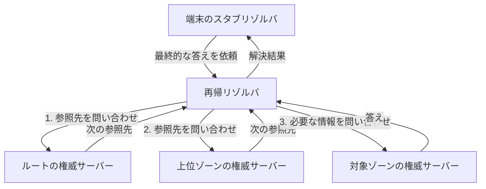

# 第3章 性能――問い合わせ経路と再利用を設計する

> 構成の理由と扱う範囲は[この章の設計メモ](../docs/document-design/03-performance.md)に記録します。

## 1. 待たされる人と、仕事を引き受ける人

利用者にとっては、ページを開くまでの待ち時間の一部として名前解決があります。一方、名前解決を提供する側は、一人の問い合わせを処理するだけでは済みません。同じ名前を何万人が使う場合にも、その人数に応じて毎回すべての問い合わせ先をたどる必要があるか、という問題があります。

第2章では管理責任を分けました。しかし、管理を分けただけでは利用者の待ち時間は短くなりません。情報の所在をたどる仕事が増える場合もあります。そこで、誰が経路をたどり、どの結果を再利用するかを設計します。本章の主題は、**一回の通信を速くすることだけでなく、繰り返す仕事を減らすこと**です。

評価する時間にも境界が必要です。アプリケーションが名前解決を依頼してから情報を得るまでを測るのか、再帰リゾルバが依頼を受けてから返すまでを測るのかで、含まれる待ち時間が違います。後続の接続やページ表示まで含めた時間を、名前解決だけの時間と呼ぶことはできません。

本章では利用者の応答時間と、リゾルバから上流へ送る問い合わせ数を分けます。さらに、初めて調べる場合と再利用できる場合、成功した場合と失敗した場合を分けます。平均だけが改善しても、一部の利用者が長く待たされるなら、その遅い側が要件を満たしたとはいえません。たとえば95パーセンタイルは、観測値を小さい順に並べたときの95%地点です。ただし成功分だけで算出すると、タイムアウトした利用者の待ちを隠してしまいます。

## 2. 再帰と反復は、仕事の渡し方が違う

**リゾルバ**は、名前について必要な情報を取得する側の機能です。端末の**スタブリゾルバ**は、通常、十分な探索機能を持つ**再帰リゾルバ**へ解決を依頼します。再帰リゾルバは、使える情報が手元になければ、その依頼を解決するための問い合わせを進めます。

この分担では、端末は「次にこのサーバーへ聞いてください」という途中経過を一つずつ処理しません。**再帰問い合わせ**は、その先の解決まで相手へ依頼します。一方、**反復問い合わせ**では、問い合わせ先が自分の知る答えや参照先を返し、問い合わせる側が次へ進みます。再帰リゾルバが権威サーバーをたどるとき、この反復の形を取れます。[RFC 9499: DNS Terminology](https://www.rfc-editor.org/rfc/rfc9499.html) 4節、6節

次の図は、途中の情報もキャッシュにない場合の、簡略化した経路です。図の矢印一つを実際のパケット一個とはみなしません。再送、別名の解決、サーバーのアドレスを調べる処理などは省いています。

利用者から見える依頼が一回でも、リゾルバの先では複数の仕事が行われ得ます。逆に、途中の委譲情報を再利用できれば、毎回ルートから始める必要もありません。「名前のドットが多いから、必ず同じ回数だけ問い合わせる」とは数えられません。名前の階層、実際の委譲、保持している情報を分けて考えます。[RFC 1034: Domain Names—Concepts and Facilities](https://www.rfc-editor.org/rfc/rfc1034.html) 5.3.3節

なお、再帰リゾルバが別のリゾルバへ処理を転送する構成もあります。この場合、端末の一段先だけを測っても、権威サーバーまでの仕事の配分は見えません。本章の図は全構成の一覧ではなく、依頼を受けることと探索を実行することを区別するための図です。

## 3. キャッシュは仕事を減らし、時間差を引き受ける

**キャッシュ**は、以前に得た情報を後の問い合わせへ再利用する仕組みです。同じ名前と種類の情報を繰り返し求められるなら、毎回その出所まで取り直す仕事を減らせます。これは第2章の分散管理と対になる設計です。管理を分けた結果、参照先をたどる処理が必要になっても、その結果を再利用すれば毎回はたどらずに済みます。分散管理とローカルキャッシュは、1987年の設計目標にも並べて記されています。[RFC 1034: Domain Names—Concepts and Facilities](https://www.rfc-editor.org/rfc/rfc1034.html) 2.2節

ただし、同じ名前でも欲しい情報の種類が違えば、同じ答えではありません。IPv4アドレスのAレコードとIPv6アドレスのAAAAレコードは別です。レコードとは、名前に結び付く情報を型ごとに表す単位です。同じ名前、クラス、型のレコードをまとめたものをリソースレコード集合（Resource Record Set、RRset）と呼びます。一つの名前に複数のアドレスがあっても、それぞれを無関係な答えとして都合よく混ぜるわけではありません。[RFC 2181: Clarifications to the DNS Specification](https://www.rfc-editor.org/rfc/rfc2181.html) 5節

再利用できた割合をキャッシュヒット率と呼びますが、これだけで性能の良否は決まりません。よく使う名前が少数に集中する場合と、毎回異なる名前を調べる場合では、同じ容量でも再利用の機会が違います。容量を増やしても、同じ情報を再び使わなければ問い合わせは減りません。

また、ヒット率はどの層で測ったかと対にします。端末のキャッシュで解決した要求は、再帰リゾルバの問い合わせ数に現れない場合があります。利用者の総要求数を分母にした値と、再帰リゾルバが受けた要求数を分母にした値は比較できません。仕事を減らした場所を特定しなければ、改善した理由も説明できません。

## 4. TTLは再利用の期限であり、更新の予約ではない

キャッシュを無期限に使えば、情報を取り直す負荷は小さくできます。その代わり、管理側でアドレスを変えても、古い値を返し続けます。**Time to Live（TTL）**は、この再利用に時間の上限を与えるための値です。通常のキャッシュでは、得た情報をいつまでも同じ残り時間のまま返すのではなく、経過した分だけ残り時間を減らします。[RFC 1035: Domain Names—Implementation and Specification](https://www.rfc-editor.org/rfc/rfc1035.html) 3.2.1節、7.1節

説明用に、あるリゾルバがTTL 300秒の情報を時刻0秒に受け取り、途中の再取得も削除もない場合を考えます。120秒後の再利用では、残り時間は180秒です。そこから受け取った別のキャッシュが、元の300秒へ勝手に戻してよいわけではありません。次の図の数値は、この仮定から作った説明用の値であり、実測ではありません。

<svg viewBox="0 0 540 260" width="100%" role="img" aria-label="説明例。0秒でTTL300秒の情報を取得し、120秒で残り180秒、300秒で通常の再利用期限を迎える">
  <line x1="46" y1="40" x2="46" y2="220" stroke="#0969da" stroke-width="3"/>
  <circle cx="46" cy="48" r="6" fill="#0969da"/>
  <text x="65" y="53" font-size="15" fill="#24292f">0秒：取得。TTLは300秒</text>
  <circle cx="46" cy="128" r="6" fill="#0969da"/>
  <text x="65" y="133" font-size="15" fill="#24292f">120秒：再利用。残りは180秒</text>
  <circle cx="46" cy="208" r="6" fill="#0969da"/>
  <text x="65" y="213" font-size="15" fill="#24292f">300秒：通常の再利用期限。次の利用には更新が必要</text>
</svg>

この300秒は、必ずキャッシュへ保持される時間でもありません。容量や実装上の判断で早く削除される場合があり、TTLは通常の再利用の上限です。また、TTLが満了した瞬間に、すべてのキャッシュが一斉に問い合わせるという意味でもありません。期限後に必要になってから取得する場合と、後述する先取り更新を行う場合を区別します。[RFC 2181: Clarifications to the DNS Specification](https://www.rfc-editor.org/rfc/rfc2181.html) 8節

長いTTLは、同じ情報を再び使う機会を増やす一方、変更前の情報が使われる期間も長くします。短くすれば変更を確認する機会は増えますが、上流への問い合わせと、その待ち時間を引き受けます。したがって、TTLを長くすることを性能の改善だけとして評価することはできません。変更反映との交換条件であり、具体的な変更計画は第5章で扱います。期限切れデータを障害時に使う例外は、通常の再利用とは分けて後述します。
