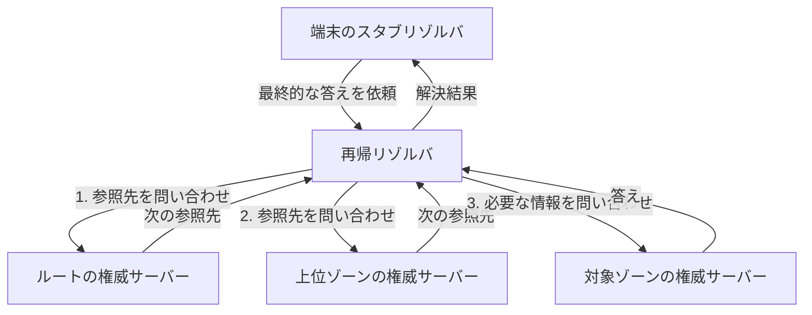

# 第3章 性能――問い合わせ経路と再利用を設計する

> 構成の理由と扱う範囲は[この章の設計メモ](../docs/document-design/03-performance.md)に記録します。

## 1. 待たされる人と、仕事を引き受ける人

利用者にとっては、ページを開くまでの待ち時間の一部として名前解決があります。一方、名前解決を提供する側は、一人の問い合わせを処理するだけでは済みません。同じ名前を何万人が使う場合にも、その人数に応じて毎回すべての問い合わせ先をたどる必要があるか、という問題があります。

第2章では管理責任を分けました。しかし、管理を分けただけでは利用者の待ち時間は短くなりません。情報の所在をたどる仕事が増える場合もあります。そこで、誰が経路をたどり、どの結果を再利用するかを設計します。本章の主題は、**一回の通信を速くすることだけでなく、繰り返す仕事を減らすこと**です。

評価する時間にも境界が必要です。アプリケーションが名前解決を依頼してから情報を得るまでを測るのか、再帰リゾルバが依頼を受けてから返すまでを測るのかで、含まれる待ち時間が違います。後続の接続やページ表示まで含めた時間を、名前解決だけの時間と呼ぶことはできません。

本章では利用者の応答時間と、リゾルバから上流へ送る問い合わせ数を分けます。さらに、初めて調べる場合と再利用できる場合、成功した場合と失敗した場合を分けます。平均だけが改善しても、一部の利用者が長く待たされるなら、その遅い側が要件を満たしたとはいえません。たとえば95パーセンタイルは、観測値を小さい順に並べたときの95%地点です。ただし成功分だけで算出すると、タイムアウトした利用者の待ちを隠してしまいます。

## 2. 再帰と反復は、仕事の渡し方が違う

**リゾルバ**は、名前について必要な情報を取得する側の機能です。端末の**スタブリゾルバ**は、通常、十分な探索機能を持つ**再帰リゾルバ**へ解決を依頼します。再帰リゾルバは、使える情報が手元になければ、その依頼を解決するための問い合わせを進めます。

この分担では、端末は「次にこのサーバーへ聞いてください」という途中経過を一つずつ処理しません。**再帰問い合わせ**は、その先の解決まで相手へ依頼します。一方、**反復問い合わせ**では、問い合わせ先が自分の知る答えや参照先を返し、問い合わせる側が次へ進みます。再帰リゾルバが権威サーバーをたどるとき、この反復の形を取れます。[RFC 9499: DNS Terminology](https://www.rfc-editor.org/rfc/rfc9499.html) 4節、6節

次の図は、途中の情報もキャッシュにない場合の、簡略化した経路です。図の矢印一つを実際のパケット一個とはみなしません。再送、別名の解決、サーバーのアドレスを調べる処理などは省いています。狭い画面では図を横へスクロールできます。



利用者から見える依頼が一回でも、リゾルバの先では複数の仕事が行われ得ます。逆に、途中の委譲情報を再利用できれば、毎回ルートから始める必要もありません。「名前のドットが多いから、必ず同じ回数だけ問い合わせる」とは数えられません。名前の階層、実際の委譲、保持している情報を分けて考えます。[RFC 1034: Domain Names—Concepts and Facilities](https://www.rfc-editor.org/rfc/rfc1034.html) 5.3.3節

なお、再帰リゾルバが別のリゾルバへ処理を転送する構成もあります。この場合、端末の一段先だけを測っても、権威サーバーまでの仕事の配分は見えません。本章の図は全構成の一覧ではなく、依頼を受けることと探索を実行することを区別するための図です。

## 3. キャッシュは仕事を減らし、時間差を引き受ける

**キャッシュ**は、以前に得た情報を後の問い合わせへ再利用する仕組みです。同じ名前と種類の情報を繰り返し求められるなら、毎回その出所まで取り直す仕事を減らせます。これは第2章の分散管理と対になる設計です。管理を分けた結果、参照先をたどる処理が必要になっても、その結果を再利用すれば毎回はたどらずに済みます。分散管理とローカルキャッシュは、1987年の設計目標にも並べて記されています。[RFC 1034: Domain Names—Concepts and Facilities](https://www.rfc-editor.org/rfc/rfc1034.html) 2.2節

ただし、同じ名前でも欲しい情報の種類が違えば、同じ答えではありません。IPv4アドレスのAレコードとIPv6アドレスのAAAAレコードは別です。レコードとは、名前に結び付く情報を型ごとに表す単位です。同じ名前、クラス、型のレコードをまとめたものをリソースレコード集合（Resource Record Set、RRset）と呼びます。一つの名前に複数のアドレスがあっても、それぞれを無関係な答えとして都合よく混ぜるわけではありません。[RFC 2181: Clarifications to the DNS Specification](https://www.rfc-editor.org/rfc/rfc2181.html) 5節

再利用できた割合をキャッシュヒット率と呼びますが、これだけで性能の良否は決まりません。よく使う名前が少数に集中する場合と、毎回異なる名前を調べる場合では、同じ容量でも再利用の機会が違います。容量を増やしても、同じ情報を再び使わなければ問い合わせは減りません。

また、ヒット率はどの層で測ったかと対にします。端末のキャッシュで解決した要求は、再帰リゾルバの問い合わせ数に現れない場合があります。利用者の総要求数を分母にした値と、再帰リゾルバが受けた要求数を分母にした値は比較できません。仕事を減らした場所を特定しなければ、改善した理由も説明できません。

## 4. TTLは再利用の期限であり、更新の予約ではない

キャッシュを無期限に使えば、情報を取り直す負荷は小さくできます。その代わり、管理側でアドレスを変えても、古い値を返し続けます。**Time to Live（TTL）**は、この再利用に時間の上限を与えるための値です。通常のキャッシュでは、得た情報をいつまでも同じ残り時間のまま返すのではなく、経過した分だけ残り時間を減らします。[RFC 1035: Domain Names—Implementation and Specification](https://www.rfc-editor.org/rfc/rfc1035.html) 3.2.1節、7.1節

説明用に、あるリゾルバがTTL 300秒の情報を時刻0秒に受け取り、途中の再取得も削除もない場合を考えます。120秒後の再利用では、残り時間は180秒です。そこから受け取った別のキャッシュが、元の300秒へ勝手に戻してよいわけではありません。次の図の数値は、この仮定から作った説明用の値であり、実測ではありません。

<div class="time-figure" role="region" aria-label="TTLの時間図。横にスクロールできます" tabindex="0">
<svg viewBox="0 0 540 260" width="100%" role="img" aria-label="説明例。0秒でTTL300秒の情報を取得し、120秒で残り180秒、300秒で通常の再利用期限を迎える">
  <line x1="46" y1="40" x2="46" y2="220" stroke="#0969da" stroke-width="3"/>
  <circle cx="46" cy="48" r="6" fill="#0969da"/>
  <text x="65" y="53" font-size="15" fill="#24292f">0秒：取得。TTLは300秒</text>
  <circle cx="46" cy="128" r="6" fill="#0969da"/>
  <text x="65" y="133" font-size="15" fill="#24292f">120秒：再利用。残りは180秒</text>
  <circle cx="46" cy="208" r="6" fill="#0969da"/>
  <text x="65" y="213" font-size="15" fill="#24292f">300秒：通常の再利用期限を迎える</text>
</svg>
</div>

この300秒は、必ずキャッシュへ保持される時間でもありません。容量や実装上の判断で早く削除される場合があり、TTLは通常の再利用の上限です。また、TTLが満了した瞬間に、すべてのキャッシュが一斉に問い合わせるという意味でもありません。期限後に必要になってから取得する場合と、後述する先取り更新を行う場合を区別します。[RFC 2181: Clarifications to the DNS Specification](https://www.rfc-editor.org/rfc/rfc2181.html) 8節

長いTTLは、同じ情報を再び使う機会を増やす一方、変更前の情報が使われる期間も長くします。短くすれば変更を確認する機会は増えますが、上流への問い合わせと、その待ち時間を引き受けます。したがって、TTLを長くすることを性能の改善だけとして評価することはできません。変更反映との交換条件であり、具体的な変更計画は第5章で扱います。期限切れデータを障害時に使う例外は、通常の再利用とは分けて後述します。

## 5. 「ない」という答えにも再利用の価値がある

利用者が存在しない名前を何度も指定する場合、そのたびに同じ探索を繰り返すと、答えが得られないまま上流の仕事だけが増えます。**Negative Caching（否定応答のキャッシュ）**は、不在を示す応答も再利用する仕組みです。ただし、「名前が存在しない」と「その名前に指定した種類の情報がない」は異なります。前者をNXDOMAIN、後者をNODATAと呼びます。たとえばAレコードがないことだけから、その名前の他の種類の情報まで存在しないとは判断できません。[RFC 2308: Negative Caching of DNS Queries](https://www.rfc-editor.org/rfc/rfc2308.html) 2節、5節

不在応答の再利用にも期限があります。RFC 2308では、ゾーンの管理情報を表すStart of Authority（SOA）レコードを使い、そのTTLとMINIMUMフィールドの小さい方から否定応答の期限を定めます。不在を再利用すると、失敗を繰り返す問い合わせの負荷を抑えられますが、その後で名前やレコードを追加しても、過去の不在が残る場合があります。「まだない」を覚える設計も、性能と変更反映を交換しているのです。[RFC 2308: Negative Caching of DNS Queries](https://www.rfc-editor.org/rfc/rfc2308.html) 3節、5節

さらに、「存在しないと確認できた」と「調べる処理が失敗した」も区別します。タイムアウトや検証失敗を不在と取り違えると、答えの意味が変わります。それでも失敗のたびに探索を繰り返せば、障害中の上流へ負荷を集中させます。RFC 9520は、この解決失敗のキャッシュを必須とする方向へ規定を更新しています。これは失敗を成功に変える仕組みではなく、失敗している処理の反復を抑える設計です。[RFC 9520: Negative Caching of DNS Resolution Failures](https://www.rfc-editor.org/rfc/rfc9520.html) 概要、3節

## 6. 通信方式だけで「速い」は決まらない

問い合わせ一回の通信にも費用があります。User Datagram Protocol（UDP）は、Transmission Control Protocol（TCP）のような接続確立を先に行わずにメッセージを送れます。ただし、届かなかったときに誰が待ち、再送し、別の相手を選ぶかという仕事がなくなるわけではありません。初期仕様も、UDPによる問い合わせについて再送の戦略を必要としています。[RFC 1035: Domain Names—Implementation and Specification](https://www.rfc-editor.org/rfc/rfc1035.html) 4.2.1節

UDPの応答へ必要な情報が収まらない場合もあります。応答が切り詰められたことを示すTruncation（TC）ビットが返ると、完全な答えを得るためにTCPを使い直す経路が生じます。したがって、UDPで始めれば常に最短の往復で終わるとは限りません。応答の大きさ、損失、やり直しまで含めて評価します。[RFC 2181: Clarifications to the DNS Specification](https://www.rfc-editor.org/rfc/rfc2181.html) 9節

反対に、TCPの接続がすでに使えるなら、問い合わせごとに確立し直す必要はありません。RFC 7766は、汎用DNS実装へUDPとTCPの両方への対応を要求し、TCPをUDP失敗後だけの手段とは位置付けていません。接続再利用や複数問い合わせの処理も、性能を考える際の対象です。[RFC 7766: DNS Transport over TCP—Implementation Requirements](https://www.rfc-editor.org/rfc/rfc7766.html) 5節、6節

ここでの判断は「UDPかTCPか」という名称の比較では終わりません。初回の接続なのか、再利用できる接続なのか、応答が一度で届くのか、待ち直しが起きるのかを条件としてそろえます。暗号化する区間と終端の選び方は第7章で扱います。

## 7. 平均を下げた後に、遅い側が残る

よく使う情報がキャッシュにあれば、多くの問い合わせは短く終わります。それでも期限直後の利用者は、情報の取得を待つ場合があります。**Prefetch（先取り更新）**は、その待ちを減らすための実装上の工夫です。たとえばBIND 9では、期限の近いキャッシュ情報への問い合わせを契機に、権威サーバーへ更新を求める設定があります。これはBINDの実装例であり、すべてのリゾルバが同じ条件で動くという意味ではありません。[BIND 9.20.16 ARM: prefetch](https://bind9.readthedocs.io/en/v9.20.16/reference.html#namedconf-statement-prefetch)

先取りは、後の利用者が待たずに済む可能性を買うために、今の問い合わせを増やします。その情報が再び利用されなければ、更新の仕事は利用者の待ち時間削減につながりません。評価には平均応答時間だけでなく、追加の上流問い合わせ数と、期限直後の遅延を含めます。

上流が遅い、または更新できない場合には、**Serve Stale**という別の選択肢があります。期限切れのデータを使って応答を続ける仕組みで、利用者の待ちや失敗を減らす代わりに、情報が古い可能性を引き受けます。更新を先に行うPrefetchとは異なる判断です。具体的な動作と運用条件は第4章に残し、ここでは「待つ時間を減らす手段が、最新性も変えてしまう」例として押さえます。[RFC 8767: Serving Stale Data to Improve DNS Resiliency](https://www.rfc-editor.org/rfc/rfc8767.html) 4節、5節

## 8. 実際の応答から何が分かるか

次は2026年11月20日に、著者のWindows作業端末から採った観測です。対象は `example.com` のAレコード、問い合わせ先に指定したアドレスは `1.1.1.1` です。地理的な観測地点とリゾルバ内部の処理先は特定していません。キャッシュの消去や対象レコードの変更も行っていません。

PowerShell 7.6.9で、次のコマンドを3回実行し、各応答の後に2秒待ちました。`-DnsOnly` と `-NoHostsFile` は、DNS以外の補助的な名前解決とhostsファイルを対象から外すための指定です。[Microsoft Learn: Resolve-DnsName](https://learn.microsoft.com/en-us/powershell/module/dnsclient/resolve-dnsname)

```powershell
Resolve-DnsName -Name example.com -Type A -Server 1.1.1.1 -DnsOnly -NoHostsFile
```

| 問い合わせ開始時刻（日本時間） | 返されたAレコード数 | 各AレコードのTTL |
| --- | --- | --- |
| 2026-11-20 20:54:51.735 | 2 | 27秒 |
| 2026-11-20 20:54:57.353 | 2 | 28秒 |
| 2026-11-20 20:54:59.378 | 2 | 126秒 |

3回とも同じ二つのアドレスが返りましたが、TTLは単調には減りませんでした。[観測の生データ](../references/observations/cache-2026-11-20.json)には時刻、アドレス、コマンド全体の所要時間も保存しています。最初の実行時間にはコマンド初期化などが含まれ得るため、通信だけの時間としては掲載しません。

この結果は、第4節の説明用の図と矛盾するのでしょうか。図は「同じキャッシュの同じ取得結果を、再取得せずに使う」という仮定でした。一方、この観測では、その仮定が成立したかを確認できません。異なるキャッシュの応答だった可能性や、途中で更新された可能性などを、この三つの値だけでは切り分けられません。TTLが増えた理由をPrefetchだったと断定することもできません。

確かめられたのは、この条件でその値が返ったことまでです。キャッシュの効果を厳密に比較するなら、同じ処理先、キャッシュの状態、上流へ実際に出た問い合わせを観測できる環境が必要になります。制御していない公開リゾルバで最初と二度目を比較しただけでは、「二度目が速かったからキャッシュの効果」とは結論できません。

## 9. 他のシステムへ持ち帰る

この設計は、APIの応答、商品情報、認証に使う情報などをキャッシュする場面でも現れます。まず、誰の待ち時間と誰の負荷を減らすのかを決めます。次に、同じ情報とみなす範囲、再利用の期限、失敗や不在を覚えてよい期間を決めます。最後に、期限切れや取得失敗の際に、待つ、古い情報を返す、失敗を返すという選択を評価します。

ただし、DNSのTTLをそのまま別の情報へ移せばよいわけではありません。名前解決で古いアドレスを短時間返すことと、失効した権限を使って操作を許可することでは、誤りの影響が違います。適用できるのは期限の値ではなく、再利用によって何を減らし、どんな古さを許すのかを明示する考え方です。

運用でも、キャッシュヒット率だけを単独の目標にしません。利用者から見た遅延と失敗率、上流の問い合わせ数、返している情報の古さを併せて確認します。上流の仕事を減らしても、利用者が使えない答えを速く返しているなら、目的を達成したとはいえません。

## この章の言い換え

| 前 | 後 |
| --- | --- |
| 「DNSが遅い」 | 「利用者の待ち時間を、再利用できた場合、上流をたどった場合、失敗した場合に分けて測る」 |
| 「DNSのTTLを長くすればよい」 | 「問い合わせを減らせる期間と、変更前の情報を再利用し得る期間を一緒に決める」 |
| 「DNSの二度目の応答が速いからキャッシュが効いた」 | 「同じ処理先とキャッシュ状態を確認していないので、時間差だけでは原因を断定しない」 |

## 参照資料

- [RFC 1034: Domain Names—Concepts and Facilities](https://www.rfc-editor.org/rfc/rfc1034.html) 2.2節、5.3.3節
- [RFC 1035: Domain Names—Implementation and Specification](https://www.rfc-editor.org/rfc/rfc1035.html) 3.2.1節、4.2.1節、7.1節
- [RFC 2181: Clarifications to the DNS Specification](https://www.rfc-editor.org/rfc/rfc2181.html) 5節、8節、9節
- [RFC 2308: Negative Caching of DNS Queries](https://www.rfc-editor.org/rfc/rfc2308.html) 2節、3節、5節
- [RFC 7766: DNS Transport over TCP—Implementation Requirements](https://www.rfc-editor.org/rfc/rfc7766.html) 5節、6節
- [RFC 8767: Serving Stale Data to Improve DNS Resiliency](https://www.rfc-editor.org/rfc/rfc8767.html) 4節、5節
- [RFC 9499: DNS Terminology](https://www.rfc-editor.org/rfc/rfc9499.html) 4節、6節
- [RFC 9520: Negative Caching of DNS Resolution Failures](https://www.rfc-editor.org/rfc/rfc9520.html) 概要、3節
- [BIND 9.20.16 ARM: prefetch](https://bind9.readthedocs.io/en/v9.20.16/reference.html#namedconf-statement-prefetch) 実装例
- [Microsoft Learn: Resolve-DnsName](https://learn.microsoft.com/en-us/powershell/module/dnsclient/resolve-dnsname) 観測コマンドのオプション

---

[← 第2章 拡張性](02-scalability.md)｜[目次](../)｜[次の章 可用性と障害耐性 →](04-availability.md)


