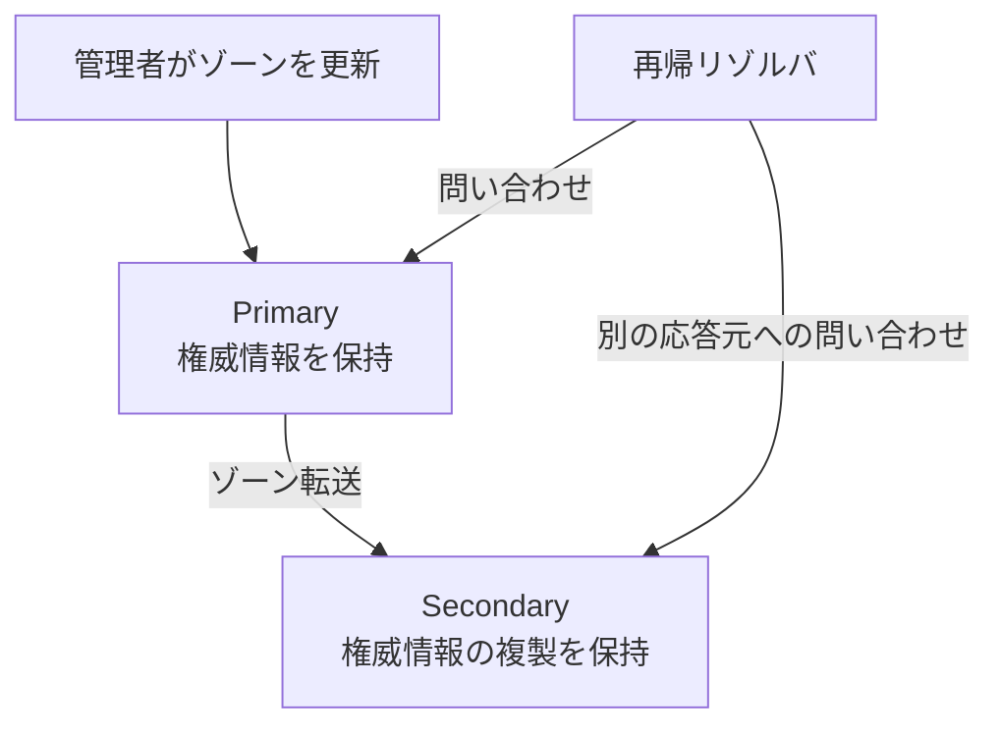

# 第4章 可用性と障害耐性――どの障害に対して応答を続けるのか

## 1. 「止まらない」の対象を決める

利用者が必要としているのは、サーバーの電源が入っていることではありません。必要な名前を調べ、利用できる情報を、待てる時間内に得られることです。応答元が生きていても経路が途切れていれば、その利用者には使えません。応答が返っても、要求した情報を解決できなければ、その要求は成功していません。

そこで可用性を考えるときは、まず成功と失敗の境界を決めます。対象を特定の利用者群からの名前解決とするのか、権威サーバーの問い合わせサービスとするのか、レコードを変更する管理機能とするのかで、数える障害が違います。既存の情報へ答えることと、新しい情報へ更新できることも別です。

許容する時間も必要です。一台が応答しなくなった後、別の応答元を試して成功すればよいのか、その待ち直しも許せないのかを決めます。古い情報を返してもよいか、古い情報なら失敗として返すべきかも要件です。本章では、**想定する失敗と許す劣化を定めてから、複製と配置を評価する**順序を取ります。

たとえば「一台の停止でサービスを失わない」は、一台の停止についての条件です。電源、回線、設定、管理アカウントなどを共有して全台が一緒に影響を受ける場合までは含みません。「高可用」という言葉を、このような失敗条件へ分けることが設計の出発点です。

## 2. 複製は、別の場所でも答えられる状態を作る

第2章では一つのゾーンを複数の権威サーバーで提供できることを見ました。ある応答元が使えなくても、同じゾーンを提供する別の応答元が使えれば、解決を続ける余地があります。ただし、リゾルバが使えない相手を試す時間は残ります。代わりがあることと、利用者が遅延を感じないことは同じではありません。

ここで**Primary**と**Secondary**は、通常、ゾーンのデータを取得する関係を表します。Secondaryはゾーン転送によって情報を取得する権威サーバーで、Primaryはその転送元となる権威サーバーです。名前がPrimaryだから通常の問い合わせを独占し、Secondaryは障害時だけ起動する、という関係ではありません。どちらも保持するゾーンの問い合わせへ応答できます。[RFC 9499: DNS Terminology](https://www.rfc-editor.org/rfc/rfc9499.html) 6節

次の図は、更新の経路と問い合わせの経路を分けています。説明用の構成であり、すべてのサービスがこの形を取るわけではありません。狭い画面では図を横へスクロールできます。



Primaryとの更新経路が止まっても、Secondaryはそれまでに取得した情報を保持しています。そのため、更新できなくなった瞬間に、すべての問い合わせが止まるわけではありません。ただし古いコピーを無期限に権威情報として提供してよいわけでもありません。RFC 1034は、Secondaryが変更を確認する間隔、失敗後の再試行間隔、確認できない状態が続いた場合の期限をSOAの値で扱っています。[RFC 1034: Domain Names—Concepts and Facilities](https://www.rfc-editor.org/rfc/rfc1034.html) 4.3.5節

したがって、「Primaryが停止した」という一文だけでは利用者への影響は決まりません。他の応答元の到達性、最後に取得したデータ、更新できない期間、問い合わせ側の挙動を併せて見ます。

例えば、転送元との連絡が途絶えたままSOAの失効期限を迎えれば、Secondaryのプロセスが動いていても、そのコピーを権威情報として使い続けることはできません。期限までに更新経路を復旧できることが、複製で応答を支える条件になります。これは、問い合わせ側のキャッシュを何秒再利用できるかというTTLとは別の期限です。[RFC 1034 4.3.5節](https://www.rfc-editor.org/rfc/rfc1034.html)

## 3. コピーを配る方法にも、負荷と時間の交換がある

ゾーン全体を転送する方式が**AXFR**です。一部分の変更であっても全体を送るので、仕組みを理解しやすい一方、ゾーンが大きい場合や変更が頻繁な場合には転送量が増えます。AXFRは1987年のRFC 1034/1035にも存在し、2010年のRFC 5936で相互運用に必要な詳細が明確化されました。[RFC 5936: DNS Zone Transfer Protocol (AXFR)](https://www.rfc-editor.org/rfc/rfc5936.html) 概要

変更部分を転送する方式が**IXFR**です。以前の版からの差分を扱うことで、全体を送り直す負荷を減らせます。その代わり、転送元には差分を提供するための情報が必要です。要求された差分を用意できない場合などには、全体を返す場合もあります。IXFRという方式名だけで、毎回必ず少量の転送になるとは限りません。[RFC 1995: Incremental Zone Transfer in DNS](https://www.rfc-editor.org/rfc/rfc1995.html) 1節、2節

そして**NOTIFY**はデータそのものの転送ではなく、変更を知らせて確認を促す仕組みです。Secondaryが次の定期確認まで待つ期間を短くすることを狙います。通知を受けたことと、新しいデータを取得し終えたことは分けて観測します。[RFC 1996: A Mechanism for Prompt Notification of Zone Changes](https://www.rfc-editor.org/rfc/rfc1996.html) 1節

この三つを区別すると、更新の失敗を説明しやすくなります。変更があったことを知らせられなかったのか、確認できなかったのか、転送が失敗したのかでは、調べる場所が違います。複製を置く設計は、応答元を増やすと同時に、コピーの更新を監視する仕事も増やします。

異なる事業者間でゾーンを同期するサービスもあります。Cloudflareの公式資料はPrimaryとSecondaryの両方の構成、およびAXFR/IXFRによる同期を説明しています。ただし、これは当該サービスが提供する構成の資料です。事業者を二つ選んだだけで、利用する全機能や設定方法まで互換になるという根拠にはしません。[Cloudflare DNS: Zone transfers](https://developers.cloudflare.com/dns/zone-setups/zone-transfers/)

## 4. 台数よりも、同時に失うものを調べる

同じ建物、同じ回線、同じ設定配布の仕組みへ依存する二台は、それぞれの故障には強くても、共通の依存先の停止には弱い構成です。このように一つの原因で一緒に影響を受ける範囲を、ここでは**障害ドメイン**と呼びます。複製の数だけでなく、何を共有しているかを調べます。

RFC 2182は、Secondaryの選択で物理的な場所とネットワーク上の配置の両方を考慮する必要を述べています。地理的に遠いだけでも、近いが別の回線というだけでも、想定したすべての障害を分離したことにはなりません。[RFC 2182: Selection and Operation of Secondary DNS Servers](https://www.rfc-editor.org/rfc/rfc2182.html) 3節、4節

共通原因は機器や回線に限りません。正しく動くサーバーへ同じ誤ったデータを配れば、複製は誤りも広めます。すべてを変更できる一つの管理アカウントや、一度に全拠点へ配る設定変更も、影響を共有する経路になります。冗長化の評価には、変更の範囲と戻す手段を含めます。

ここまでの考え方を、説明用の二案へ当てはめます。同じ拠点に応答元を追加する案と、回線と電源を分けた別拠点へ追加する案です。「一台の故障中も読む処理を続けたい」が要件なら、前者でも、残った応答元へ到達できて負荷を引き受けられる条件では候補になります。「拠点全体の停止中も続けたい」が要件なら、前者では対象の失敗を分離できず、後者を検討する理由になります。ただし後者でも、利用者から残った拠点へ到達できることと、待ち直しが許容時間内に収まることが必要です。

さらに「誤った更新を全体へ広めたくない」という要件なら、場所を分けるだけでは足りません。更新前の検証や配布範囲の制御が対象になります。場所を分ける案には複製と到達性を維持する仕事が、配布を段階に分ける案には新旧データが混在する期間が生まれます。どれが優れた構成かを台数で決めるのではなく、避けたい失敗に効く案を、その運用負担とともに選びます。

運用当事者の報告にも、この区別が現れます。Cloudflareは2020年7月17日の障害について、バックボーンのルーター設定の誤りが、そこへ接続する複数の拠点に影響したと報告しています。全拠点が止まったという報告ではありません。この事例から本書が引く論点は、複数の場所に設備があっても、共通の経路や変更を通じて影響が広がるということです。[Cloudflare: Cloudflare outage on July 17, 2020](https://blog.cloudflare.com/cloudflare-outage-on-july-17-2020/)

## 5. Anycastは、同じ宛先を複数の場所で提供する

応答元を分ける方法は、異なるアドレスを列挙するだけではありません。**Anycast**では、同じアドレスへの経路を複数の場所から提供し、ネットワークの経路選択によって到達先を分けます。利用者側が物理拠点を一つずつ選ぶのではなく、経路の側が到達先を決める設計です。権威サーバーへの適用はRFC 3258、運用上の考慮事項はRFC 4786に記されています。[RFC 3258: Distributing Authoritative Name Servers via Shared Unicast Addresses](https://www.rfc-editor.org/rfc/rfc3258.html)、[RFC 4786: Operation of Anycast Services](https://www.rfc-editor.org/rfc/rfc4786.html) 3節、4節

これにより、一つの名前やアドレスで複数の設備を提供できます。しかし「いつでも地理的に一番近い拠点へ届く」「一拠点の故障が即座に隠れる」とまではいえません。経路選択の条件、サービスの異常をどう検出して経路へ反映するか、経路の変化にかかる時間が関係します。サーバープロセスが止まっても経路を提供し続ければ、そこへ届く利用者の失敗は残ります。

IANAの公式一覧も、ルートの権威サーバー名と、各地に置かれた多数のサーバーを区別しています。したがって、NSレコードに現れる名前の数を物理的な台数と読むことはできません。名前、アドレス、拠点、運用主体は、異なる数え方です。[IANA: Root Name Servers](https://www.iana.org/domains/root/servers)

複数リージョンを使う場合も同じです。別の場所に置くことで分かれる依存先と、設定配布や管理機能など共有したままの依存先を列挙します。Anycastや複数リージョンは、障害条件に対して選ぶ仕組みであり、それ自体が可用性の達成を証明するラベルではありません。

## 6. 古い答えで応答を続けるという選択

第3章のキャッシュは、通常の再利用期限の間、上流へ問い合わせずに答える機会を作りました。上流が使えなくなっても、期限内の情報が手元にあれば、その範囲の問い合わせは影響を受けずに済む場合があります。しかし、初めて調べる名前や、必要な情報が残っていない場合には、この助けはありません。

**Serve Stale**は、情報を更新できないときに、期限を過ぎたデータも使って応答の継続を図る仕組みです。RFC 8767は、TTLが満了した後もデータを保持できるよう従来の定義を更新しています。通常のキャッシュ期限と、障害対応のため期限後に保持する期間を区別しなければなりません。[RFC 8767: Serving Stale Data to Improve DNS Resiliency](https://www.rfc-editor.org/rfc/rfc8767.html) 4節

同RFCの実装例では、利用者へ返すまで待つ時間、解決処理を続ける時間、失敗した相手を再確認する間隔、期限切れデータを保持する上限が分かれています。利用者へ古い情報を返した後も更新を試す場合があり、「応答を返した」と「最新の情報を取り直せた」は別の時点です。これは一つの実装例であり、全リゾルバが同一のタイマーで動くという規定ではありません。[RFC 8767: Serving Stale Data to Improve DNS Resiliency](https://www.rfc-editor.org/rfc/rfc8767.html) 5節、6節

可用性の評価では、応答を返せた割合だけでなく、古い情報が利用者にどの影響を与えるかを見ます。アドレスが以前と同じなら利用を継続できても、すでに接続先が廃止されていれば、名前解決の応答が返るだけでは目的を果たしません。古い情報を使う設計は「正しさを不要にした」のではなく、最新性の保証を弱めることで応答を続ける判断です。

また、使える古い情報がキャッシュにない場合には生成できません。上流が復旧したことを検知できなければ、古い情報を使う期間も延びます。応答継続を導入するときは、更新失敗を見失わない観測と、復旧後に通常の更新へ戻ったことの確認を組み合わせます。

本書の設計上の比較では、旧接続先も有効な読み取りサービスなら、古い回答を許して停止を避ける案を検討できます。反対に、旧接続先を利用させてはいけないなら、回答が返る割合を上げるだけでは要件に反します。ゾーンを提供する側は外部リゾルバの設定を一括で選べないため、「TTLを過ぎれば旧接続先は使われない」という前提で停止計画を組むこともできません。どこまで古い情報を許すかという運用方針と、それを制御できる範囲を分けます。

署名付きデータには、さらに署名の有効期間があります。期限切れのキャッシュを返せることと、その回答が署名検証を通ることは別です。RFC 8767も、署名の有効期間を過ぎたデータによる検証失敗を注意点に挙げています。検証が必要な利用者への応答継続は、署名の条件も満たして評価します。詳細は[第6章](06-security.md)で扱います。[RFC 8767 10節](https://www.rfc-editor.org/rfc/rfc8767.html)

## 7. 二つの応答元を観測してみる

複製の一覧を見たとき、そこからどこまで可用性を判断できるでしょうか。まず二つの応答元へ問い合わせ、その結果と、障害時に知りたいことの違いを見ます。

2026年11月20日、著者のWindows作業端末で、`iana.org` のNSレコードを `1.1.1.1` へ問い合わせました。返された四つのサーバー名のうち、名前順の先頭二つへSOAレコードを直接問い合わせています。地理的な観測地点と、各サーバー名の背後の物理拠点は特定していません。障害の注入や設定変更は行っていません。

```powershell
Resolve-DnsName -Name iana.org -Type NS -Server 1.1.1.1 -DnsOnly -NoHostsFile
Resolve-DnsName -Name iana.org -Type SOA -Server a.iana-servers.net -DnsOnly -NoHostsFile -NoRecursion
Resolve-DnsName -Name iana.org -Type SOA -Server b.iana-servers.net -DnsOnly -NoHostsFile -NoRecursion
```

| 問い合わせ開始時刻（日本時間） | 問い合わせ先 | 結果 | SOAのSerial |
| --- | --- | --- | --- |
| 2026-11-20 21:04:26.286 | a.iana-servers.net | 応答あり | 2026110902 |
| 2026-11-20 21:04:26.500 | b.iana-servers.net | 応答あり | 2026110902 |

Serialは、ゾーンの版を比較するための値です。この観測では二つの名前で指定した応答元から、同じ値が返りました。生データには更新確認、再試行、失効までの時間を表すSOAの値も残しています。[観測の生データ](../references/observations/authorities-2026-11-20.json)

ただし、この結果が証明するのは、その時点のその観測地点から、二つの問い合わせへ応答があったことまでです。一方を停止させたときにも利用者が解決できること、両者が異なる電源や回線を使うこと、ゾーン内の全データが同じことは証明していません。同じSerialが返ったことも、データ全体を比較したこととは区別します。

正常時の一覧と障害時の能力を混同しないことが、この観測の読みどころです。障害耐性を確かめるには、自分で管理する検証環境で一つの依存先を外し、別の応答元を使えるか、利用者が何秒待つか、復旧後にデータが揃うかを測る必要があります。第三者の公開サービスへ、その実験を勝手に行うことはしません。

## 8. 応答経路と復旧経路を別々に設計する

この章の考え方は、アプリケーションサーバーやデータベースの複製にも持ち帰れます。まず、読む処理と更新する処理の依存先を分けます。次に、一つの故障で同時に失う範囲を調べます。最後に、残ったコピーをいつまで、どんな条件で使えるかを決めます。

ただしDNSの応答継続を、あらゆる更新処理へそのまま移すことはできません。以前の情報を返すだけでよい処理と、重複してはいけない決済や在庫更新では、失敗時に守る条件が違います。複製を置けば自動的に正しい更新が続く、とは考えません。

運用時には、利用者から見た解決の成否、個々の権威サーバーへの到達性、複製の更新状態を分けて監視します。キャッシュで応答できている間に、更新経路だけが壊れている可能性もあります。応答が戻った後も、滞留していた変更と古いコピーの扱いを確認します。可用性は復旧の瞬間の緑色の表示だけでなく、どの情報でサービスを続け、その後どう通常状態へ戻したかまで含めて評価します。

## この章の言い換え

| 前 | 後 |
| --- | --- |
| 「DNSを二台にしたから止まらない」 | 「一台の停止はもう一台で補えても、共有する回線の停止や誤った更新は両方へ影響します」 |
| 「DNSのPrimaryが落ちた」 | 「更新元へ到達できなくても、複製側が有効なデータを保持し、利用者から届けば応答を続けられます」 |
| 「DNSは応答しているから復旧した」 | 「キャッシュや複製で応答できても、更新経路の障害が残っている場合があります」 |

## 参照資料

- [RFC 1034: Domain Names—Concepts and Facilities](https://www.rfc-editor.org/rfc/rfc1034.html) 4.3.5節
- [RFC 1995: Incremental Zone Transfer in DNS](https://www.rfc-editor.org/rfc/rfc1995.html) 1節、2節
- [RFC 1996: A Mechanism for Prompt Notification of Zone Changes](https://www.rfc-editor.org/rfc/rfc1996.html) 1節
- [RFC 2182: Selection and Operation of Secondary DNS Servers](https://www.rfc-editor.org/rfc/rfc2182.html) 3節、4節
- [RFC 3258: Distributing Authoritative Name Servers via Shared Unicast Addresses](https://www.rfc-editor.org/rfc/rfc3258.html)
- [RFC 4786: Operation of Anycast Services](https://www.rfc-editor.org/rfc/rfc4786.html) 3節、4節
- [RFC 5936: DNS Zone Transfer Protocol (AXFR)](https://www.rfc-editor.org/rfc/rfc5936.html) 概要
- [RFC 8767: Serving Stale Data to Improve DNS Resiliency](https://www.rfc-editor.org/rfc/rfc8767.html) 4〜6・10節
- [RFC 9499: DNS Terminology](https://www.rfc-editor.org/rfc/rfc9499.html) 6節
- [IANA: Root Name Servers](https://www.iana.org/domains/root/servers)
- [Cloudflare DNS: Zone transfers](https://developers.cloudflare.com/dns/zone-setups/zone-transfers/)
- [Cloudflare: Cloudflare outage on July 17, 2020](https://blog.cloudflare.com/cloudflare-outage-on-july-17-2020/)

本文の構成と範囲: [文書設計メモ](../docs/document-design/04-availability.md)

---

[← 第3章 性能](03-performance.md)｜[目次](../)｜[第5章 整合性と変更反映 →](05-consistency.md)


