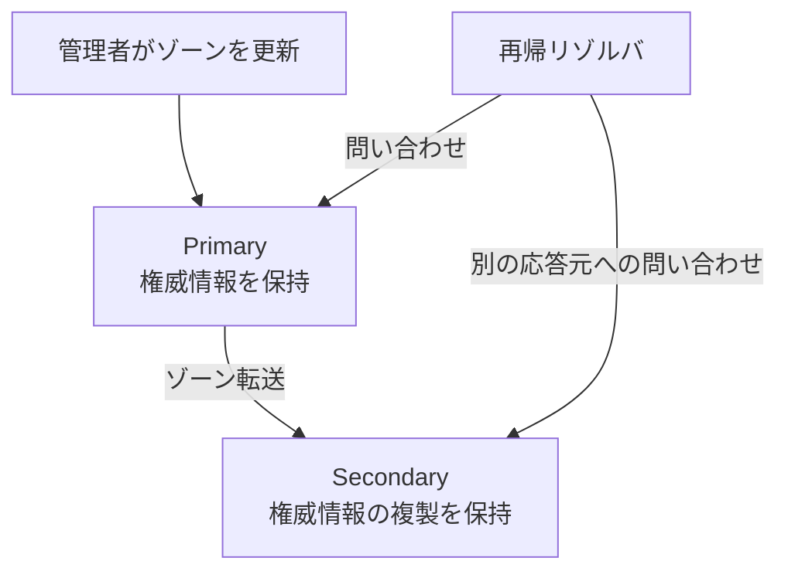

# 第4章 可用性と障害耐性――どの障害でも応答を続けるのか

> 構成の理由と扱う範囲は[この章の設計メモ](../docs/document-design/04-availability.md)に記録します。

## 1. 「止まらない」の対象を決める

利用者が必要としているのは、サーバーの電源が入っていることではありません。必要な名前を調べ、利用できる情報を、待てる時間内に得られることです。応答元が生きていても経路が途切れていれば、その利用者には使えません。応答が返っても、要求した情報を解決できなければ、その要求は成功していません。

そこで可用性を考えるときは、まず成功と失敗の境界を決めます。対象を特定の利用者群からの名前解決とするのか、権威サーバーの問い合わせサービスとするのか、レコードを変更する管理機能とするのかで、数える障害が違います。既存の情報へ答えることと、新しい情報へ更新できることも別です。

許容する時間も必要です。一台が応答しなくなった後、別の応答元を試して成功すればよいのか、その待ち直しも許せないのかを決めます。古い情報を返してもよいか、古い情報なら失敗として返すべきかも要件です。本章では、**想定する失敗と許す劣化を定めてから、複製と配置を評価する**順序を取ります。

たとえば「一台の停止でサービスを失わない」は、一台の停止についての条件です。電源、回線、設定、管理アカウントなどを共有して全台が一緒に影響を受ける場合までは含みません。「高可用」という言葉を、このような失敗条件へ分けることが設計の出発点です。

## 2. 複製は、別の場所でも答えられる状態を作る

第2章では一つのゾーンを複数の権威サーバーで提供できることを見ました。ある応答元が使えなくても、同じゾーンを提供する別の応答元が使えれば、解決を続ける余地があります。ただし、リゾルバが使えない相手を試す時間は残ります。代わりがあることと、利用者が遅延を感じないことは同じではありません。

ここで**Primary**と**Secondary**は、通常、ゾーンのデータを取得する関係を表します。Secondaryはゾーン転送によって情報を取得する権威サーバーで、Primaryはその転送元となる権威サーバーです。名前がPrimaryだから通常の問い合わせを独占し、Secondaryは障害時だけ起動する、という関係ではありません。どちらも保持するゾーンの問い合わせへ応答できます。[RFC 9499: DNS Terminology](https://www.rfc-editor.org/rfc/rfc9499.html) 6節

次の図は、更新の経路と問い合わせの経路を分けています。説明用の構成であり、すべてのサービスがこの形を取るわけではありません。狭い画面では図を横へスクロールできます。

Primaryとの更新経路が止まっても、Secondaryはそれまでに取得した情報を保持しています。そのため、更新できなくなった瞬間に、すべての問い合わせが止まるわけではありません。ただし古いコピーを無期限に権威情報として提供してよいわけでもありません。RFC 1034は、Secondaryが変更を確認する間隔、失敗後の再試行間隔、確認できない状態が続いた場合の期限をSOAの値で扱っています。[RFC 1034: Domain Names—Concepts and Facilities](https://www.rfc-editor.org/rfc/rfc1034.html) 4.3.5節

したがって、「Primaryが停止した」という一文だけでは利用者への影響は決まりません。他の応答元の到達性、最後に取得したデータ、更新できない期間、問い合わせ側の挙動を併せて見ます。

## 3. コピーを配る方法にも、負荷と時間の交換がある

ゾーン全体を転送する方式が**AXFR**です。一部分の変更であっても全体を送るので、仕組みを理解しやすい一方、ゾーンが大きい場合や変更が頻繁な場合には転送量が増えます。AXFRは1987年のRFC 1034/1035にも存在し、2010年のRFC 5936で相互運用に必要な詳細が明確化されました。[RFC 5936: DNS Zone Transfer Protocol (AXFR)](https://www.rfc-editor.org/rfc/rfc5936.html) 概要

変更部分を転送する方式が**IXFR**です。以前の版からの差分を扱うことで、全体を送り直す負荷を減らせます。その代わり、転送元には差分を提供するための情報が必要です。要求された差分を用意できない場合などには、全体を返す場合もあります。IXFRという方式名だけで、毎回必ず少量の転送になるとは限りません。[RFC 1995: Incremental Zone Transfer in DNS](https://www.rfc-editor.org/rfc/rfc1995.html) 1節、2節

そして**NOTIFY**はデータそのものの転送ではなく、変更を知らせて確認を促す仕組みです。Secondaryが次の定期確認まで待つ期間を短くすることを狙います。通知を受けたことと、新しいデータを取得し終えたことは分けて観測します。[RFC 1996: A Mechanism for Prompt Notification of Zone Changes](https://www.rfc-editor.org/rfc/rfc1996.html) 1節

この三つを区別すると、更新の失敗を説明しやすくなります。変更があったことを知らせられなかったのか、確認できなかったのか、転送が失敗したのかでは、調べる場所が違います。複製を置く設計は、応答元を増やすと同時に、コピーの更新を監視する仕事も増やします。

異なる事業者間でゾーンを同期するサービスもあります。Cloudflareの公式資料はPrimaryとSecondaryの両方の構成、およびAXFR/IXFRによる同期を説明しています。ただし、これは当該サービスが提供する構成の資料です。事業者を二つ選んだだけで、利用する全機能や設定方法まで互換になるという根拠にはしません。[Cloudflare DNS: Zone transfers](https://developers.cloudflare.com/dns/zone-setups/zone-transfers/)

## 4. 台数よりも、同時に失うものを調べる

同じ建物、同じ回線、同じ設定配布の仕組みへ依存する二台は、それぞれの故障には強くても、共通の依存先の停止には弱い構成です。このように一つの原因で一緒に影響を受ける範囲を、ここでは**障害ドメイン**と呼びます。複製の数だけでなく、何を共有しているかを調べます。

RFC 2182は、Secondaryの選択で物理的な場所とネットワーク上の配置の両方を考慮する必要を述べています。地理的に遠いだけでも、近いが別の回線というだけでも、想定したすべての障害を分離したことにはなりません。[RFC 2182: Selection and Operation of Secondary DNS Servers](https://www.rfc-editor.org/rfc/rfc2182.html) 3節、4節

共通原因は機器や回線に限りません。正しく動くサーバーへ同じ誤ったデータを配れば、複製は誤りも広めます。すべてを変更できる一つの管理アカウントや、一度に全拠点へ配る設定変更も、影響を共有する経路になります。冗長化の評価には、変更の範囲と戻す手段を含めます。

運用当事者の報告にも、この区別が現れます。Cloudflareは2020年7月17日の障害について、バックボーンのルーター設定の誤りが、そこへ接続する複数の拠点に影響したと報告しています。全拠点が止まったという報告ではありません。この事例から本書が引く論点は、複数の場所に設備があっても、共通の経路や変更を通じて影響が広がるということです。[Cloudflare: Cloudflare outage on July 17, 2020](https://blog.cloudflare.com/cloudflare-outage-on-july-17-2020/)
