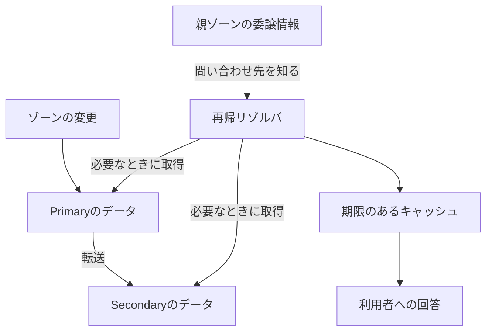

# 第5章 整合性と変更反映――コピーはいつ同じになるのか

レコードを書き換え、管理画面にも新しい値が表示されました。それでも利用者は古い接続先へ向かいます。変更は失敗したのでしょうか。それとも、待てば直るのでしょうか。

この判断には「DNSの反映待ち」では情報が足りません。更新を受け付けた場所、問い合わせた場所、そこで保持している情報の期限を分ける必要があります。本章では、コピーを再利用する利点を残しながら、変更前後の不一致をどう扱うかを考えます。

制作上の責務と構成意図は[文書設計メモ](../docs/document-design/05-consistency.md)に記録しています。

## 1. 何をもって変更完了とするのか

整合性を評価するときは、誰がどの情報を同じものとして読む必要があるかを決めます。権威サーバーが新しいレコードを返すことと、利用者の再帰リゾルバが新しいレコードを返すことは、別の完了条件です。さらに、アプリケーションが既存の接続を使い続けていれば、名前解決の結果が変わっても通信先はすぐには変わりません。最後の部分は本書の運用上の整理であり、レコードのTTLだけでは評価できない範囲です。

第3章で見たキャッシュは、毎回権威サーバーへ問い合わせないための仕組みでした。新しい変更を常に確認してから回答するなら、その利点は小さくなります。RFC 1034の設計では、情報を一定期間保持して使うことと、更新が各所に同時には見えないことが結び付いています。[RFC 1034: Domain Names—Concepts and Facilities 2.3・3.6節](https://www.rfc-editor.org/rfc/rfc1034.html)

本章では「管理側で受理された」「各権威サーバーで確認した」「指定した再帰リゾルバで確認した」を分けて記録します。「全員に反映された」は、これらの観測だけからは言いません。

## 2. 一つの伝播ではなく、異なる経路がある

ゾーンの変更では、まず権威データの更新があります。PrimaryからSecondaryへ転送する構成なら、次に複製の更新があります。その先に、再帰リゾルバが保持するキャッシュがあります。NOTIFYはSecondaryが変更を確認するきっかけを早めますが、利用者側のキャッシュを一斉に消去する通知ではありません。[RFC 1996: DNS NOTIFY 2・3節](https://www.rfc-editor.org/rfc/rfc1996.html)

権威サービスの事業者を替える場合は、親ゾーンの委譲情報も関わります。古い委譲先を記憶しているリゾルバは、移行前のサーバーへ問い合わせる可能性があります。新しい事業者のゾーンにだけ正しいデータを置いても、その経路からは読まれません。[RFC 1034 4.2節](https://www.rfc-editor.org/rfc/rfc1034.html)

次の図は、別々に進む更新と参照を分けています。矢印全体を一つの「伝播速度」として測ると、どこが遅れているかを見失います。狭い画面では図を横へスクロールできます。

## 3. Serialは版、TTLは再利用期間

SOA（Start of Authority）レコードのSerialは、ゾーンの版を比較するための値です。Secondaryが更新の必要性を判断する際に使います。一方、TTL（Time to Live）は取得した情報を再利用する期間に関わります。Serialを増やしても、すでに情報を持つ再帰リゾルバへ変更が配信されるわけではありません。[RFC 1035: Domain Names—Implementation and Specification 3.3.13節](https://www.rfc-editor.org/rfc/rfc1035.html)

Serialは32ビットの値で、通常の無制限な整数と同じ比較はできません。RFC 1982は周回を含む比較規則を定め、一部の差では順序を定義しません。日付に見える値も、更新時刻そのものの保証にはなりません。古いファイルへ切り戻すときも、内容と版を分けて考え、複製側が新しい版として認識できるSerialを付けます。[RFC 1982: Serial Number Arithmetic 2〜4節](https://www.rfc-editor.org/rfc/rfc1982.html)

TTLを短くすれば、通常のキャッシュ利用で古い回答を保持できる期間は短くなります。その代わり、再取得が増えて権威側の負荷や上流障害への依存が増えます。しかも、新しいTTLはこれから取得する回答に載る値です。すでに長いTTLで取得されたコピーを、その場で短くする操作ではありません。[RFC 1034 3.6節](https://www.rfc-editor.org/rfc/rfc1034.html)

存在する情報だけが残るわけでもありません。RFC 2308の不在応答のキャッシュでは、SOAのTTLとMINIMUMフィールドの小さい方を使って期限を定めます。新しい名前を追加しても、直前にその不在を取得した側からは、しばらく利用できないことがあります。[RFC 2308: Negative Caching of DNS Queries 3・5節](https://www.rfc-editor.org/rfc/rfc2308.html)

## 4. 更新の原子性と、全員に見えることは別

RFC 2136は、ゾーンのレコードを追加・削除する動的更新を規定しています。1997年の文書は、従来のマスターファイルの外部編集を背景に、前提条件付きの更新を導入しました。前提条件が満たされなければ更新を行わない、という原子性を定めています。[RFC 2136: Dynamic Updates in the Domain Name System (DNS UPDATE) 概要・3節](https://www.rfc-editor.org/rfc/rfc2136.html)

ここでの原子性は、すべての再帰リゾルバが同時に新しい値へ切り替わる保証ではありません。更新の受理と、複製やキャッシュを経た観測は分けて扱います。本書ではこれを、書き込み側の保証を読み取り側全体へ広げないための境界として捉えます。更新要求の認証・認可も必要ですが、その具体的な保護は第6章で扱います。
