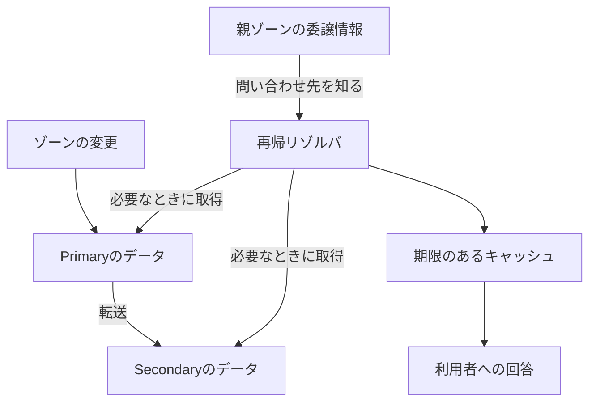

# 第5章 整合性と変更反映――コピーはいつ同じになるのか

レコードを書き換え、管理画面にも新しい値が表示されました。それでも利用者は古い接続先へ向かいます。変更は失敗したのでしょうか。それとも、待てば直るのでしょうか。

この判断には「DNSの反映待ち」では情報が足りません。更新を受け付けた場所、問い合わせた場所、そこで保持している情報の期限を分ける必要があります。本章では、コピーを再利用する利点を残しながら、変更前後の不一致をどう扱うかを考えます。

制作上の責務と構成意図は[文書設計メモ](../docs/document-design/05-consistency.md)に記録しています。

## 1. 何をもって変更完了とするのか

整合性を評価するときは、誰がどの情報を同じものとして読む必要があるかを決めます。権威サーバーが新しいレコードを返すことと、利用者の再帰リゾルバが新しいレコードを返すことは、別の完了条件です。さらに、アプリケーションが既存の接続を使い続けていれば、名前解決の結果が変わっても通信先はすぐには変わりません。最後の部分は本書の運用上の整理であり、レコードのTTLだけでは評価できない範囲です。

第3章で見たキャッシュは、毎回権威サーバーへ問い合わせないための仕組みでした。新しい変更を常に確認してから回答するなら、その利点は小さくなります。RFC 1034の設計では、情報を一定期間保持して使うことと、更新が各所に同時には見えないことが結び付いています。[RFC 1034: Domain Names—Concepts and Facilities 2.3・3.6節](https://www.rfc-editor.org/rfc/rfc1034.html)

本章では「管理側で受理された」「各権威サーバーで確認した」「指定した再帰リゾルバで確認した」を分けて記録します。「全員に反映された」は、これらの観測だけからは言いません。

## 2. 一つの伝播ではなく、異なる経路がある

ゾーンの変更では、まず権威データの更新があります。PrimaryからSecondaryへ転送する構成なら、次に複製の更新があります。その先に、再帰リゾルバが保持するキャッシュがあります。NOTIFYはSecondaryが変更を確認するきっかけを早めますが、利用者側のキャッシュを一斉に消去する通知ではありません。[RFC 1996: DNS NOTIFY 2・3節](https://www.rfc-editor.org/rfc/rfc1996.html)

権威サービスの事業者を替える場合は、親ゾーンの委譲情報も関わります。古い委譲先を記憶しているリゾルバは、移行前のサーバーへ問い合わせる可能性があります。新しい事業者のゾーンにだけ正しいデータを置いても、その経路からは読まれません。[RFC 1034 4.2節](https://www.rfc-editor.org/rfc/rfc1034.html)

次の図は、別々に進む更新と参照を分けています。矢印全体を一つの「伝播速度」として測ると、どこが遅れているかを見失います。狭い画面では図を横へスクロールできます。



## 3. Serialは版、TTLは再利用期間

SOA（Start of Authority）レコードのSerialは、ゾーンの版を比較するための値です。Secondaryが更新の必要性を判断する際に使います。一方、TTL（Time to Live）は取得した情報を再利用する期間に関わります。Serialを増やしても、すでに情報を持つ再帰リゾルバへ変更が配信されるわけではありません。[RFC 1035: Domain Names—Implementation and Specification 3.3.13節](https://www.rfc-editor.org/rfc/rfc1035.html)

Serialは32ビットの値で、通常の無制限な整数と同じ比較はできません。RFC 1982は周回を含む比較規則を定め、一部の差では順序を定義しません。日付に見える値も、更新時刻そのものの保証にはなりません。古いファイルへ切り戻すときも、内容と版を分けて考え、複製側が新しい版として認識できるSerialを付けます。[RFC 1982: Serial Number Arithmetic 2〜4節](https://www.rfc-editor.org/rfc/rfc1982.html)

TTLを短くすれば、通常のキャッシュ利用で古い回答を保持できる期間は短くなります。その代わり、再取得が増えて権威側の負荷や上流障害への依存が増えます。しかも、新しいTTLはこれから取得する回答に載る値です。すでに長いTTLで取得されたコピーを、その場で短くする操作ではありません。[RFC 1034 3.6節](https://www.rfc-editor.org/rfc/rfc1034.html)

存在する情報だけが残るわけでもありません。RFC 2308の不在応答のキャッシュでは、SOAのTTLとMINIMUMフィールドの小さい方を使って期限を定めます。新しい名前を追加しても、直前にその不在を取得した側からは、しばらく利用できないことがあります。[RFC 2308: Negative Caching of DNS Queries 3・5節](https://www.rfc-editor.org/rfc/rfc2308.html)

## 4. 更新の原子性と、全員に見えることは別

RFC 2136は、ゾーンのレコードを追加・削除する動的更新を規定しています。1997年の文書は、従来のマスターファイルの外部編集を背景に、前提条件付きの更新を導入しました。前提条件が満たされなければ更新を行わない、という原子性を定めています。[RFC 2136: Dynamic Updates in the Domain Name System (DNS UPDATE) 概要・3節](https://www.rfc-editor.org/rfc/rfc2136.html)

ここでの原子性は、すべての再帰リゾルバが同時に新しい値へ切り替わる保証ではありません。更新の受理と、複製やキャッシュを経た観測は分けて扱います。本書ではこれを、書き込み側の保証を読み取り側全体へ広げないための境界として捉えます。更新要求の認証・認可も必要ですが、その具体的な保護は第6章で扱います。

## 5. 権威側を変え、キャッシュ側を観測する

2026年11月20日21時10分（日本標準時）、Windows上のループバックだけを使い、CoreDNS 1.15.0で実験しました。権威側を`127.0.0.1:15354`、キャッシュ側を`127.0.0.1:15353`で待ち受け、外部への転送は設定していません。キャッシュ側はこの権威側だけを参照します。OSの名前解決設定も変更していません。

権威側には`lab.test`を読み込ませ、Serialが変わったかを1秒間隔で確認する`file`プラグインを使いました。キャッシュ側には`cache 300`と`forward`を設定しました。この300は保持期間の上限であり、20秒のTTLを300秒に延長する指定ではありません。[CoreDNS: file](https://coredns.io/plugins/file/)、[cache](https://coredns.io/plugins/cache/)、[forward](https://coredns.io/plugins/forward/)

最初は`app.lab.test`のAレコードを`192.0.2.1`、TTLを20秒とし、`new.lab.test`は存在させませんでした。両方をキャッシュ側へ問い合わせた後、Serialを1から2へ進め、`app`を`192.0.2.2`、TTLを5秒へ変更し、`new`に`192.0.2.3`を追加しました。SOAのTTLとMINIMUMは20秒のままです。次の表は実測値で、アドレスは説明用の範囲を使っています。

| 時刻（日本標準時） | 問い合わせ先・操作 | 観測した結果 |
| --- | --- | --- |
| 21:10:28.428 | キャッシュへ`app` | `192.0.2.1`、TTL 20 |
| 21:10:28.432 | キャッシュへ`new` | クライアントが`ENOTFOUND`を報告 |
| 21:10:28.434 | ゾーンファイルを変更 | Serial 2、`app`変更、`new`追加 |
| 21:10:29.408 | 権威側へ`app` | `192.0.2.2`、TTL 5 |
| 21:10:29.409 | キャッシュへ`app` | `192.0.2.1`、TTL 20 |
| 21:10:29.410 | 権威側へ`new` | `192.0.2.3`、TTL 5 |
| 21:10:29.411 | キャッシュへ`new` | 引き続き`ENOTFOUND` |
| 21:10:50.441 | キャッシュへ`app` | `192.0.2.2`、TTL 5 |
| 21:10:50.443 | キャッシュへ`new` | `192.0.2.3`、TTL 5 |

権威側の変更を確認した直後でも、キャッシュ側には古いアドレスと不在の回答が残りました。最初の取得から約22秒後には、両方とも新しい値を得ました。約1秒後と約22秒後の標本なので、切り替わった瞬間を測定したとは言えません。また、2回目の`app`の取得は最初から約0.98秒後であり、整数のTTLは20のまま記録されています。見やすさのために19へ補正することはしていません。

以下の図は観測の前後関係です。横幅が足りない場合はスクロールできます。

<div class="time-figure">
<svg viewBox="0 0 680 330" width="100%" role="img" aria-label="変更直後は権威側だけが新しく、キャッシュ側は古い回答を保持し、約22秒後の再問い合わせで新しい回答を取得した">
  <rect width="680" height="330" fill="#f6f8fa"/>
  <g font-family="sans-serif" font-size="16" fill="#24292f">
    <text x="20" y="30">時刻</text><text x="220" y="30">権威側</text><text x="440" y="30">キャッシュ側</text>
    <path d="M180 50V300 M410 50V300" stroke="#8c959f"/>
    <text x="20" y="80">21:10:28</text><text x="220" y="80">旧アドレス／不在</text><text x="440" y="80">旧アドレス／不在を取得</text>
    <text x="20" y="140">ファイル変更</text><text x="220" y="140">Serialを更新</text><text x="440" y="140">変更通知は届かない</text>
    <text x="20" y="200">21:10:29</text><text x="220" y="200">新アドレス／追加済み</text><text x="440" y="200">旧アドレス／不在が残る</text>
    <text x="20" y="270">21:10:50</text><text x="220" y="270">新アドレス／追加済み</text><text x="440" y="270">再取得で新しい回答</text>
  </g>
</svg>
</div>

再現には、[公式リリース](https://github.com/coredns/coredns/releases/tag/v1.15.0)のチェックサムで確認した実行ファイルとNode.jsを使います。今回のNode.jsはv22.20.0です。リポジトリのルートで次を実行すると、専用プロセスを起動し、観測後に終了します。ポート15353と15354が空いている環境で実行します。

```powershell
node scripts/observe_change.cjs <CoreDNS実行ファイルのパス> .review/change-rerun.json
```

[設定・ゾーン内容・全観測の記録](../references/observations/change-2026-11-20.json)と[実行スクリプト](https://github.com/crg-docs/dns-design-tradeoffs/blob/main/scripts/observe_change.cjs)を公開しています。`ENOTFOUND`はNode.jsのクライアントが返した状態であり、パケットを採取して応答コードを直接表示したものではありません。

この実験が示すのは、一つのキャッシュで更新前の情報が残る挙動です。Secondaryへの転送、親の委譲変更、署名の検証、期限切れ情報の提供は測っていません。Serve Staleなどを使う構成もあるため、この20秒を一般の環境の上限へ読み替えることはできません。[RFC 8767: Serving Stale Data to Improve DNS Resiliency](https://www.rfc-editor.org/rfc/rfc8767.html)

## 6. 変更当日より前にできること

ここからは仕様と観測を踏まえた、本書の運用上の整理です。変更を急ぐほど、変更前の状態を知る必要があります。旧TTLが長ければ、まずTTLだけを短くし、各権威サーバーでその値を確認してから、旧TTLで取得したコピーが残り得る期間を見込みます。その後に接続先を変えることで、変更直前に取得される回答の保持期間を短くできます。

事前短縮には費用があります。問い合わせが増え、上流へ到達できない状況では再取得の失敗が表に出やすくなります。切替の速さだけでなく、権威側の容量と障害時の振る舞いも確認します。短いTTLを恒久的に設定するか、移行時だけ使うかも別の判断です。

存在しなかった名前の追加では、AレコードのTTLだけを見ても不十分です。不在応答の保持期間と、追加前に問い合わせられた可能性を考えます。予約した名前を早めに有効な構成で用意できるか、利用開始までの時間を確保できるかを検討します。

## 7. 事業者の移行と切り戻しを分けて準備する

権威サービスを替えるなら、新しい側が同じ必要データを返せることを、委譲を変える前に確認します。移行中は古い委譲先への問い合わせも想定し、旧サービスをいつまで残すかを決めます。対象レコードのTTLだけでなく、委譲情報や権威サーバーのアドレスに関わる情報も確認対象です。署名付きゾーンでは親のDSなども関わるため、通常のレコード移行と同じ手順だとは扱いません。

切り戻しも新しい変更です。旧アドレスへ戻しても、途中の新アドレスを取得したキャッシュが残ります。旧サービスだけを復活させれば全員が直ちに戻る、とは考えません。どちらの接続先へ向かう利用者にも対応できる期間と、アプリケーションの接続の扱いを含めて準備します。

反映の確認では、権威サーバーを指定した応答と、利用者が使う再帰リゾルバを指定した応答を別々に採取します。時刻、問い合わせ名・型、サーバー、値、TTL、必要に応じてSerialを残せば、同じ「古い回答」でも複製が遅いのか、期限内のキャッシュなのかを切り分けやすくなります。全地点で一致したと主張する代わりに、確認した範囲を明示します。

## 8. 他のシステムへ持ち帰る

読み取り用の複製やキャッシュがあるシステムでも、書き込みの成功と、各読者から見える状態は別の条件になり得ます。本章から持ち帰れるのは、更新経路、版の比較、再利用期限、無効化手段を分けて設計する考え方です。

ただし、すべてのキャッシュがDNSと同じではありません。管理下のクライアントへ無効化通知を配れるシステムも、読み取りのたびに版を検証するシステムもあります。そうした手段があるなら、その到達性や失敗時の規則も評価します。「キャッシュだから反映を待つしかない」と一般化せず、誰のコピーをどこまで制御できるかを確認するのが、この章の応用です。

## この章の言い換え

| 前 | 後 |
| --- | --- |
| 「DNSの反映待ちです」 | 「権威側は更新済みですが、この再帰リゾルバには旧TTLで取得した回答が残っています」 |
| 「DNSのTTLを短くしたので、すぐ切り替わります」 | 「新しく取得する回答の保持期間は短くなりますが、取得済みのコピーの期限は変わりません」 |
| 「DNSを戻せば復旧します」 | 「切り戻し後も途中の接続先がキャッシュに残るため、両方へ向かう利用者への対応を確認します」 |

## 参照資料

- [RFC 1034: Domain Names—Concepts and Facilities](https://www.rfc-editor.org/rfc/rfc1034.html) 2.3・3.6・4.2節
- [RFC 1035: Domain Names—Implementation and Specification](https://www.rfc-editor.org/rfc/rfc1035.html) 3.3.13節
- [RFC 1982: Serial Number Arithmetic](https://www.rfc-editor.org/rfc/rfc1982.html) 2〜4節
- [RFC 1996: A Mechanism for Prompt Notification of Zone Changes (DNS NOTIFY)](https://www.rfc-editor.org/rfc/rfc1996.html) 2・3節
- [RFC 2136: Dynamic Updates in the Domain Name System (DNS UPDATE)](https://www.rfc-editor.org/rfc/rfc2136.html) 概要・3節
- [RFC 2308: Negative Caching of DNS Queries (DNS NCACHE)](https://www.rfc-editor.org/rfc/rfc2308.html) 3・5節
- [RFC 8767: Serving Stale Data to Improve DNS Resiliency](https://www.rfc-editor.org/rfc/rfc8767.html)
- CoreDNS公式資料: [file](https://coredns.io/plugins/file/)、[cache](https://coredns.io/plugins/cache/)、[forward](https://coredns.io/plugins/forward/)、[v1.15.0リリース](https://github.com/coredns/coredns/releases/tag/v1.15.0)

---

[← 第4章 可用性と障害耐性](04-availability.md)｜[目次](../)｜[第6章 セキュリティ →](06-security.md)


