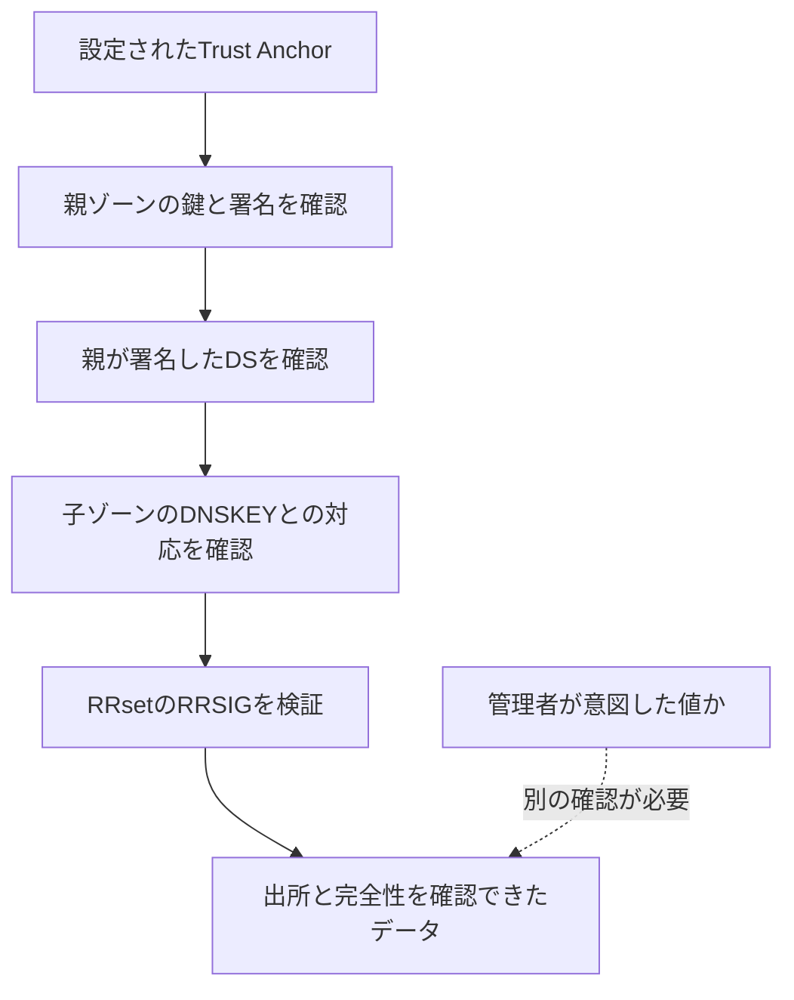

# 第6章 セキュリティ――何を、誰から守るのか

応答が速く、止まらず、更新も行き渡る。それでも、その応答が攻撃者の指定した接続先なら、ここまでの改善は誤った情報を効率よく配る仕組みになってしまいます。

ただし「DNSを安全にする」という一つの設定はありません。偽の回答を受け入れないこと、管理者以外に書き換えさせないこと、通信内容を見せないこと、サービスを攻撃の踏み台にしないことは、異なる要件です。本章は最初の二つと資源の保護を扱い、通信内容の開示は第7章へつなぎます。

## 1. 守る対象と攻撃者の位置を決める

例えば、通信経路を見ることのできない攻撃者が、再帰リゾルバへ偽の応答を送り込む場合があります。一方で、管理用アカウントを奪って正規の更新経路からレコードを変える場合もあります。後者のデータに正規の署名が付けば、署名だけで管理者の意図との違いは見抜けません。RFC 3833は、応答の偽造、データの改変、サービス妨害などを異なる脅威として整理しています。[RFC 3833: Threat Analysis of the Domain Name System (DNS) 2節](https://www.rfc-editor.org/rfc/rfc3833.html)

本書では、保護対象を回答データ、更新権限、サービスの処理資源に分けます。さらに攻撃者が経路を観測できるのか、管理権限を持つのかを明示します。同じ「偽造を防ぐ」でも、推測を難しくする対策と暗号学的にデータを検証する対策では、前提が違います。

## 2. 回答を受け入れる入口を狭くする

キャッシュポイズニングは、誤ったデータがキャッシュへ入り、後続の利用者にも使われる問題です。再利用期間が長ければ、その影響も残り得ます。第3章で性能を改善した再利用が、ここでは誤情報の寿命に関わります。

RFC 5452は、応答が実際の問い合わせに対応するかを、問い合わせ名・型・クラス、トランザクションID、アドレスやポートなどで照合することを求めています。IDと送信元ポートの予測を難しくする対策は、経路外から正しい組み合わせを当てる攻撃を難しくします。しかし問い合わせを観測できる攻撃者に対して、データの出所を保証するものではありません。[RFC 5452: Measures for Making DNS More Resilient against Forged Answers 9節](https://www.rfc-editor.org/rfc/rfc5452.html)

Bailiwickという語も見かけますが、RFC 9499はゾーンとその名前サーバーの名前の関係を表す歴史的な用語として扱い、語の意味による混乱に注意しています。この語だけで、キャッシュへ受け入れる全規則を説明したことにはなりません。RFC 2181は取得元によるデータの信頼度を区別しています。本章では、応答に含まれる情報をすべて同じ信用で採用するのではなく、「誰の情報として採用してよいか」を判断することと、署名による認証を分けます。[RFC 9499: DNS Terminology 7節](https://www.rfc-editor.org/rfc/rfc9499.html)、[RFC 2181: Clarifications to the DNS Specification 5.4.1節](https://www.rfc-editor.org/rfc/rfc2181.html)

## 3. DNSSECはデータの出所と完全性を検証する

DNS Security Extensions（DNSSEC）は、データの出所の認証と完全性を提供する拡張です。通信内容の暗号化や、問い合わせ元へのアクセス制御、サービス妨害への耐性を提供する仕組みではありません。2005年のRFC 4033〜4035は、それ以前の仕様を置き換えた文書群であり、2005年を最初の着想や全体への普及の年とはしません。[RFC 4033: DNS Security Introduction and Requirements 概要・4節](https://www.rfc-editor.org/rfc/rfc4033.html)

基本となるのは、レコードの集合であるRRsetに対する署名です。RRSIGが署名を、DNSKEYが公開鍵を表します。親ゾーンのDS（Delegation Signer）は子の鍵に関係する情報を保持し、検証のつながりを作ります。鍵が応答に含まれるだけでは信用できないため、検証者が信頼の起点として設定したTrust Anchorから確認していきます。[RFC 4034: Resource Records for the DNS Security Extensions 2・3・5節](https://www.rfc-editor.org/rfc/rfc4034.html)、[RFC 4035: Protocol Modifications for the DNS Security Extensions 5節](https://www.rfc-editor.org/rfc/rfc4035.html)

次の図は検証の依存関係です。実際の問い合わせ順を示すものではありません。狭い画面では横へスクロールできます。

この連鎖が保護するのは、署名された情報を途中で差し替えられていないかという点です。正規の更新権限を使って誤った値を登録した場合まで、正しいサービスの接続先だと保証するものではありません。これは署名の機能から導く、本書の適用範囲の整理です。

## 4. 検証できない理由を一つにまとめない

検証者から見た状態は、次のように分かれます。[RFC 4033 5節](https://www.rfc-editor.org/rfc/rfc4033.html)

| 状態 | 検証者が判断できること |
| --- | --- |
| Secure | 信頼の起点からの連鎖と必要な署名を検証できた |
| Insecure | 署名による保護がないと判断できる |
| Bogus | 保護されるはずなのに検証が成立しない |
| Indeterminate | その領域が保護されると判断する信頼の起点を持たない |

「署名がない」と「署名の検証に失敗した」は同じ状態ではありません。検証途中で必要な情報を取得できない場合を、すべてIndeterminateと呼ぶわけでもありません。

特に、通常のDNSSEC検証と「対象の回答は必ずSecureでなければ使わない」という利用側の方針は異なります。検証するリゾルバでも、Insecureと判断したデータを返せます。逆に、保護されるはずのデータで署名が欠けているなら、単なる未署名として受け入れる理由にはなりません。検証をリゾルバへ任せ、検証を省略させない問い合わせでBogusになった場合は、解決失敗を示すSERVFAILを返す扱いです。[RFC 4035 4.3・5.5節](https://www.rfc-editor.org/rfc/rfc4035.html)

例えば、公開名を広く解決する用途と、管理下の特定名に署名による認証を必須とする用途では、成功の条件が違います。後者では、未署名でも回答を得られたことを成功に含められません。これは本書の方針比較です。保護のない回答を許す範囲と、検証失敗時に止める範囲を分け、名前解決の成功率にもその違いを反映します。

署名を検証する再帰リゾルバへ処理を任せる場合、その結果を端末へどう伝えるかも境界になります。応答のAD（Authenticated Data）ビットは検証結果に関わる通知ですが、信頼できない経路で受け取ったビットだけを安全性の根拠にはできません。端末自身で検証するか、委ねるリゾルバと通信経路を信頼できる条件にする必要があります。ADの取り扱いはRFC 4035に加え、RFC 6840で明確化されています。[RFC 4035 4.9.3節](https://www.rfc-editor.org/rfc/rfc4035.html)、[RFC 6840: Clarifications and Implementation Notes for DNS Security (DNSSEC) 5.7・5.8節](https://www.rfc-editor.org/rfc/rfc6840.html)

検証を必須にする経路では、署名の期限切れや親子の鍵情報の不整合が、利用者にとって名前解決の失敗になります。偽造を受け入れない効果と、署名運用の失敗でも応答を利用できなくなる代償が対になっています。失敗を見たら検証を無効にする、という運用では、保護したかった要件を失います。署名、鍵、時刻、親の情報のどこで連鎖が切れたかを調べる準備が必要です。[RFC 6781: DNSSEC Operational Practices, Version 2 4節](https://www.rfc-editor.org/rfc/rfc6781.html)

## 5. 正規の更新経路にも境界を置く

DNSSECの署名鍵があっても、管理用アカウントの権限設計は省略できません。誰がどの名前・型を変更できるか、誰が委譲や鍵を変更できるかを分けます。これは本書の運用上の提案です。サービスの管理画面やAPIの権限は、問い合わせプロトコルの仕様とは別に確認します。

Transaction Signature（TSIG）は、共有秘密を使ってDNSの取引単位の認証を行う仕組みです。動的更新や転送などで相手とメッセージを認証する用途があります。RFC 8945は旧RFC 2845と4635を置き換えています。秘密の配布方法は別途用意する前提であり、データを暗号化するものではありません。[RFC 8945: Secret Key Transaction Authentication for DNS (TSIG) 概要・1節](https://www.rfc-editor.org/rfc/rfc8945.html)

相手を認証できても、すべての変更を許可してよいとは限りません。認証された主体に与える更新範囲と転送先の制限を決め、鍵の保管、失効、交換の担当を用意します。共有鍵を広く配れば、運用は簡単になる反面、漏えい時に止める範囲も広がります。

## 6. 公開する回答と、公開しない再帰処理

権威サーバーが公開ゾーンの問い合わせに答えることと、再帰リゾルバが誰のために上流へ問い合わせるかは別です。送信元を偽装した要求に対し、被害者へ応答を送らせるのが反射です。要求より大きな応答が返れば、送信量の増幅にもつながります。RFC 5358は、この悪用を減らすため、再帰サービスを意図した利用者へ限定する設定を推奨しています。[RFC 5358: Preventing Use of Recursive Nameservers in Reflector Attacks 3・4節](https://www.rfc-editor.org/rfc/rfc5358.html)

公開の権威サービスでも、応答量の制御が検討対象になります。BINDのResponse Rate Limiting（RRL）は、似たUDP応答の過剰送信を抑える実装例です。ただし制限の単位や設定次第で正当な問い合わせにも影響するため、単に上限を低くするほどよいわけではありません。製品固有の機能と、すべてのサーバーが従う標準仕様を区別します。[BIND 9.20.16: rate-limit](https://bind9.readthedocs.io/en/v9.20.16/reference.html#namedconf-statement-rate-limit)

## 7. 対策を維持できるかまで評価する

第3章のTTLと、署名を使って検証できる期間は別です。TTLを長くしても署名の有効期間は延びません。アドレスを変更しないゾーンでも、有効な署名を提供し続ける保守が必要になります。[RFC 4033 8.1・8.2節](https://www.rfc-editor.org/rfc/rfc4033.html)

さらに、検証者が認証済みのRRsetをキャッシュするときのTTLは、RRsetと署名のTTL、署名にある元のTTL、署名の残り有効時間の最小値以下に制限されます。「TTLはまだ残るから、署名が切れても認証済みとして使える」とは判断できません。第4章の期限切れデータによる応答継続でも、署名検証を通る保証が自動で付くわけではありません。[RFC 4035 5.3.3節](https://www.rfc-editor.org/rfc/rfc4035.html)

ここから本書が引く設計上の判断は、応答元の複製と署名の保守を一組で評価することです。複製が同じ期限の署名を返しているなら、台数を増やしてもその期限切れを回避できません。応答が返るかだけでなく、利用者が必要とする検証を通るかまでを可用性の条件に含めます。

本章の運用上の整理では、導入時の成功だけでなく、保護が維持される条件を確認します。署名付き応答を一度取得できても、署名更新や鍵の交換が将来成功するとは限りません。親子の鍵情報、署名の有効期間、検証失敗の増加を観測し、変更時に担当者がどの順序で確認するかを決めます。鍵の交換には、古い情報がキャッシュに残る期間も関係します。[RFC 6781 4.1節](https://www.rfc-editor.org/rfc/rfc6781.html)

一方、公開性を優先して制限を緩めれば悪用の余地が増え、厳しくすれば正当な利用を妨げる可能性があります。評価対象を「対策を有効にしたか」から、偽造の受け入れ、権限外の変更、検証失敗、正当な応答の欠落へ移します。本章では攻撃や負荷の再現実験は行っていないため、特定の構成で防御が成功したという実測結果は示しません。

## 8. 他のシステムへ持ち帰る

署名された設定ファイルや配布パッケージでも、署名者を信頼できることと、内容が利用目的に適切であることは別です。認証された操作にも権限の範囲が必要で、検証を強制するなら鍵の更新失敗もサービス設計へ入ります。これは本章の設計上の類推です。

ただし、DNSSECの親子関係やキャッシュ期限を、そのまま別の認証基盤へ移せるわけではありません。持ち帰るのは、信頼の起点、検証の終点、失敗時の扱い、管理権限を図にして別々に評価する方法です。

## この章のポイント

- DNSSECはデータの出所と完全性を検証する仕組みで、問い合わせ内容を秘匿するものではありません。
- 署名を検証できても、登録値が管理者の意図どおりかは別の確認が必要です。
- 相手の認証、変更を許す範囲、再帰処理を提供する範囲は、それぞれ分けて設計します。

## 参照資料

- [RFC 3833: Threat Analysis of the Domain Name System (DNS)](https://www.rfc-editor.org/rfc/rfc3833.html) 2節
- [RFC 5452: Measures for Making DNS More Resilient against Forged Answers](https://www.rfc-editor.org/rfc/rfc5452.html) 9節
- [RFC 9499: DNS Terminology](https://www.rfc-editor.org/rfc/rfc9499.html) Bailiwick
- [RFC 2181: Clarifications to the DNS Specification](https://www.rfc-editor.org/rfc/rfc2181.html) 5.4.1節
- [RFC 4033: DNS Security Introduction and Requirements](https://www.rfc-editor.org/rfc/rfc4033.html) 4・5・8節
- [RFC 4034: Resource Records for the DNS Security Extensions](https://www.rfc-editor.org/rfc/rfc4034.html) 2・3・5節
- [RFC 4035: Protocol Modifications for the DNS Security Extensions](https://www.rfc-editor.org/rfc/rfc4035.html) 4.3・4.9.3・5.3.3・5.5節
- [RFC 6840: Clarifications and Implementation Notes for DNS Security (DNSSEC)](https://www.rfc-editor.org/rfc/rfc6840.html) 5.7・5.8節
- [RFC 6781: DNSSEC Operational Practices, Version 2](https://www.rfc-editor.org/rfc/rfc6781.html) 4節
- [RFC 8945: Secret Key Transaction Authentication for DNS (TSIG)](https://www.rfc-editor.org/rfc/rfc8945.html)
- [RFC 5358: Preventing Use of Recursive Nameservers in Reflector Attacks](https://www.rfc-editor.org/rfc/rfc5358.html) 3・4節
- [BIND 9.20.16: rate-limit](https://bind9.readthedocs.io/en/v9.20.16/reference.html#namedconf-statement-rate-limit)

本文の構成と範囲: [文書設計メモ](../docs/document-design/06-security.md)

---

[← 第5章 整合性と変更反映](05-consistency.md)｜[目次](../)｜[第7章 プライバシー →](07-privacy.md)


