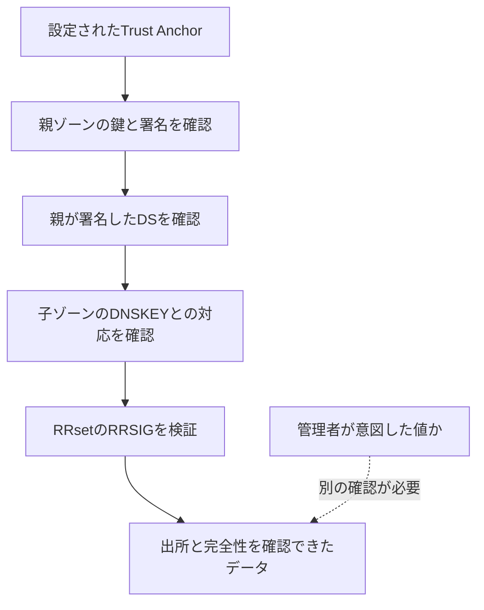

# 第6章 セキュリティ――何を、誰から守るのか

応答が速く、止まらず、更新も行き渡る。それでも、その応答が攻撃者の指定した接続先なら、ここまでの改善は誤った情報を効率よく配る仕組みになってしまいます。

ただし「DNSを安全にする」という一つの設定はありません。偽の回答を受け入れないこと、管理者以外に書き換えさせないこと、通信内容を見せないこと、サービスを攻撃の踏み台にしないことは、異なる要件です。本章は最初の二つと資源の保護を扱い、通信内容の開示は第7章へつなぎます。

制作上の責務は[文書設計メモ](../docs/document-design/06-security.md)に記録しています。

## 1. 守る対象と攻撃者の位置を決める

例えば、通信経路を見ることのできない攻撃者が、再帰リゾルバへ偽の応答を送り込む場合があります。一方で、管理用アカウントを奪って正規の更新経路からレコードを変える場合もあります。後者のデータに正規の署名が付けば、署名だけで管理者の意図との違いは見抜けません。RFC 3833は、応答の偽造、データの改変、サービス妨害などを異なる脅威として整理しています。[RFC 3833: Threat Analysis of the Domain Name System (DNS) 2節](https://www.rfc-editor.org/rfc/rfc3833.html)

本書では、保護対象を回答データ、更新権限、サービスの処理資源に分けます。さらに攻撃者が経路を観測できるのか、管理権限を持つのかを明示します。同じ「偽造を防ぐ」でも、推測を難しくする対策と暗号学的にデータを検証する対策では、前提が違います。

## 2. 回答を受け入れる入口を狭くする

キャッシュポイズニングは、誤ったデータがキャッシュへ入り、後続の利用者にも使われる問題です。再利用期間が長ければ、その影響も残り得ます。第3章で性能を改善した再利用が、ここでは誤情報の寿命に関わります。

RFC 5452は、応答が実際の問い合わせに対応するかを、問い合わせ名・型・クラス、トランザクションID、アドレスやポートなどで照合することを求めています。IDと送信元ポートの予測を難しくする対策は、経路外から正しい組み合わせを当てる攻撃を難しくします。しかし問い合わせを観測できる攻撃者に対して、データの出所を保証するものではありません。[RFC 5452: Measures for Making DNS More Resilient against Forged Answers 9節](https://www.rfc-editor.org/rfc/rfc5452.html)

Bailiwickは、どの名前がその権威の範囲にあるかを考えるための用語です。応答に含まれているというだけで、無関係な名前の情報まで同じ信用で採用してはいけません。受け入れる範囲を制限する判断と、署名による認証を分けて考えます。用語の定義と実装ごとの詳細規則を同一視せず、本章では「誰の情報として採用してよいか」という境界を扱います。[RFC 9499: DNS Terminology 6節](https://www.rfc-editor.org/rfc/rfc9499.html)

## 3. DNSSECはデータの出所と完全性を検証する

DNS Security Extensions（DNSSEC）は、データの出所の認証と完全性を提供する拡張です。通信内容の暗号化や、問い合わせ元へのアクセス制御、サービス妨害への耐性を提供する仕組みではありません。2005年のRFC 4033〜4035は、それ以前の仕様を置き換えた文書群であり、2005年を最初の着想や全体への普及の年とはしません。[RFC 4033: DNS Security Introduction and Requirements 概要・4節](https://www.rfc-editor.org/rfc/rfc4033.html)

基本となるのは、レコードの集合であるRRsetに対する署名です。RRSIGが署名を、DNSKEYが公開鍵を表します。親ゾーンのDS（Delegation Signer）は子の鍵に関係する情報を保持し、検証のつながりを作ります。鍵が応答に含まれるだけでは信用できないため、検証者が信頼の起点として設定したTrust Anchorから確認していきます。[RFC 4034: Resource Records for the DNS Security Extensions 2・3・5節](https://www.rfc-editor.org/rfc/rfc4034.html)、[RFC 4035: Protocol Modifications for the DNS Security Extensions 5節](https://www.rfc-editor.org/rfc/rfc4035.html)

次の図は検証の依存関係です。実際の問い合わせ順を示すものではありません。狭い画面では横へスクロールできます。

この連鎖が保護するのは、署名された情報を途中で差し替えられていないかという点です。正規の更新権限を使って誤った値を登録した場合まで、正しいサービスの接続先だと保証するものではありません。これは署名の機能から導く、本書の適用範囲の整理です。
