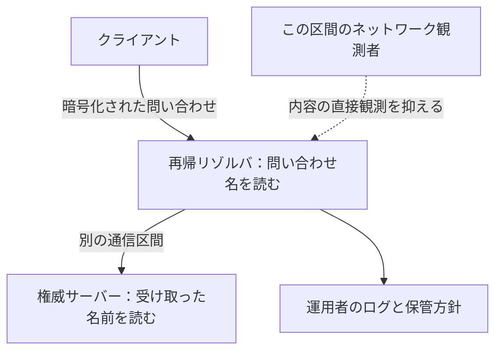

# 第7章 プライバシー――誰に何が見えるのか

レコードの内容が公開情報でも、誰がいつその名前を問い合わせたかまで公開したいとは限りません。問い合わせの並びは、利用するサービスや行動を推測する材料になり得ます。ただし、名前解決が行われたことは、その人がページを読んだことの証明ではありません。アプリケーションの自動通信やキャッシュも関わります。[RFC 9076: DNS Privacy Considerations 1・4.1節](https://www.rfc-editor.org/rfc/rfc9076.html)

本章の要件は、単に「暗号化する」ではなく、観測者ごとに必要以上の情報を渡さないことです。

## 1. 観測者を経路上に置く

クライアントの近くのネットワーク、再帰リゾルバの運用者、問い合わせを受けた権威サーバーの運用者は、同じ情報を見るわけではありません。再帰リゾルバは、通常はクライアントから問い合わせ名を受け取ります。権威側が直接見る問い合わせ元は、通常はその再帰リゾルバです。しかし転送される追加情報や配置によって、見える範囲は変わります。[RFC 9076 6.1・6.2節](https://www.rfc-editor.org/rfc/rfc9076.html)

次の図は、クライアントから再帰リゾルバまでを暗号化した例です。後半の経路まで同じ保護が自動的に広がるとは限りません。狭い画面では図を横へスクロールできます。



通信内容を読み取りにくくしても、通信先のIPアドレスや時刻、量などがすべて隠れるわけではありません。内容の秘匿と、通信の存在や特徴の秘匿を分ける必要があります。[RFC 8310: Usage Profiles for DNS over TLS and DNS over DTLS 11.1節](https://www.rfc-editor.org/rfc/rfc8310.html)

## 2. DoT、DoH、DoQが変える区間

DNS over TLS（DoT）はTLSを、DNS over HTTPS（DoH）はHTTPSを、DNS over QUIC（DoQ）は専用のQUIC接続を使います。2016年、2018年、2022年にそれぞれのRFCが公表されました。これは仕様の公表年であり、全利用者の切替時期ではありません。[RFC 7858: Specification for DNS over Transport Layer Security (TLS)](https://www.rfc-editor.org/rfc/rfc7858.html)、[RFC 8484: DNS Queries over HTTPS (DoH)](https://www.rfc-editor.org/rfc/rfc8484.html)、[RFC 9250: DNS over Dedicated QUIC Connections](https://www.rfc-editor.org/rfc/rfc9250.html)

これらを選ぶときは、暗号化の方式名だけでなく、相手をどう認証するかを確認します。認証に失敗したら止めるのか、平文で継続するのかで、失敗時のプライバシーと可用性は変わります。RFC 8310はDoTなどの利用プロファイルを整理し、厳格な保護と、可能なときに保護を使う方式を区別しています。[RFC 8310 5・6節](https://www.rfc-editor.org/rfc/rfc8310.html)

性能も方式名だけで決まりません。接続の確立、再利用、並行する問い合わせ、パケット損失、相手までの距離が関わります。DoQは問い合わせをストリームに分け、TCPで生じるストリーム間の先頭待ちの問題を避ける設計ですが、どの環境でも最速だという実測の結論ではありません。[RFC 9250 1・4節](https://www.rfc-editor.org/rfc/rfc9250.html)

## 3. 暗号化する前に、渡す情報を減らす

QNAME Minimisationは、上流へ常に元の完全な問い合わせ名と型を送るのではなく、その段階で必要な範囲に絞る方法です。例えば`www.example.com`を解決するとき、ルートが次の委譲先を案内するために、常に`www`まで知る必要はありません。実際の問い合わせはキャッシュや応答によって変わるため、毎回同じ一連の要求になるとは限りません。[RFC 9156: DNS Query Name Minimisation to Improve Privacy 2・3節](https://www.rfc-editor.org/rfc/rfc9156.html)

この方法は、受け取る側への情報開示を減らします。端末から問い合わせを受けた再帰リゾルバ自身に、元の名前を見せない仕組みではありません。また、暗号化せずに送る区間があれば、その区間を観測する者に対する保護は別に必要です。情報の最小化と通信の暗号化は組み合わせて評価します。

反対に、情報を追加して応答選択に使う仕組みがEDNS Client Subnet（ECS）です。問い合わせの起点となるネットワークの情報を伝え、利用者に合う応答の選択を助けます。その代償として、権威側へ開示する情報や、ネットワーク別の回答を保持するキャッシュの管理が増えます。RFC 7871はInformational（情報提供）の文書であり、それ自体が運用とプライバシー上の問題を記しています。[RFC 7871: Client Subnet in DNS Queries 概要・2・7.3節](https://www.rfc-editor.org/rfc/rfc7871.html)

ECSが解こうとする問題には、再帰リゾルバの位置を手掛かりに選ばれた接続先が、実際の利用者には適していない場合があります。RFC 7871は、再帰リゾルバと利用者がネットワーク上で離れている構成を背景として挙げています。したがって、ここで期待する性能改善は、名前解決自体の時間だけでなく、返された接続先を使うときの時間にも関わります。[RFC 7871 1節](https://www.rfc-editor.org/rfc/rfc7871.html)

この点から、次の設計判断を考えられます。利用者のネットワーク情報を追加しても接続先の選択が改善しないなら、情報開示とキャッシュ管理の負担を増やす理由は弱くなります。改善する場合でも、その利用者が得る効果と、渡す情報の範囲を比較する必要があります。「暗号化しているから追加で送ってよい」とは判断できません。暗号化の終端や情報を受け取る権威側には、その情報が見えるからです。

QNAME MinimisationとECSは、互いを打ち消す二者択一の設定でもありません。前者は問い合わせ名などを必要な範囲に絞り、後者は問い合わせ元ネットワークの情報を加えます。どの項目を誰へ渡す必要があるかを別々に決めることが、本章の要件からの評価です。

## 4. 信頼する相手と保管期間を選ぶ

暗号化の終端になる再帰リゾルバは、問い合わせを処理するために内容を読みます。近くのネットワークから内容を隠しても、終端の運用者への信頼は残ります。多くの利用者が少数のサービスへ集まると、運用や防御に資源を集められる一方、問い合わせ情報や障害の影響も集まり得ます。[RFC 9076 6.1節](https://www.rfc-editor.org/rfc/rfc9076.html)

ここからは本書の運用上の整理です。選定時には、通信方式に加え、何を記録するか、どれだけ保管するか、誰がアクセスするか、別の目的で使うかを確認します。公開方針があることと、外部からその実施状況を検証できることは別です。プロトコルの仕様だけから、特定の事業者がログを保存しないとは判断しません。

## 5. 二つの入口から同じ名前を問い合わせる

2026年11月20日、日本標準時21時24分に、Windowsの同じ端末から`example.com`のAレコードを問い合わせました。一つは`Resolve-DnsName`で`1.1.1.1`を指定する通常の問い合わせ、もう一つはCloudflareのHTTPS JSON APIです。OS全体のリゾルバ設定は変更していません。

```powershell
Resolve-DnsName -Name example.com -Type A -Server 1.1.1.1 -DnsOnly
Invoke-WebRequest -Uri 'https://cloudflare-dns.com/dns-query?name=example.com&type=A' -Headers @{Accept='application/dns-json'}
```

JSON APIは事業者が提供する形式です。RFC 8484の`application/dns-message`による標準のワイヤー形式を測ったものではありません。Cloudflareの公式資料も、JSON形式には共通の正式なRFCがないと明記しています。[Cloudflare: Using JSON](https://developers.cloudflare.com/1.1.1.1/encryption/dns-over-https/make-api-requests/dns-json/)

| 問い合わせ開始時刻（日本標準時） | 入口 | 観測したAレコード | TTL |
| --- | --- | --- | --- |
| 21:24:10.351 | 通常の問い合わせ、`1.1.1.1` | `172.66.147.243`、`104.20.23.154` | 両方102 |
| 21:24:13.068 | HTTPS JSON API | `104.20.23.154`、`172.66.147.243` | 両方46 |

HTTPS側はHTTPステータス200で、応答の`Question`に`example.com`と型1が含まれていました。少なくともこのAPIの終端は、要求を復号して名前を処理しています。問い合わせ名をURLのパラメーターに入れていますが、HTTPSの通信経路でそのURL全体が平文送信されるという意味ではありません。クライアントや終端がURLを記録する可能性とは分けて考えます。

アドレスの集合は一致し、順序とTTLは異なりました。この差から、同じキャッシュを使ったとも、暗号化のためにTTLが減ったとも判断できません。問い合わせの入口が同じ事業者でも、内部の経路やキャッシュの共有は今回観測していません。

[生データ](../references/observations/privacy-2026-11-20.json)と[再現スクリプト](https://github.com/crg-docs/dns-design-tradeoffs/blob/main/scripts/observe_privacy.ps1)を残しています。リポジトリのルートで次を実行できます。応答値は日時や地点により変わります。

```powershell
./scripts/observe_privacy.ps1 -OutputPath .review/privacy-rerun.json
```

これはパケットの採取や暗号化の解読実験ではありません。上流への問い合わせ、QNAME Minimisation、ECS、事業者のログ保持も測っていません。確認できたのは、この端末から二つの入口を使って回答を取得できたことと、その内容です。暗号化が提供する保護の根拠は仕様、観測値の根拠はこの記録と分けています。

## 6. 保護できないときの挙動を決める

本書の運用上の提案は、正常時と失敗時の両方で経路を確認することです。暗号化先へ到達できないときに平文へ戻るなら、通信は続いても、秘匿するという要件は満たされなくなります。一方、停止するなら、保護を維持する代わりに名前解決ができません。どちらを許容するかを先に決め、利用者や運用者がその状態を判別できるようにします。

アプリケーションが独自のリゾルバを選ぶ構成では、OSの設定だけを見ても実際の経路を説明できません。組織内だけで使う名前や、問い合わせの監視も含め、どのクライアントがどこへ送るかを確認します。内容を見ない運用に変えるなら、接続失敗率、待ち時間、検証失敗など、必要な診断情報をどの層で得るかも設計対象です。

## 7. 他のシステムへ持ち帰る

これは、暗号化されたAPIやログ基盤にも通じる設計上の類推です。転送中に読めなくすること、送る項目を減らすこと、受信後に保持しないことは別々の対策です。すべての情報を送ってから通信だけを暗号化する案と、不要な項目を最初から送らない案を比較できます。

ただし、問い合わせ先が名前解決をするために必要な情報と、別のアプリケーションが必要とする情報は異なります。機能名を移植するのではなく、観測者、情報、区間、保管期間を一つずつ描き、目的に必要かを問い直します。

## この章の言い換え

| 前 | 後 |
| --- | --- |
| 「DNSを暗号化したので誰にも見えません」 | 「この通信区間の盗聴を抑えますが、終端のリゾルバは問い合わせ名を読みます」 |
| 「DNSのプライバシー対策です」 | 「上流に渡す名前を必要な範囲に絞り、通信の保護とログ保持を別々に評価します」 |
| 「DNSの設定はOSで確認しました」 | 「アプリケーションが独自の問い合わせ先を使うか、失敗時に別経路へ戻るかも確認します」 |

## 参照資料

- [RFC 9076: DNS Privacy Considerations](https://www.rfc-editor.org/rfc/rfc9076.html) 1・4・6節
- [RFC 7858: Specification for DNS over Transport Layer Security (TLS)](https://www.rfc-editor.org/rfc/rfc7858.html)
- [RFC 8310: Usage Profiles for DNS over TLS and DNS over DTLS](https://www.rfc-editor.org/rfc/rfc8310.html) 5・6・11.1節
- [RFC 8484: DNS Queries over HTTPS (DoH)](https://www.rfc-editor.org/rfc/rfc8484.html)
- [RFC 9250: DNS over Dedicated QUIC Connections](https://www.rfc-editor.org/rfc/rfc9250.html) 1・4節
- [RFC 9156: DNS Query Name Minimisation to Improve Privacy](https://www.rfc-editor.org/rfc/rfc9156.html) 2・3節
- [RFC 7871: Client Subnet in DNS Queries](https://www.rfc-editor.org/rfc/rfc7871.html) 2・7.3節
- [Cloudflare: Using JSON](https://developers.cloudflare.com/1.1.1.1/encryption/dns-over-https/make-api-requests/dns-json/)

本文の構成と範囲: [文書設計メモ](../docs/document-design/07-privacy.md)

---

[← 第6章 セキュリティ](06-security.md)｜[目次](../)｜[第8章 運用性と保守性 →](08-operations.md)


