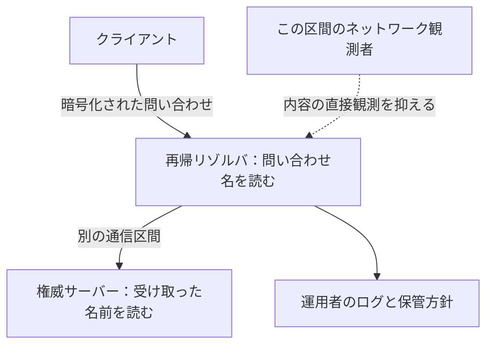

# 第7章 プライバシー――誰に何が見えるのか

レコードの内容が公開情報でも、誰がいつその名前を問い合わせたかまで公開したいとは限りません。問い合わせの並びは、利用するサービスや行動を推測する材料になり得ます。ただし、名前解決が行われたことは、その人がページを読んだことの証明ではありません。アプリケーションの自動通信やキャッシュも関わります。[RFC 9076: DNS Privacy Considerations 3節](https://www.rfc-editor.org/rfc/rfc9076.html)

本章の要件は、単に「暗号化する」ではなく、観測者ごとに必要以上の情報を渡さないことです。制作上の責務は[文書設計メモ](../docs/document-design/07-privacy.md)に記録しています。

## 1. 観測者を経路上に置く

クライアントの近くのネットワーク、再帰リゾルバの運用者、問い合わせを受けた権威サーバーの運用者は、同じ情報を見るわけではありません。再帰リゾルバは、通常はクライアントから問い合わせ名を受け取ります。権威側が直接見る問い合わせ元は、通常はその再帰リゾルバです。しかし転送される追加情報や配置によって、見える範囲は変わります。[RFC 9076 3節](https://www.rfc-editor.org/rfc/rfc9076.html)

次の図は、クライアントから再帰リゾルバまでを暗号化した例です。後半の経路まで同じ保護が自動的に広がるとは限りません。狭い画面では図を横へスクロールできます。

通信内容を読み取りにくくしても、通信先のIPアドレスや時刻、量などがすべて隠れるわけではありません。内容の秘匿と、通信の存在や特徴の秘匿を分ける必要があります。[RFC 8310: Usage Profiles for DNS over TLS and DNS over DTLS 11.1節](https://www.rfc-editor.org/rfc/rfc8310.html)

## 2. DoT、DoH、DoQが変える区間

DNS over TLS（DoT）はTLSを、DNS over HTTPS（DoH）はHTTPSを、DNS over QUIC（DoQ）は専用のQUIC接続を使います。2016年、2018年、2022年にそれぞれのRFCが公表されました。これは仕様の公表年であり、全利用者の切替時期ではありません。[RFC 7858: Specification for DNS over Transport Layer Security (TLS)](https://www.rfc-editor.org/rfc/rfc7858.html)、[RFC 8484: DNS Queries over HTTPS (DoH)](https://www.rfc-editor.org/rfc/rfc8484.html)、[RFC 9250: DNS over Dedicated QUIC Connections](https://www.rfc-editor.org/rfc/rfc9250.html)

これらを選ぶときは、暗号化の方式名だけでなく、相手をどう認証するかを確認します。認証に失敗したら止めるのか、平文で継続するのかで、失敗時のプライバシーと可用性は変わります。RFC 8310はDoTなどの利用プロファイルを整理し、厳格な保護と、可能なときに保護を使う方式を区別しています。[RFC 8310 5・6節](https://www.rfc-editor.org/rfc/rfc8310.html)

性能も方式名だけで決まりません。接続の確立、再利用、並行する問い合わせ、パケット損失、相手までの距離が関わります。DoQは問い合わせをストリームに分け、TCPで生じるストリーム間の先頭待ちの問題を避ける設計ですが、どの環境でも最速だという実測の結論ではありません。[RFC 9250 1・4節](https://www.rfc-editor.org/rfc/rfc9250.html)

## 3. 暗号化する前に、渡す情報を減らす

QNAME Minimisationは、上流へ常に元の完全な問い合わせ名と型を送るのではなく、その段階で必要な範囲に絞る方法です。例えば`www.example.com`を解決するとき、ルートが次の委譲先を案内するために、常に`www`まで知る必要はありません。実際の問い合わせはキャッシュや応答によって変わるため、毎回同じ一連の要求になるとは限りません。[RFC 9156: DNS Query Name Minimisation to Improve Privacy 2・3節](https://www.rfc-editor.org/rfc/rfc9156.html)

この方法は、受け取る側への情報開示を減らします。端末から問い合わせを受けた再帰リゾルバ自身に、元の名前を見せない仕組みではありません。また、暗号化せずに送る区間があれば、その区間を観測する者に対する保護は別に必要です。情報の最小化と通信の暗号化は組み合わせて評価します。

反対に、情報を追加して応答選択に使う仕組みがEDNS Client Subnet（ECS）です。問い合わせの起点となるネットワークの情報を伝え、利用者に合う応答の選択を助けます。その代償として、権威側へ開示する情報や、ネットワーク別の回答を保持するキャッシュの管理が増えます。RFC 7871自身が運用とプライバシー上の問題を記しています。[RFC 7871: Client Subnet in DNS Queries 概要・2・7.3節](https://www.rfc-editor.org/rfc/rfc7871.html)

この二つは、どちらも単に「高度な名前解決機能」ではありません。一方は必要な情報を絞り、他方は応答選択のために情報を増やします。性能向上で誰が利益を得て、誰の情報が追加で渡るかを確認する必要があります。

## 4. 信頼する相手と保管期間を選ぶ

暗号化の終端になる再帰リゾルバは、問い合わせを処理するために内容を読みます。近くのネットワークから内容を隠しても、終端の運用者への信頼は残ります。多くの利用者が少数のサービスへ集まると、運用や防御に資源を集められる一方、問い合わせ情報や障害の影響も集まり得ます。[RFC 9076 3.6節](https://www.rfc-editor.org/rfc/rfc9076.html)

ここからは本書の運用上の整理です。選定時には、通信方式に加え、何を記録するか、どれだけ保管するか、誰がアクセスするか、別の目的で使うかを確認します。公開方針があることと、外部からその実施状況を検証できることは別です。プロトコルの仕様だけから、特定の事業者がログを保存しないとは判断しません。
