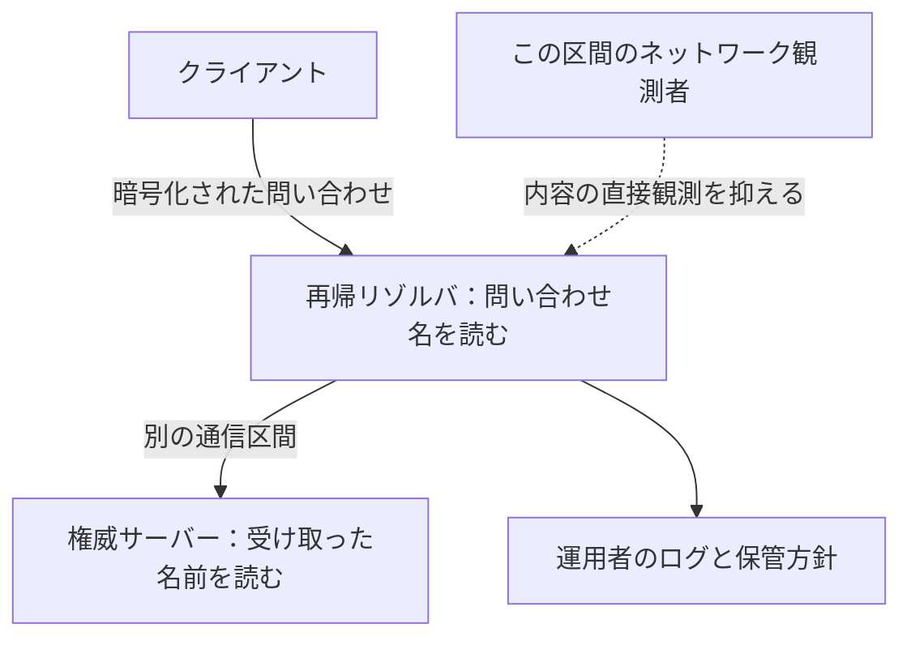

# 第7章 プライバシー――誰に何が見えるのか

レコードの内容が公開情報でも、誰がいつその名前を問い合わせたかまで公開したいとは限りません。問い合わせの並びは、利用するサービスや行動を推測する材料になり得ます。ただし、名前解決が行われたことは、その人がページを読んだことの証明ではありません。アプリケーションの自動通信やキャッシュも関わります。[RFC 9076: DNS Privacy Considerations 1・4.1節](https://www.rfc-editor.org/rfc/rfc9076.html)

本章の要件は、単に「暗号化する」ではなく、観測者ごとに必要以上の情報を渡さないことです。

## 1. 観測者を経路上に置く

クライアントの近くのネットワーク、再帰リゾルバの運用者、問い合わせを受けた権威サーバーの運用者は、同じ情報を見るわけではありません。再帰リゾルバは、通常はクライアントから問い合わせ名を受け取ります。権威側が直接見る問い合わせ元は、通常はその再帰リゾルバです。しかし転送される追加情報や配置によって、見える範囲は変わります。[RFC 9076 6.1・6.2節](https://www.rfc-editor.org/rfc/rfc9076.html)

次の図は、クライアントから再帰リゾルバまでを暗号化した例です。後半の経路まで同じ保護が自動的に広がるとは限りません。狭い画面では図を横へスクロールできます。

通信内容を読み取りにくくしても、通信先のIPアドレスや時刻、量などがすべて隠れるわけではありません。内容の秘匿と、通信の存在や特徴の秘匿を分ける必要があります。[RFC 8310: Usage Profiles for DNS over TLS and DNS over DTLS 11.1節](https://www.rfc-editor.org/rfc/rfc8310.html)

## 2. 問い合わせを運ぶ途中で読まれたくない

名前解決をするには、名前を問い合わせ先へ伝える必要があります。しかし、その途中のネットワークにまで内容を知らせる必要はありません。この区間の機密性を確保するため、DNSの問い合わせを暗号化された通信で運ぶ方法が加わりました。DoT、DoH、DoQはその方法です。方式の違いは[準備章：暗号化DNSの通信方式](01-name-resolution.md#暗号化dnsの通信方式)で確認できます。

ここで叶えたいのは、単に読めないデータを送ることではありません。意図した相手へ送っていることも必要です。そのため、暗号化と相手の認証を組み合わせます。RFC 8310のStrict Privacyは両方を要求し、同じ問い合わせの途中で保護条件を弱めて継続することを認めません。[RFC 8310 5・5.1・6.6節](https://www.rfc-editor.org/rfc/rfc8310.html)

この解決で保護できるのは、暗号化した区間です。終端は問い合わせを読む必要があり、後半の区間に同じ保護があるとも限りません。また、接続を確立する仕事が加わるので、性能を考えるなら接続の再利用や相手までの距離も関わります。暗号化の採用で、誰から何を守れたかを確かめる必要があります。[RFC 9250 1・4節](https://www.rfc-editor.org/rfc/rfc9250.html)

## 3. 名前を探す相手に必要以上の情報を渡したくない

通信を暗号化しても、受信する相手に渡した情報は見えます。そこで次に考えるのは、そもそもその相手が何を知る必要があるかです。DNSでは次の問い合わせ先を案内する相手と、最終的な情報を答える相手の役割が違います。案内するだけの段階で、常に完全な問い合わせ名を渡す必要はありません。

必要な部分に絞って問い合わせるQNAME Minimisationは、この違いを利用します。再帰リゾルバには元の名前が見えますが、上流への開示を減らせます。通信経路から隠す暗号化と、受信者へ渡す量を減らす方法は、別の要件に応えるものです。[RFC 9156 2・3節](https://www.rfc-editor.org/rfc/rfc9156.html)

一方、利用者に適した接続先を選ぶには、情報を追加したい場合があります。再帰リゾルバの位置だけで選ぶと、そこから離れた利用者には不向きな接続先が返ることがあるからです。ECSは利用者側のネットワーク情報を伝え、この選択を助けます。得たい効果は、名前を調べる速さだけでなく、調べた接続先へ通信するときの性能です。[RFC 7871 1・2節](https://www.rfc-editor.org/rfc/rfc7871.html)

情報を足しても接続先の選択が改善しないなら、開示を増やす理由は弱くなります。改善する場合も、誰にどこまで渡すかを決める必要があります。RFC 7871は、既定では無効にし、利用者への明確な利益がある場合に明示的に有効にすることを推奨しています。具体的に送る情報とキャッシュへの影響は[準備章：問い合わせ名の最小化とECS](01-name-resolution.md#問い合わせ名の最小化とecs)にまとめています。

QNAME MinimisationとECSは、互いを打ち消す二者択一の設定でもありません。前者は問い合わせ名などを必要な範囲に絞り、後者は問い合わせ元ネットワークの情報を加えます。どの項目を誰へ渡す必要があるかを別々に決めることが、本章の要件からの評価です。

## 4. 信頼する相手と保管期間を選ぶ

暗号化の終端になる再帰リゾルバは、問い合わせを処理するために内容を読みます。近くのネットワークから内容を隠しても、終端の運用者への信頼は残ります。多くの利用者が少数のサービスへ集まると、運用や防御に資源を集められる一方、問い合わせ情報や障害の影響も集まり得ます。[RFC 9076 6.1節](https://www.rfc-editor.org/rfc/rfc9076.html)

ここからは本書の運用上の整理です。選定時には、通信方式に加え、何を記録するか、どれだけ保管するか、誰がアクセスするか、別の目的で使うかを確認します。公開方針があることと、外部からその実施状況を検証できることは別です。プロトコルの仕様だけから、特定の事業者がログを保存しないとは判断しません。

## 5. 同じ回答でも、情報の見え方は違う

2026年11月20日に同じ端末から通常の問い合わせとHTTPSのJSON APIを使い、同じ名前のアドレスを取得しました。返ったアドレスの集合は一致しました。しかし、同じ回答が得られることと、途中の観測者に同じ情報が見えることは別です。HTTPSの終端は問い合わせを処理するために名前を読みます。日時、対象、コマンド、結果は[準備章：通常の問い合わせとHTTPSの観測記録](01-name-resolution.md#通常の問い合わせとhttpsの観測記録)に残しています。

これはパケットの採取や暗号化の解読実験ではありません。上流の通信やログの保管も測っていません。したがって、この記録だけでプライバシーの優劣は決められません。回答の正しさに加えて、誰に何を渡す経路だったかを評価する必要がある、という区別を確認する例です。

## 6. 保護できないときの挙動を決める

本書の運用上の提案は、正常時と失敗時の両方で経路を確認することです。例えば、ある暗号化先が停止したとき、事前に信頼対象として選んだ別の相手へ、同じ認証と暗号化を保って接続する案があります。これは保護を外す案とは違い、別の相手へ情報を渡すことと、追加の接続待ちを引き受ける判断です。代替先が同じ障害原因を共有していないかも確認します。

許容した保護条件を満たす相手が残っていなければ、Strict Privacyではその問い合わせを平文へ戻して継続できません。最初からOpportunistic Privacyを選ぶ案なら、保護できない場合の継続を許す代わりに、常時の秘匿を約束できません。先に決めた要件がどちらの方針を許すのかを明示し、本書の運用提案として、実際に使った相手と保護状態を判別できるようにします。

アプリケーションが独自のリゾルバを選ぶ構成では、OSの設定だけを見ても実際の経路を説明できません。組織内だけで使う名前や、問い合わせの監視も含め、どのクライアントがどこへ送るかを確認します。内容を見ない運用に変えるなら、接続失敗率、待ち時間、検証失敗など、必要な診断情報をどの層で得るかも設計対象です。

## この章のポイント

- 通信区間を暗号化しても、終端のリゾルバは問い合わせ名を読みます。保護する区間と信頼する相手を区別します。
- 通信の保護、上流へ開示する情報の削減、ログの保持は、別々に評価する必要があります。
- 失敗時の代替経路も保護範囲に含まれます。秘匿を必須にする場合、保護を失う経路への切り替えでは要件を満たせません。

## 参照資料

- [RFC 9076: DNS Privacy Considerations](https://www.rfc-editor.org/rfc/rfc9076.html) 1・4・6節
- [RFC 7858: Specification for DNS over Transport Layer Security (TLS)](https://www.rfc-editor.org/rfc/rfc7858.html)
- [RFC 8310: Usage Profiles for DNS over TLS and DNS over DTLS](https://www.rfc-editor.org/rfc/rfc8310.html) 5・6・11.1節
- [RFC 8484: DNS Queries over HTTPS (DoH)](https://www.rfc-editor.org/rfc/rfc8484.html)
- [RFC 9250: DNS over Dedicated QUIC Connections](https://www.rfc-editor.org/rfc/rfc9250.html) 1・4節
- [RFC 9156: DNS Query Name Minimisation to Improve Privacy](https://www.rfc-editor.org/rfc/rfc9156.html) 2・3節
- [RFC 7871: Client Subnet in DNS Queries](https://www.rfc-editor.org/rfc/rfc7871.html) 2・7.3節
- [Cloudflare: Using JSON](https://developers.cloudflare.com/1.1.1.1/encryption/dns-over-https/make-api-requests/dns-json/)

本文の構成と範囲: [文書設計メモ](../docs/document-design/07-privacy.md)

---

[← 第6章 セキュリティ](06-security.md)｜[目次](../)｜[第8章 運用性と保守性 →](08-operations.md)


