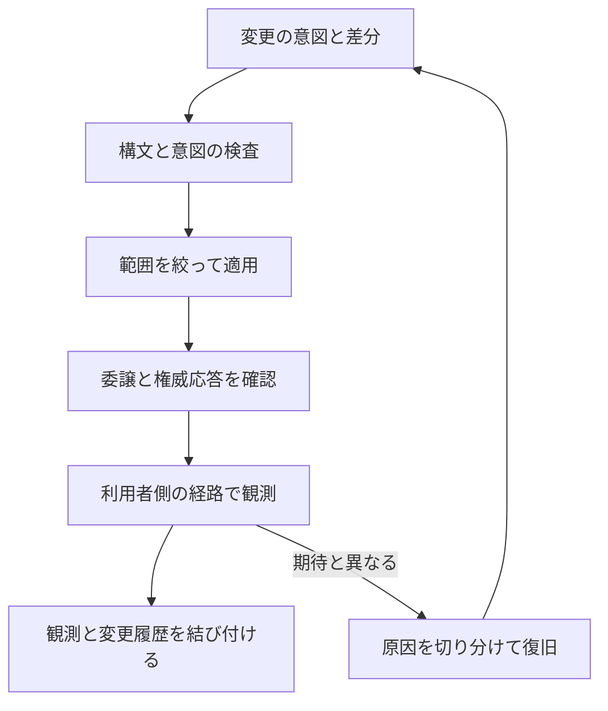

# 第8章 運用性と保守性――正しさを維持し、説明できるか

設定ファイルの文法は正しく、サーバーのプロセスも動いています。それでも利用者の問い合わせは失敗します。このとき「設定チェックは通った」と言えても、「必要な人へ正しい回答を届けている」とはまだ言えません。

運用性とは、日々の変更と失敗を扱えることです。本章では、変更の意図と実際の応答を結び付け、別の担当者にも状態を説明できるようにします。制作上の責務は[文書設計メモ](../docs/document-design/08-operations.md)に記録しています。

## 1. 正しい状態を一度作るだけでは足りない

レコードの追加、権威サーバーの交換、鍵の更新、組織の引き継ぎが重なると、かつて正しかった設定が残って不整合を生むことがあります。1996年のRFC 1912は、委譲先として指定されているサーバーがそのゾーンを提供していない、という運用上の誤りを説明しています。これはプロセスの生存確認だけでは分からない関係の誤りです。[RFC 1912: Common DNS Operational and Configuration Errors 2.8節](https://www.rfc-editor.org/rfc/rfc1912.html)

この古い資料を、現在の製品設定や推奨タイマーの一覧として使うわけではありません。ここから読み取るのは、別々の主体が管理する情報の一致を維持しなければならない、という問題です。第2章で管理を分割した効果の裏側に、運用時の調整が残っています。

本書では、変更の再現可能性、影響範囲、異常の検出、原因の説明、復旧の条件を評価します。作業時間が短いことだけで運用性を高いとはしません。

## 2. どこが正本かを決める

設定をコードとして管理する、いわゆるDNS as Codeは、変更内容を差分として確認し、履歴と自動適用を結び付ける運用方法です。本章では製品の名称ではなく、この運用上の選択として扱います。誰が何のために変更したかを残しやすくする反面、誤った変更を広く速く適用する経路にもなります。

特に、管理画面からの手動変更、自動適用、動的更新を併用する場合は、どこを正本とするかが必要です。自動化が古い宣言を正しいものとして再適用すれば、緊急修正を消してしまう可能性があります。これは運用設計上の問題であり、動的更新の原子性では解決しません。RFC 2136の更新が保証する範囲と、複数の変更主体の調整を分けます。[RFC 2136: Dynamic Updates in the Domain Name System (DNS UPDATE)](https://www.rfc-editor.org/rfc/rfc2136.html)

本書の提案は、名前やゾーンごとの更新主体を決め、緊急時の変更も後から正本へ戻すことです。秘密情報を設定履歴へ混ぜず、適用権限とレビュー権限を必要な範囲に分けます。自動化を入れたことより、競合と失敗を説明できることが重要です。

## 3. 構文、意図、関係、実際の応答を分ける

構文検査は、ファイルや設定を読み取れるかを確認します。それだけでは、消してはいけない名前を削除していないか、接続先が正しいか、親の委譲先が対応しているかまでは分かりません。そこで本書では確認を段階に分けます。

まず差分を見て意図を確認します。次に対象の権威サーバーへ直接問い合わせ、期待するレコードや権威としての応答を確認します。その後、利用者が使うリゾルバを通り、アプリケーションまで含めて観測します。第5章のとおり、権威側が新しくてもキャッシュ側に旧情報が残る期間があります。

次の図は変更と確認の流れの一例です。すべての組織に同じ承認人数を要求するものではありません。狭い画面では横へスクロールできます。

プロトコルとして適切なエラー応答を返すかも、データの内容とは別の確認です。RFC 8906は、特定の問い合わせへ応答しない、または不適切に応答するサーバーが、当面の障害と将来の拡張の両方を妨げる問題を整理しています。[RFC 8906: A Common Operational Problem in DNS Servers: Failure to Communicate 概要](https://www.rfc-editor.org/rfc/rfc8906.html)
