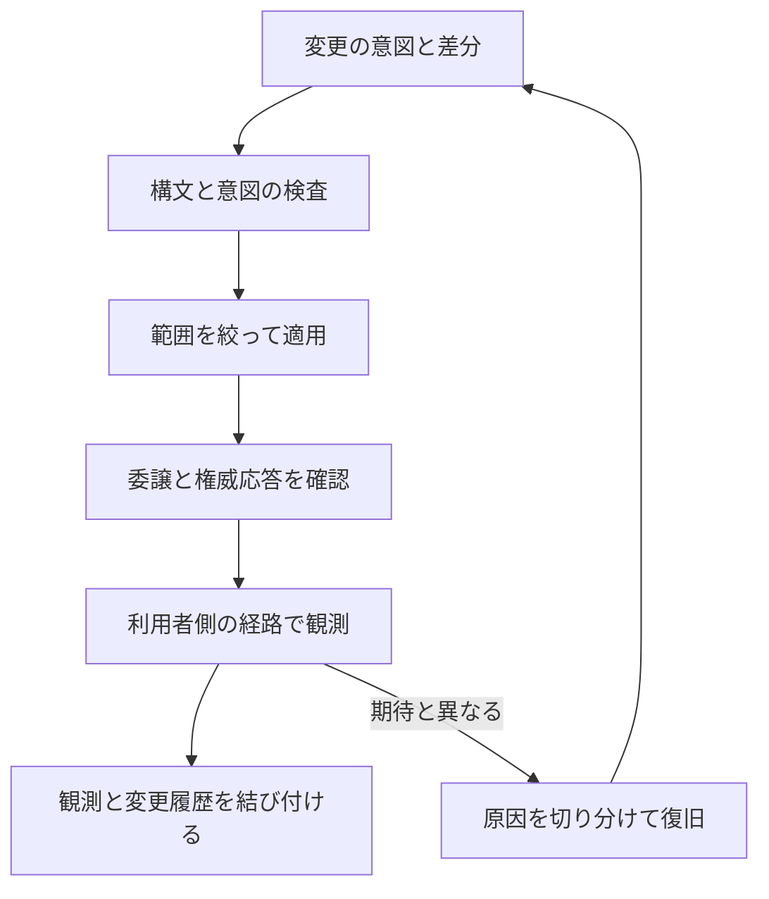

# 第8章 運用性と保守性――正しさを維持し、説明できるか

ここまで、管理、再利用、複製、署名、情報開示の境界を分けてきました。運用では、その境界をまたいで一つの変更や障害を追う必要があります。設定ファイルの文法が正しく、サーバーのプロセスが動いていても、「必要な人へ正しい回答を届けている」とはまだ言えません。

運用性とは、日々の変更と失敗を扱えることです。本章では、変更の意図と実際の応答を結び付け、別の担当者にも状態を説明できるようにします。

## 1. 正しい状態を一度作るだけでは足りない

レコードの追加、権威サーバーの交換、鍵の更新、組織の引き継ぎが重なると、かつて正しかった設定が残って不整合を生むことがあります。1996年のRFC 1912は、委譲先として指定されているサーバーがそのゾーンを提供していない、という運用上の誤りを説明しています。これはプロセスの生存確認だけでは分からない関係の誤りです。[RFC 1912: Common DNS Operational and Configuration Errors 2.8節](https://www.rfc-editor.org/rfc/rfc1912.html)

この古い資料を、現在の製品設定や推奨タイマーの一覧として使うわけではありません。ここから読み取るのは、別々の主体が管理する情報の一致を維持しなければならない、という問題です。第2章で管理を分割した効果の裏側に、運用時の調整が残っています。

本書では、変更の再現可能性、影響範囲、異常の検出、原因の説明、復旧の条件を評価します。作業時間が短いことだけで運用性を高いとはしません。

## 2. どこが正本かを決める

設定をコードとして管理する、いわゆるDNS as Codeは、変更内容を差分として確認し、履歴と自動適用を結び付ける運用方法です。本章では製品の名称ではなく、この運用上の選択として扱います。誰が何のために変更したかを残しやすくする反面、誤った変更を広く速く適用する経路にもなります。

特に、管理画面からの手動変更、自動適用、動的更新を併用する場合は、どこを正本とするかが必要です。自動化が古い宣言を正しいものとして再適用すれば、緊急修正を消してしまう可能性があります。これは運用設計上の問題であり、動的更新の原子性では解決しません。RFC 2136の更新が保証する範囲と、複数の変更主体の調整を分けます。[RFC 2136: Dynamic Updates in the Domain Name System (DNS UPDATE)](https://www.rfc-editor.org/rfc/rfc2136.html)

本書の提案は、名前やゾーンごとの更新主体を決め、緊急時の変更も後から正本へ戻すことです。秘密情報を設定履歴へ混ぜず、適用権限とレビュー権限を必要な範囲に分けます。自動化を入れたことより、競合と失敗を説明できることが重要です。

例えば、固定した宣言を定期適用する案は、更新が少なく差分を事前確認できる範囲に向きます。機械が頻繁に追加・削除する範囲まで同じ宣言へ戻せば、その正当な更新も消し得ます。その場合は、動的に管理する名前や型を宣言側の適用対象から分けるなど、変更の所有範囲を明確にします。緊急修正では、競合する自動適用を止めてから変更し、正本へ取り込んだ差分を確認して再開する手順が候補です。履歴を残す利点と、停止・再開を管理する負担を比較して選びます。

## 3. 構文、意図、関係、実際の応答を分ける

構文検査は、ファイルや設定を読み取れるかを確認します。それだけでは、消してはいけない名前を削除していないか、接続先が正しいか、親の委譲先が対応しているかまでは分かりません。そこで本書では確認を段階に分けます。

まず差分を見て意図を確認します。次に対象の権威サーバーへ直接問い合わせ、期待するレコードや権威としての応答を確認します。その後、利用者が使うリゾルバを通り、アプリケーションまで含めて観測します。第5章のとおり、権威側が新しくてもキャッシュ側に旧情報が残る期間があります。

例えば、移行先のアドレスを一文字誤ったものの、アドレスの形式は正しい変更を考えます。自動適用が成功し、権威サーバーが設定どおりの値を返しても、利用者が目的のサービスへ接続できるとは限りません。設定ファイルと応答が一致する検査だけでは、同じ誤りを二度確認したことになります。接続先の所有者や移行計画との照合、利用者側からの接続確認には、自動適用と別の役割があります。

この仮定で「適用成功なら全体へ広げる」という案を選ぶと、速さと引き換えに誤りの影響も広がります。「限定した対象で目的の動作を確認してから広げる」という案なら、確認時間と新旧状態の混在を引き受ける代わりに、途中で止める機会を作れます。対象を限定できない一つの重要な名前の変更では、同じ段階化ができると決め付けず、事前の接続確認と旧接続先の扱いを別に準備します。

次の図は変更と確認の流れの一例です。すべての組織に同じ承認人数を要求するものではありません。狭い画面では横へスクロールできます。

プロトコルとして適切なエラー応答を返すかも、データの内容とは別の確認です。RFC 8906は、特定の問い合わせへ応答しない、または不適切に応答するサーバーが、当面の障害と将来の拡張の両方を妨げる問題を整理しています。[RFC 8906: A Common Operational Problem in DNS Servers: Failure to Communicate 概要](https://www.rfc-editor.org/rfc/rfc8906.html)

## 4. 観測地点が違えば、正常な答えも違い得る

Split DNSは、問い合わせ元などによって同じドメインに異なる応答を提供する構成を指します。社内と社外で異なる接続先を使う場合などです。RFC 9499は、Viewという実装上の設定も区別しています。Viewは広く実装されていますが、DNSプロトコルで標準化された設定方式ではありません。[RFC 9499: DNS Terminology 6節](https://www.rfc-editor.org/rfc/rfc9499.html)

この構成では、二地点の回答が違うこと自体を障害と判断できません。どの地点に、どの応答を期待するかが必要です。転送先が多段になっている場合や、VPN・アプリケーション独自の問い合わせ先を使う場合には、端末の場所だけでも経路を説明できません。

第4章の観測では、二つの権威サーバーのSOA Serialが一致しました。これはその時点の二つの応答の一致であり、利用者の全経路の成功を示しません。第5章では、一つの端末でも権威側とキャッシュ側で回答が異なりました。新しい調査を始める前に、このように既存の記録がどの境界を観測したものかを確認します。[第4章の観測](04-availability.md)、[第5章の観測](05-consistency.md)

## 5. 症状から確認する境界を選ぶ

以下は本書が提案する切り分け表です。原因を決め付ける表ではありません。例えば、タイムアウトはサーバー停止だけでなく経路や応答の扱いにも関わるため、観測を追加して範囲を狭めます。

| 見えている症状 | 次に比較するもの | その観測だけでは言えないこと |
| --- | --- | --- |
| 名前が見つからない | 問い合わせた名前・型、権威側、不在応答のキャッシュ | 追加操作が失敗したとは限らない |
| 古いアドレスが返る | 権威ごとの値、Serial、リゾルバ側のTTL | 待つだけで必ず直るとは限らない |
| 応答が来ない | 利用者側経路、対象サーバー、通信方式 | プロセスが停止しているとは限らない |
| SERVFAILが返る | 権威への到達性、署名検証、追加のエラー情報 | 名前が存在しないとは限らない |
| 社内と社外で違う | Split DNSの意図、転送先、問い合わせ元 | 一方が誤っているとは限らない |

SERVFAILのような応答コードだけでは、原因の表現力が不足します。Extended DNS Errors（EDE）は、原因について追加情報を返すための拡張です。ただし元の応答コードの処理を変更するものではなく、すべてのサーバーが詳細を返す保証でもありません。安全な取引で保護されていない情報は、それだけで信頼できる原因報告にはなりません。[RFC 8914: Extended DNS Errors 概要・3・6節](https://www.rfc-editor.org/rfc/rfc8914.html)

調査記録には、時刻、観測地点、名前と型、問い合わせ先、応答内容、TTL、エラーを残します。毎回すべての利用者の全問い合わせを保存するという意味ではありません。第7章のプライバシー要件と合わせ、必要な期間と範囲に絞ります。

## 6. 監視の成功条件を利用者へ近づける

プロセスの生存、権威応答の成功、再帰解決の成功、アプリケーションの通信成功は異なる指標です。上流が壊れていてもキャッシュにより成功する場合があります。反対に、問い合わせが成功しても、返された接続先のアプリケーションが動くとは限りません。

本書の監視設計の提案は、権威へ直接確認する経路と、利用者に近い経路を組み合わせることです。キャッシュが効く名前の成功だけでなく、権威データや署名の状態も確認します。上流まで毎回確認するために大量のランダム名を問い合わせる、といった負荷の高い方法を無条件に採用する必要はありません。管理下の対象で、必要な確認頻度と負荷を決めます。

値の違いが想定内なら許容し、必要な名前の欠落や期限の接近を検出します。アラートには担当と次の確認先を対応させます。単に「異常件数が増えた」より、どの利用者経路が、いつから、どの状態で失敗しているかが復旧に役立ちます。

検出の速さも復旧までの時間から逆算します。例えば、署名の期限までに復旧するには、監視の間隔だけでなく、通知を受けて調べる時間と、更新・配布をやり直す時間が必要です。残り有効時間よりその合計が長ければ、期限前に警告が出ても応答を守れません。これは本書の監視設計上の評価であり、RFCが全組織に同じ監視間隔を要求しているわけではありません。実際の担当体制と変更所要時間に合わせて、検出条件を見直します。

## 7. 速い変更と小さい失敗範囲を両立させる

自動化の価値は、人を介さないことだけではありません。差分を再現し、同じ確認を繰り返し、変更の範囲を制御できることにもあります。初めから全ゾーンへ適用する代わりに、管理下の限られた対象で結果を確認し、広げる条件を決めます。これは本書の運用上の提案です。

緊急時には、通常の経路を短縮することもあります。その場合も、実際に変更した値、理由、担当、戻す条件を記録します。切り戻し後のキャッシュや接続の残存は第5章の条件を引き継ぎます。管理画面を元へ戻した時刻を、全利用者の復旧時刻とはしません。

## 8. 他のシステムへ持ち帰る

設定の正本と実行中の状態が別にあるシステムでは、同じ問題が起こり得ます。宣言どおりに適用したこと、依存する相手と整合すること、利用者から成功することを分けて確認できます。

ただし本書の観測表を、そのまま別のシステムの監視項目へコピーするのではありません。そこにある管理境界と複製、キャッシュ、権限を描き直します。正しさを維持する運用とは、失敗が起きないと約束することではなく、何が起きたかを説明し、次の変更を選べる状態を保つことです。

## この章のポイント

- 構文が正しくても、意図した設定や利用者からの到達を保証できません。委譲、権威応答、利用者側の経路を分けて確認します。
- 観測結果が示すのは、その地点と経路で見えた状態です。他の経路や上流の正常性まで広げて判断しません。
- 自動化には、変更の正本と適用範囲の合意が必要です。動的更新や緊急変更との競合も扱います。

## 参照資料

- [RFC 1912: Common DNS Operational and Configuration Errors](https://www.rfc-editor.org/rfc/rfc1912.html) 2.8節
- [RFC 2136: Dynamic Updates in the Domain Name System (DNS UPDATE)](https://www.rfc-editor.org/rfc/rfc2136.html)
- [RFC 9499: DNS Terminology](https://www.rfc-editor.org/rfc/rfc9499.html) 6節
- [RFC 8906: A Common Operational Problem in DNS Servers: Failure to Communicate](https://www.rfc-editor.org/rfc/rfc8906.html)
- [RFC 8914: Extended DNS Errors](https://www.rfc-editor.org/rfc/rfc8914.html) 3・6節

本文の構成と範囲: [文書設計メモ](../docs/document-design/08-operations.md)

---

[← 第7章 プライバシー](07-privacy.md)｜[目次](../)｜[第9章 後方互換性と発展性 →](09-compatibility.md)


