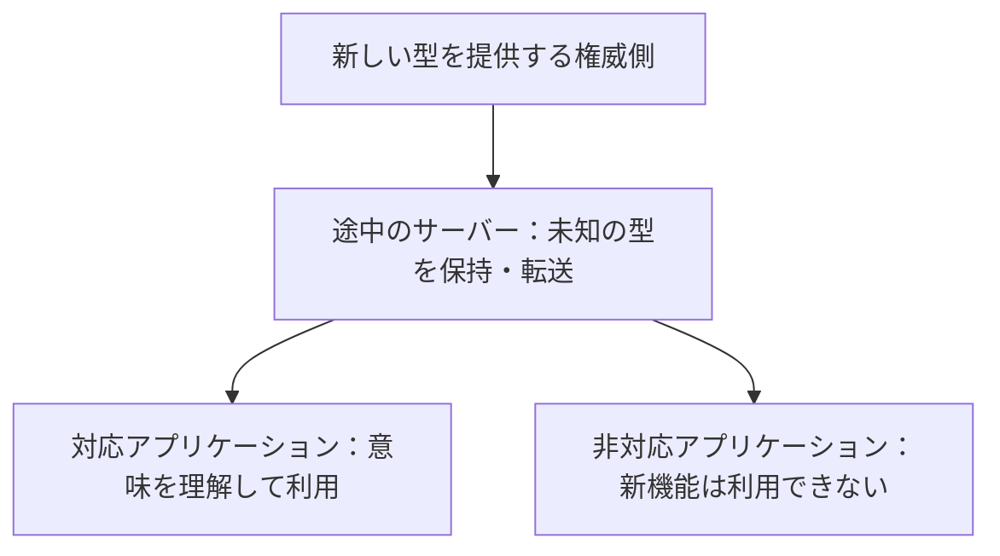

# 第9章 後方互換性と発展性――基盤を止めずに変える

新しい機能を実装したクライアントと権威サーバーがあっても、その間の再帰リゾルバや転送機器まで同時に更新できるとは限りません。古い実装と新しい実装が混ざる経路を通って初めて、利用者はその機能を使えます。

本章では、既存の利用を維持しながら拡張する設計を考えます。互換性を「何があっても古い動作へ戻すこと」とせず、どこまで共存でき、どの保証は落とせないかを決めます。

## 1. 意味を理解することと、データを運ぶこと

新しいレコード型を導入するたびに、途中のすべてのサーバーがその意味を理解しなければならないなら、導入は進みにくくなります。RFC 3597は、未知の型のデータ部分を構造のないバイナリとして保持し、変更せずに扱う規則を定めました。2003年の文書は、それまで新しい型の導入が広い範囲のソフトウェア更新を必要としていた問題を説明しています。[RFC 3597: Handling of Unknown DNS Resource Record (RR) Types 1・3節](https://www.rfc-editor.org/rfc/rfc3597.html)

これにより、中継する側が意味を知らなくても、新しい情報を届けられる余地ができます。ただし、アプリケーションが新しい型の意味を理解して利用できることは別です。運べること、保存できること、表示できること、機能として使えることを同じ対応状況にまとめないようにします。

次の図は、その役割の分離です。途中の実装までアプリケーションの意味を理解する必要がある設計と比べ、更新の依存範囲を小さくできます。狭い画面では横へスクロールできます。

この分離にも条件があります。例えば、メッセージ内の位置に依存する圧縮参照を含むデータを、単純に別のメッセージへコピーすると壊れます。RFC 3597は新しい型の圧縮の扱いも定めています。「未知の値は何でもそのまま渡せばよい」という、任意のプロトコルへの一般則ではありません。[RFC 3597 4節](https://www.rfc-editor.org/rfc/rfc3597.html)

## 2. 能力を既存の形式へ追加する

初期のDNSメッセージには固定されたフィールドがあり、UDPのDNSメッセージ長にも512バイトの制約がありました。拡張機能を増やすには、新しい情報を置く場所と、相手に能力を伝える方法が必要です。[RFC 1035: Domain Names—Implementation and Specification 2.3.4・4.1節](https://www.rfc-editor.org/rfc/rfc1035.html)

Extension Mechanisms for DNS（EDNS）は、OPTという疑似レコードを使って拡張情報を伝えます。EDNS(0)の0は拡張の版です。2013年のRFC 6891は1999年のRFC 2671を置き換え、実装経験を踏まえて仕様を改訂しました。ゾーンに登録する通常のレコードとは役割が違い、OPT自体はキャッシュしません。[RFC 6891: Extension Mechanisms for DNS (EDNS(0)) 概要・6節](https://www.rfc-editor.org/rfc/rfc6891.html)

EDNSでは、受信可能なUDPペイロードの大きさを通知できます。ただし、その値は経路上のすべての機器が配送できることの証明ではありません。断片化や途中機器の扱いで、通知した大きさの応答が届かないこともあります。大きな値を広告することと、到達性の改善は同義ではありません。[RFC 6891 6.2.3・6.2.6節](https://www.rfc-editor.org/rfc/rfc6891.html)

## 3. レコードの拡張と通信の拡張を切り離す

IPv6アドレスを表すAAAAレコードは、情報の表現の拡張です。AAAAを問い合わせるために、その問い合わせ自体が必ずIPv6通信でなければならないわけではありません。逆に、IPv6で通信するサーバーもAレコードを扱えます。RFC 3596は、問い合わせたレコードと輸送に使うIPの版の独立性を説明しています。[RFC 3596: DNS Extensions to Support IP Version 6 1節](https://www.rfc-editor.org/rfc/rfc3596.html)

この分離により、情報の対応と通信経路の対応を別々に進められます。一方で、運用者は「IPv6対応済み」の意味を具体化しなければなりません。AAAAを公開したのか、権威サーバーへIPv6で到達できるのか、返されたIPv6アドレスのサービスへ利用者が接続できるのかは別の確認です。最後の点は本書の運用上の整理です。

## 4. 黙って捨てると、未対応と障害を区別できない

未知の機能を使う問い合わせに対して応答がない場合、送信側は、相手が未対応なのか、途中で失われたのか、単に遅いのかを直接には区別できません。タイムアウトや再試行が増え、別の方法を試す実装も複雑になります。RFC 8906は、未知の型やオプションなどへの不適切な応答が、機能の発展を妨げる問題を扱います。[RFC 8906: A Common Operational Problem in DNS Servers: Failure to Communicate](https://www.rfc-editor.org/rfc/rfc8906.html)

これは、実装が一つの正常系で動くことと、他の実装と共存できることの違いです。必要な場合に規定どおりのエラーを返せることも、互換性の一部です。本書では、失敗を明示する動作を、将来の変更のための情報として評価します。

ただし、「未知ならすべてエラーにする」という規則でもありません。RFC 6891では、理解できないEDNSのオプションコードは無視する一方、実装していないEDNSの版に対してはBADVERSという応答コードを返すよう規定しています。未知の項目と、メッセージの解釈に関わる版を区別しているのです。したがって、通常の回答が返っただけでは、そのオプションが使われた証拠になりません。拡張を設計・導入する側には、必須の機能が実際に使われたと確認する方法が必要になります。最後の点は、規定から導く本書の評価です。[RFC 6891 6.1.2・6.1.3節](https://www.rfc-editor.org/rfc/rfc6891.html)

途中機器の制約を避けるために新機能を使わなくすれば、当面は動くかもしれません。しかし、その制約を見えなくしたままでは、いつまで古い動作が必要か判断できません。フォールバックの回数や条件を記録することには、互換処理を将来整理するための意味もあります。これは本書の運用上の提案です。

## 5. 戻れることと、戻ってよいこと

RFC 6891は、相手がEDNS(0)未対応だと分かった場合にOPTなしで問い合わせる選択を認めています。ただし、DNSSECなどEDNSを必要とする機能が必須なら、同じように戻してはいけないとしています。回答を得ることだけを成功とすると、要求していた機能を失ったことが隠れます。[RFC 6891 6.2.2節](https://www.rfc-editor.org/rfc/rfc6891.html)

同様に、第7章の暗号化で保護を必須にしているなら、平文での成功は同じ要件を満たした成功ではありません。第6章の検証も、署名の確認を省いて接続できたことと、保護を維持して解決できたことを分けます。これは各章の要件を互換性へ引き継ぐ、本書の整理です。

| 代替動作を考える場面 | 維持すべき条件 | 確認する代償 |
| --- | --- | --- |
| UDPで応答を取得できずTCPを使う | 必要な回答内容を得る | 接続管理と経路の到達性 |
| EDNSなしで問い合わせる | 必須の拡張機能を失わない | 回答サイズや機能の制約 |
| 暗号化経路が使えない | 秘匿を必須にする方針 | 止める場合の可用性、平文へ戻る場合の情報開示 |
| 未対応アプリケーションを残す | 従来利用を続けられる範囲 | 新機能の恩恵が届かない利用者 |

最初のTCP利用は、第3章で扱った通常の通信方式の一つです。TCPへ切り替えることを、直ちにセキュリティの低下と呼ぶわけではありません。何を変更し、どの保証を維持するかを具体的に評価します。[RFC 7766: DNS Transport over TCP - Implementation Requirements](https://www.rfc-editor.org/rfc/rfc7766.html)

## 6. 導入の順番も設計する

ここからは本書の導入手順の提案です。まず、新しいデータを生成する側、保存・転送する側、意味を利用する側を一覧にします。次に、どの段階で未知の値を扱える必要があるか、失敗時に何が返るかを確認します。単一の製品が対応しているという情報だけでは、利用者の経路全体を確認したことにはなりません。

管理下の範囲から導入し、成功した割合だけでなく、タイムアウト、再試行、代替経路の利用も観測します。新機能を使った場合と従来の経路の結果を比較し、保護や性能のどこに差があるかを確認します。本章はその設計例であり、特定製品の互換性試験を実施した結果ではありません。

次に、機能を必須へ変える条件を決めます。未対応の利用者をどう扱うか、障害時にどこまで戻せるか、例外をいつ見直すかも含めます。永続的な例外は運用を複雑にしますが、期限だけを決めて実態を確認せず撤去することもできません。例外の存在と利用状況を記録するのが、次の判断の材料になります。

例えば、追加した機能が利用できるときだけ性能を改善する要件なら、従来経路を残す案は候補です。ただし新機能を使えた割合と、従来経路で成功した割合を分けなければ、導入効果が分かりません。追加した機能が必須の保護なら、同じ戻し方は要件違反になります。その場合は、未対応の経路を更新してから対象を広げるか、適用範囲を限定します。前者は導入が遅れ、後者は保護を届けられる利用者が限られるという代償を明示します。これは特定の製品試験ではなく、要件の違いによって導入案が変わる比較です。

## 7. 他のシステムへ持ち帰る

APIやメッセージ形式を拡張するときも、未知の値を中継できるか、新しい機能を使えるか、未対応を明示できるかを分けて考えられます。受信者が増えるたびに全員の一斉更新を必要としない設計は、組織の調整範囲も小さくできます。

ただし、未知の項目を無視してよいとは限りません。その項目が認証や権限の意味を変えるなら、未対応のまま処理することが危険な場合があります。拡張の各項目について「知らなくても運べる」「知らなくても利用できる」「知らなければ止める」を分けることが、この章から持ち帰る判断です。

## この章のポイント

- 新しいデータを途中のサーバーが運べることと、アプリケーションがその機能を使えることは別です。
- 受信できる大きさの通知は、その応答が経路上を通って届く保証にはなりません。
- 従来方式へ戻して回答を得られても、必須の検証や秘匿を失えば要件を満たしません。

## 参照資料

- [RFC 3597: Handling of Unknown DNS Resource Record (RR) Types](https://www.rfc-editor.org/rfc/rfc3597.html) 1・3・4節
- [RFC 1035: Domain Names—Implementation and Specification](https://www.rfc-editor.org/rfc/rfc1035.html) 2.3.4・4.1節
- [RFC 6891: Extension Mechanisms for DNS (EDNS(0))](https://www.rfc-editor.org/rfc/rfc6891.html) 6節
- [RFC 3596: DNS Extensions to Support IP Version 6](https://www.rfc-editor.org/rfc/rfc3596.html) 1節
- [RFC 8906: A Common Operational Problem in DNS Servers: Failure to Communicate](https://www.rfc-editor.org/rfc/rfc8906.html)
- [RFC 7766: DNS Transport over TCP - Implementation Requirements](https://www.rfc-editor.org/rfc/rfc7766.html)

本文の構成と範囲: [文書設計メモ](../docs/document-design/09-compatibility.md)

---

[← 第8章 運用性と保守性](08-operations.md)｜[目次](../)｜[第10章 総括 →](10-synthesis.md)


