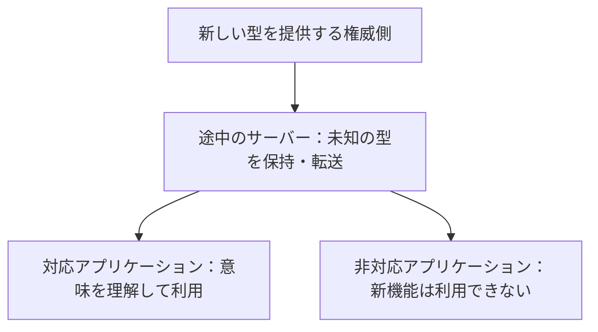

# 第9章 後方互換性と発展性――基盤を止めずに変える

新しい機能を実装したクライアントと権威サーバーがあっても、その間の再帰リゾルバや転送機器まで同時に更新できるとは限りません。古い実装と新しい実装が混ざる経路を通って初めて、利用者はその機能を使えます。

本章では、既存の利用を維持しながら拡張する設計を考えます。互換性を「何があっても古い動作へ戻すこと」とせず、どこまで共存でき、どの保証は落とせないかを決めます。制作上の責務は[文書設計メモ](../docs/document-design/09-compatibility.md)に記録しています。

## 1. 意味を理解することと、データを運ぶこと

新しいレコード型を導入するたびに、途中のすべてのサーバーがその意味を理解しなければならないなら、導入は進みにくくなります。RFC 3597は、未知の型のデータ部分を構造のないバイナリとして保持し、変更せずに扱う規則を定めました。2003年の文書は、それまで新しい型の導入が広い範囲のソフトウェア更新を必要としていた問題を説明しています。[RFC 3597: Handling of Unknown DNS Resource Record (RR) Types 1・3節](https://www.rfc-editor.org/rfc/rfc3597.html)

これにより、中継する側が意味を知らなくても、新しい情報を届けられる余地ができます。ただし、アプリケーションが新しい型の意味を理解して利用できることは別です。運べること、保存できること、表示できること、機能として使えることを同じ対応状況にまとめないようにします。

次の図は、その役割の分離です。途中の実装までアプリケーションの意味を理解する必要がある設計と比べ、更新の依存範囲を小さくできます。狭い画面では横へスクロールできます。

この分離にも条件があります。例えば、メッセージ内の位置に依存する圧縮参照を含むデータを、単純に別のメッセージへコピーすると壊れます。RFC 3597は新しい型の圧縮の扱いも定めています。「未知の値は何でもそのまま渡せばよい」という、任意のプロトコルへの一般則ではありません。[RFC 3597 4節](https://www.rfc-editor.org/rfc/rfc3597.html)

## 2. 能力を既存の形式へ追加する

初期のDNSメッセージには固定されたフィールドがあり、UDPのDNSメッセージ長にも512バイトの制約がありました。拡張機能を増やすには、新しい情報を置く場所と、相手に能力を伝える方法が必要です。[RFC 1035: Domain Names—Implementation and Specification 2.3.4・4.1節](https://www.rfc-editor.org/rfc/rfc1035.html)

Extension Mechanisms for DNS（EDNS）は、OPTという疑似レコードを使って拡張情報を伝えます。EDNS(0)の0は拡張の版です。2013年のRFC 6891は1999年のRFC 2671を置き換え、実装経験を踏まえて仕様を改訂しました。ゾーンに登録する通常のレコードとは役割が違い、OPT自体はキャッシュしません。[RFC 6891: Extension Mechanisms for DNS (EDNS(0)) 概要・6節](https://www.rfc-editor.org/rfc/rfc6891.html)

EDNSでは、受信可能なUDPペイロードの大きさを通知できます。ただし、その値は経路上のすべての機器が配送できることの証明ではありません。断片化や途中機器の扱いで、通知した大きさの応答が届かないこともあります。大きな値を広告することと、到達性の改善は同義ではありません。[RFC 6891 6.2.3・6.2.6節](https://www.rfc-editor.org/rfc/rfc6891.html)

## 3. レコードの拡張と通信の拡張を切り離す

IPv6アドレスを表すAAAAレコードは、情報の表現の拡張です。AAAAを問い合わせるために、その問い合わせ自体が必ずIPv6通信でなければならないわけではありません。逆に、IPv6で通信するサーバーもAレコードを扱えます。RFC 3596は、問い合わせたレコードと輸送に使うIPの版の独立性を説明しています。[RFC 3596: DNS Extensions to Support IP Version 6 1節](https://www.rfc-editor.org/rfc/rfc3596.html)

この分離により、情報の対応と通信経路の対応を別々に進められます。一方で、運用者は「IPv6対応済み」の意味を具体化しなければなりません。AAAAを公開したのか、権威サーバーへIPv6で到達できるのか、返されたIPv6アドレスのサービスへ利用者が接続できるのかは別の確認です。最後の点は本書の運用上の整理です。
