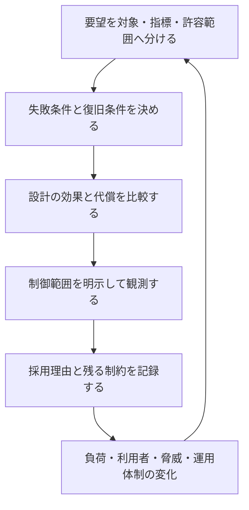

# 第10章 総括――要件を設計判断へ変換する

「DNSを速くしたい」「止まらないようにしたい」「安全にしたい」。本書の最初では、これらは自然な要望でした。ここまで読んだ今なら、何を測り、どの失敗を防ぎ、そのために何を引き受けるのかを、もう少し具体的に話せます。

本章は各章で確認した設計を結び、自分のシステムの判断へ移すための整理です。新しい機能の説明ではありません。制作上の責務は[文書設計メモ](../docs/document-design/10-synthesis.md)に記録しています。

## 1. 同じ仕組みが、別の要件へ負担を渡す

[第2章](02-scalability.md)では、管理責任の分割によって、一つの登録・配布主体へ集まる仕事を減らしました。その代わり、委譲先と委譲元の関係を維持する仕事が生まれました。[第3章](03-performance.md)のキャッシュは、その分散した参照の仕事を再利用しますが、取得時点の情報を保持します。

[第4章](04-availability.md)で複製を増やすと、別の応答元を用意できます。しかし複製が同じ設定や経路で失敗するなら、台数だけでは十分ではありません。[第5章](05-consistency.md)では、更新した権威情報と、複製やキャッシュから見える情報の一致を別々に確認しました。

[第6章](06-security.md)の署名検証は、受け入れる情報に条件を加えます。同時に、鍵や署名の運用失敗でも情報を利用できなくなる可能性を引き受けます。[第7章](07-privacy.md)の暗号化は、保護する区間の観測を抑えますが、終端が読める情報やログの扱いは残ります。

[第8章](08-operations.md)では、その複数の境界を変更履歴と観測で説明できるようにしました。[第9章](09-compatibility.md)では、新機能を使えない相手と共存しながら、必須の保証は落とさない条件を考えました。

どれも単独の「良い機能」ではありません。同じキャッシュを、性能の章では減らせる仕事として、整合性の章では残るコピーとして見ました。評価する要件を変えると、同じ設計の別の面が見えます。

要件は機能の形も変えます。不在の回答も保存すれば、同じ失敗の問い合わせを減らせる一方、追加後も不在が残ります。Serve Staleは期限切れ情報を使って応答を継続します。署名検証は、情報が届いても利用しない条件を加えます。「回答を返す」という機能そのものが、負荷、可用性、最新性、認証のどれを優先するかによって変わっています。

## 2. 要望を五つの問いへ分ける

本書で使ってきた問いは、対象、指標、許容範囲、失敗条件、復旧条件です。まず誰のどの操作を対象にするかを決めます。次に、待ち時間や失敗率、更新が見えるまでの時間など、観測できるものを選びます。さらに、どこまでの差や遅れを許容するか、どんな状況を失敗とするか、何を確認できれば復旧とするかを明示します。

「速い」という要望だけでは、キャッシュがある場合の平均値を改善する案と、初回の最悪時遅延を抑える案を比較できません。「止まらない」だけでは、古い情報を返してよいかが分かりません。「安全」だけでは、偽造、盗聴、権限外の更新のどれを防ぐかが分かりません。

数値が必要でも、先に普遍的な正解を探すのではありません。実際の利用者が困る条件と、運用側が制御できる範囲から決めます。測れる指標であることと、目的に合った指標であることも別です。監視地点から一度応答を得たという事実だけで、全利用者の成功を代弁させないようにします。

## 3. 「5分で切り替えたい」を設計へ変える

ここでは架空のサービス移行を考えます。数値は設計練習のための仮定であり、本書の実測や推奨値ではありません。要求は「接続先を変更してから5分以内に切り替えたい」です。

まず、切り替える対象を聞き直します。管理画面に新しい値が出ればよいのか、新しく名前解決する端末が新しい値を得る必要があるのか、既存の接続も終わらせたいのかで、設計が変わります。第5章のように、名前解決とアプリケーションの接続は別の境界です。

ここでは対象を、管理下の端末が新しく接続するための名前解決に絞ります。次の表は、その条件を具体化した例です。

| 問い | この例で決めること |
| --- | --- |
| 対象 | 管理下の端末が、指定の再帰リゾルバを使って新規接続する場合 |
| 指標 | 権威側の変更確認から、指定地点の問い合わせが新しい値を返すまでの時間 |
| 許容範囲 | 5分以内を目標とし、移行期間は旧接続先も利用可能にする |
| 失敗条件 | 対象地点で古い値が残る、解決できない、または新接続先が利用できない |
| 復旧条件 | 対象地点の応答と、そこからの新規接続の成功を確認する |

次に、目標を満たせる前提を確認します。旧TTLで取得された回答が長く残るなら、変更と同時にTTLを短くするだけでは不十分です。利用者が別のリゾルバや独自キャッシュを使うなら、管理下の条件から外れます。署名検証や期限切れ情報の利用を設定しているなら、それらの振る舞いも確認します。

そこで、事前にTTLを調整して旧情報が残る期間を見込み、権威側の更新を確認し、利用者側から観測します。旧サービスは、残存する利用者を受け止めるために維持します。それでも5分という条件を保証できない範囲があるなら、保証の対象を狭めるか、アプリケーション側で移行を支える設計を加えます。「設定したTTLが5分以下だから完了」という判定にはしません。

## 4. 代償と、選ばなかった案を残す

この移行例でTTLを短くすれば、再取得が増える可能性があります。旧サービスを残せば費用と保守対象が増えます。切り戻しを用意しても、途中の新しい値を取得した利用者が即座に戻るわけではありません。判断の記録には、選んだ設定値だけでなく、こうした代償を残します。

「短いTTLを使う」という結論より、「変更反映の目標を優先し、権威側の負荷増加をこの範囲で受け入れる」という記録のほうが、次の担当者に判断材料を渡せます。負荷が増えたときに、元の目的を壊さず変更できるかを考えられるからです。

選ばなかった案も、条件とともに残します。複数事業者を使う案を、更新経路の複雑さから見送ったのであれば、運用体制が変わったときに再検討できます。「複数化は不要」とだけ残すと、当時の制約が見えなくなります。設計の記録は、過去の判断を固定するためではなく、前提の変化を見つけるために使います。

## 5. 観測で分かったことと、まだ分からないこと

本書の実測は、仕様の正しさを証明するためのものではありません。第3章では共有リゾルバのTTLが単調に減らず、単純な一つのキャッシュという想像だけでは説明できませんでした。第4章のSerialの一致は、全データや障害時の独立性の証明ではありませんでした。

第5章では制御した環境で、権威側を更新しても旧回答が残ることを確認しました。ただし、インターネット全体の切替時間は測っていません。第7章では二つの入口から同じアドレス集合を得ましたが、上流の処理やログ保持は観測していません。

ここで必要なのは、観測できなかった部分を想像で埋めないことです。仕様が定める動作、実装の設定、観測した事実、そこから導く解釈を分けます。追加の判断が必要なら、どの境界を次に測るべきかを決めます。

次の図は、本書で使った判断の繰り返しを表しています。狭い画面では横へスクロールできます。

## 6. DNS以外へ応用するときに確かめること

管理を分割する設計、キャッシュ、複製、署名、暗号化、段階導入は、別のシステムにも現れます。ただし、DNSで成立した条件まで同じとは限りません。全クライアントを更新できる環境なら無効化通知を使えるかもしれません。単一組織の中なら、世界中の独立した管理者と調整する場合より強い前提を置けるかもしれません。

応用するときは、誰が正本を持ち、誰がコピーを保持し、どこまで更新や停止を制御できるかを描き直します。署名を信用する相手、通信内容を読む相手、障害を復旧できる担当も確認します。表面上の機能が同じでも、管理境界や失敗条件が違えば、同じ選択にはなりません。

本書の副題は「『DNS』と言わずに説明する」でした。それはDNSという用語を避ける練習ではありません。一語にまとめていた対象をほどき、誰のどの仕事を減らし、どのコピーが残り、どの情報を誰に渡し、どこで失敗するのかを説明する練習です。その説明ができれば、機能名からではなく、必要な条件から設計を選べます。

## この章の言い換え

| 前 | 後 |
| --- | --- |
| 「DNSを速く、止まらず、安全にしたい」 | 「対象の利用者経路、待ち時間、許容する古さ、保護する情報、失敗時の動作を決めます」 |
| 「DNSを冗長化したので安心です」 | 「応答元を増やした効果と、共通の設定・経路・更新主体に残る失敗を分けて評価します」 |
| 「DNSの反映は確認済みです」 | 「指定した権威側と利用者側の観測は一致しました。未観測の範囲は保証に含めません」 |

## 参照資料

本章の技術的な根拠と観測条件は、次の各章とそこに示した一次資料へ戻れます。移行の5分という値は架空例であり、出典のある推奨値ではありません。

- [第2章 拡張性](02-scalability.md)、[第3章 性能](03-performance.md)
- [第4章 可用性と障害耐性](04-availability.md)、[第5章 整合性と変更反映](05-consistency.md)
- [第6章 セキュリティ](06-security.md)、[第7章 プライバシー](07-privacy.md)
- [第8章 運用性と保守性](08-operations.md)、[第9章 後方互換性と発展性](09-compatibility.md)
- [出典と裏付け対象](../references/sources.md)

---

[← 第9章 後方互換性と発展性](09-compatibility.md)｜[目次](../)


